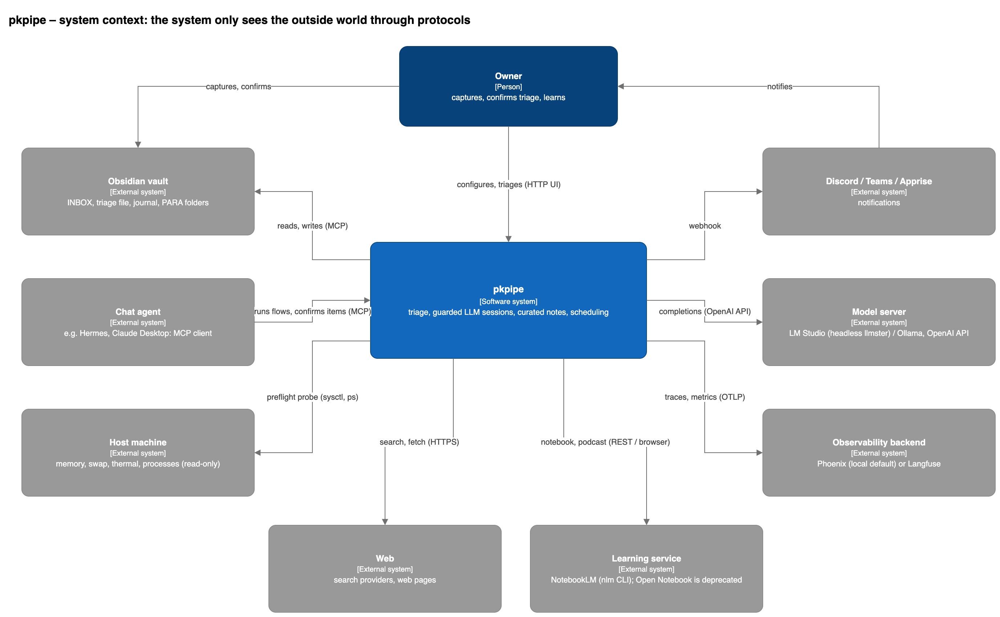
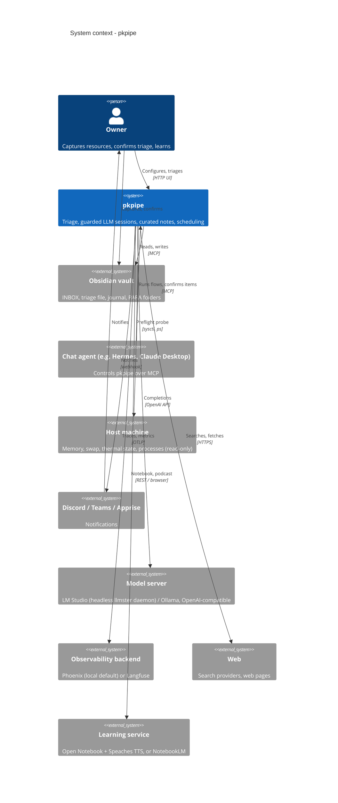
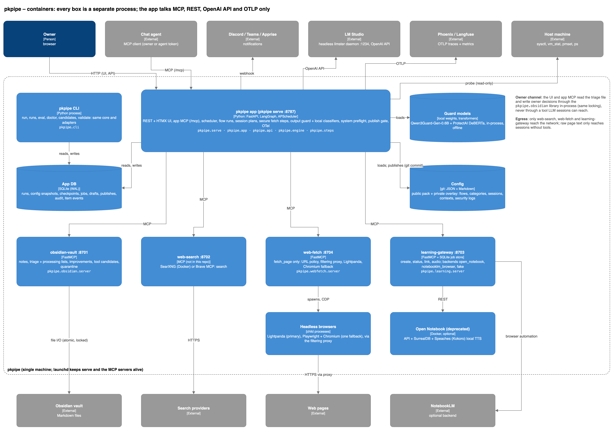
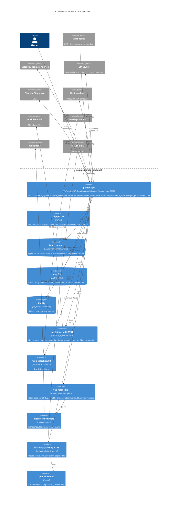
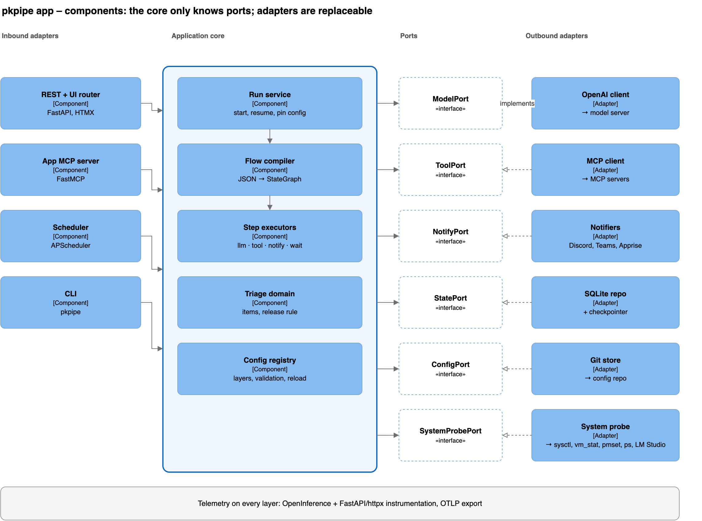
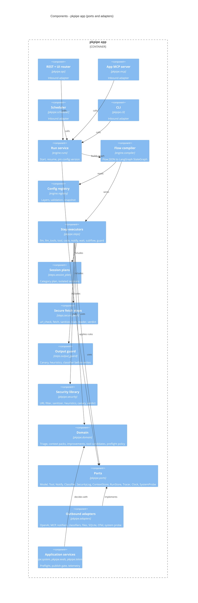
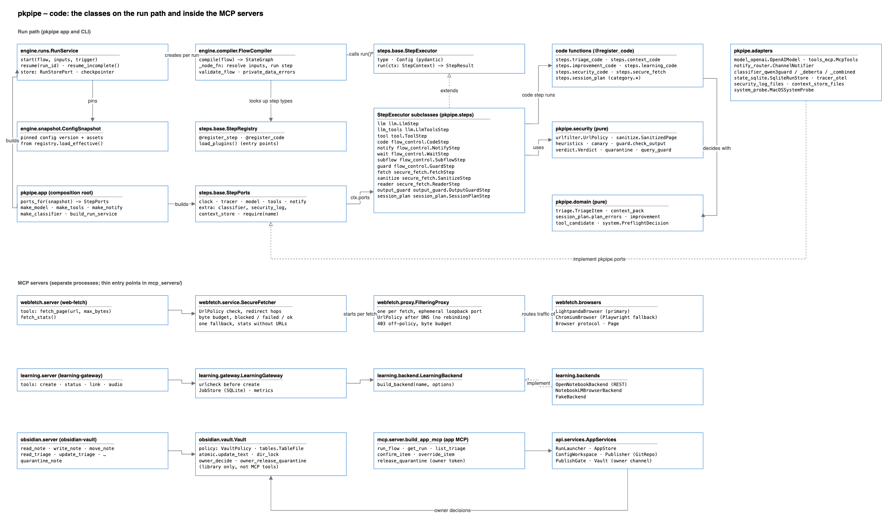
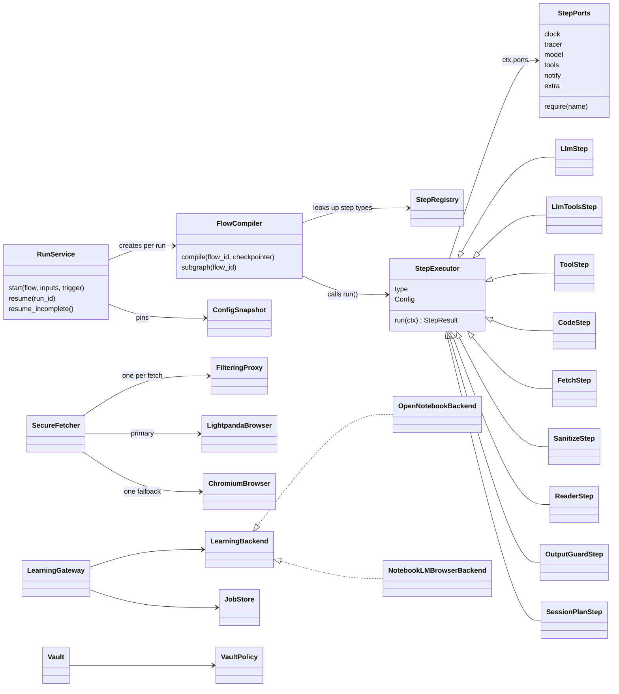

# Architecture

pkpipe is a single Python application that orchestrates flows with LangGraph, plus a handful of MCP servers that run as separate processes on the same machine. Every external dependency sits behind a standard protocol (MCP, OpenAI API, REST, OTLP, webhook) and, inside the code, behind a port. Swapping the model server, the learning backend or a notification channel is configuration, not code.

## Principles

The binding rules are in the constitution (`.specify/memory/constitution.md`). In short:

1. **Local-first, model-agnostic, deployable anywhere.** The reference deployment is one machine with a local model; the same engine runs in the cloud (for example Microsoft Foundry) by swapping configuration and adapters.
2. **Hexagonal core.** The core depends only on ports; integrations are adapters. The deterministic security code (`pkpipe.security`: URL filter, sanitizer, heuristics, canary, verdict) is held to the same import rule, so steps may use it.
3. **Configuration over code.** Flows, categories, session plans and instructions are JSON + Markdown, layered (public pack → private overlay) and versioned in git.
4. **Untrusted content isolation.** Raw web text only reaches sessions without tools.
5. **Code decides, models propose.** Gates, flags and state changes are deterministic code.
6. **Human in the loop.** Triage, weekly reviews and quarantine releases are the owner's decisions.

## Technology

| Concern | Choice |
| --- | --- |
| Language, tooling | Python 3.12+, `uv` |
| Orchestration | LangGraph (StateGraph, SQLite checkpointer) |
| API and UI | FastAPI + HTMX + Monaco editor |
| Scheduling | APScheduler (SQLite job store), `launchd` keeps the app alive |
| Model | Any OpenAI-compatible server; default LM Studio, run headless as the `llmster` daemon (`lms daemon up`), with a ~9B instruct model, JSON-schema structured output |
| Tools | MCP over Streamable HTTP (`langchain-mcp-adapters`, FastMCP) |
| Web fetch | web-fetch MCP server: Lightpanda (headless) behind a filtering proxy, one Playwright + Chromium fallback |
| Learning backend | Open Notebook (REST) with local TTS (Speaches / Kokoro); NotebookLM as optional backend |
| Guards | Local classifiers: Qwen3Guard-Gen-0.6B (harmful content, jailbreak) + ProtectAI DeBERTa (prompt injection), [decision 0001](decisions/0001-injection-classifier.md); canary, heuristics and verdicts in code |
| Observability | OpenTelemetry (OpenInference, FastAPI, httpx) → Phoenix (local default) or Langfuse |
| Docs | Docusaurus, GitHub Pages |

The diagrams below have one source, `docs/design/pkpipe-c4.drawio` (pages: system context, containers, components, code). The PNGs in `docs/img/c4/` are exports of those pages (draw.io CLI: `draw.io -x -f png -p <page> -o docs/img/c4/<name>.png docs/design/pkpipe-c4.drawio`), and each Mermaid block shows the same elements. A change to one updates all three.

## C4 – level 1: system context

The system has one user; everything else is an external system that can be replaced as long as it speaks the same protocol. The host machine is read, never changed: the system preflight (`pkpipe doctor`, every eval run, the live tests) checks memory pressure, swap, thermal state and the LLM server before heavy work.

## C4 – level 2: containers

Every box is a separate process. The app never imports an MCP server; it reaches them by URL from `mcp_servers.json`, and `launchd` keeps `pkpipe serve` and the three pkpipe MCP servers alive (`deploy/launchd/`). The one exception is the owner channel: the UI and the app MCP read the triage file and write the owner's decisions through the `pkpipe.obsidian` library in-process (same file locking as the vault server), because owner decisions must not be a tool on the server that LLM sessions can reach. Only the `learning-gateway` knows about Open Notebook or NotebookLM, so switching the learning backend does not touch the app. Only web-search, web-fetch and learning-gateway have egress; the browsers reach the web only through the per-fetch filtering proxy.

| Container | Code | Entry point | Notes |
| --- | --- | --- | --- |
| pkpipe app | `pkpipe.serve`, `pkpipe.app`, `pkpipe.api`, `pkpipe.mcp`, `pkpipe.scheduler`, `pkpipe.engine`, `pkpipe.steps` | `pkpipe serve` | One listener for UI, `/api` and `/mcp`; bind check and tokens in `pkpipe.api.security` |
| pkpipe CLI | `pkpipe.cli`, `pkpipe.candidates_cli`, `pkpipe.system.cli`, `pkpipe.evals.cli` | `pkpipe <command>` | Same composition root (`pkpipe.app`) as the app |
| Guard models | `pkpipe.adapters.classifier_qwen3guard`, `classifier_deberta`, `classifier_combined` | loaded by `pkpipe.adapters.classifiers.build_classifier` | Weights read from local directories, never downloaded at run time |
| App DB | `pkpipe.adapters.state_sqlite`, `pkpipe.adapters.app_store_sqlite`, `pkpipe.scheduler.sqlite_jobstore` | – | One SQLite file |
| Config | `packs/learning-inbox/` (public pack), private overlay repo | `pkpipe.engine.registry.load_effective` | Published by `pkpipe.api.publish.Publisher` (one local commit, no push) |
| obsidian-vault | `pkpipe.obsidian` (`server`, `vault.Vault`, `policy.VaultPolicy`, `tables`, `atomic`) | `mcp_servers/obsidian_vault/server.py` | – |
| web-search | external (SearXNG in `deploy/docker-compose.yml`, or Brave MCP) | – | Only the `search` tool is allow-listed |
| web-fetch | `pkpipe.webfetch` (`server`, `service.SecureFetcher`, `proxy.FilteringProxy`, `browsers`) | `mcp_servers/web_fetch/server.py` | Tools `fetch_page`, `fetch_stats` |
| learning-gateway | `pkpipe.learning` (`server`, `gateway.LearningGateway`, `store.JobStore`, `backends.*`) | `mcp_servers/learning_gateway/server.py` | `deploy/open-notebook/` runs Open Notebook + Speaches |

## C4 – level 3: components of the app

Dependencies point inwards: inbound adapters call the core, the core knows only the ports, outbound adapters implement the ports. The core (`pkpipe.engine`, `.domain`, `.steps`, `.security`) may import only `pkpipe.ports`, the stdlib, LangGraph, pydantic and `langchain_core`; `tests/unit/repo/test_architecture.py` enforces it.

| Component | Module (main classes) | Depends on | Replacing it affects |
| --- | --- | --- | --- |
| REST + UI router | `pkpipe.api.app.create_app`, `pkpipe.api.services.AppServices`, `RunLauncher`, `pkpipe.api.workspace.ConfigWorkspace`, `pkpipe.api.security.GuardMiddleware` | Run service, Config registry, App store, Publish gate | UI only |
| App MCP server | `pkpipe.mcp.server.build_app_mcp` (`run_flow`, `get_run`, `list_triage`, `confirm_item`, `override_item`, `release_quarantine`, `restore_run`) | `pkpipe.api.services.AppServices`, Triage domain | MCP clients only |
| Scheduler | `pkpipe.scheduler.FlowScheduler` | Run service, APScheduler SQLite job store | Nothing |
| CLI | `pkpipe.cli.main`, `pkpipe.candidates_cli`, `pkpipe.snapshot_cli`, `pkpipe.system.cli`, `pkpipe.evals.cli` | Run service, Snapshot restore, Preflight service, Evals | – |
| Run service | `pkpipe.engine.runs.RunService` | Flow compiler, RunStorePort, checkpointer | – |
| Flow compiler | `pkpipe.engine.compiler.FlowCompiler`, `validate_flow`, `validate_config_flows` | Step executors, Config registry | – |
| Config registry | `pkpipe.engine.registry.load_effective`, `EffectiveConfig`, `pkpipe.engine.snapshot.ConfigSnapshot`, `pkpipe.engine.config_models` | Files of the pack and overlay | – |
| Step executors | `pkpipe.steps.base` (`StepExecutor`, `StepRegistry`, `@register_step`, `@register_code`, `StepPorts`), `steps.llm`, `steps.tool`, `steps.flow_control` | ModelPort, ToolPort, NotifyPort, ClockPort, TracerPort | New step type = new module (`@register_step`) |
| Session plans | `pkpipe.steps.session_plan.SessionPlanStep`, `pkpipe.domain.session_plan` | Step executors, `categories.json` | New category = data only |
| Secure fetch steps | `pkpipe.steps.secure_fetch` (`FetchStep`, `SanitizeStep`, `ReaderStep`, `url_check`, `scan`, `verdict`) | ToolPort (web-fetch), ClassifierPort, Security library | – |
| Output guard | `pkpipe.steps.output_guard.OutputGuardStep`, `pkpipe.security.guard.check_output` | ClassifierPort, canary, heuristics | – |
| Security library | `pkpipe.security` (`urlfilter.UrlPolicy`, `sanitize`, `heuristics`, `canary`, `verdict`, `quarantine`, `query_guard`) | Nothing (pure Python) | – |
| Triage domain | `pkpipe.domain.triage`, `pkpipe.steps.triage_code` | Nothing (pure Python) | – |
| Context packs | `pkpipe.domain.context_pack`, `pkpipe.steps.context_code` | ContextStorePort | – |
| Improvements, tool candidates | `pkpipe.domain.improvement`, `pkpipe.domain.tool_candidate`, `pkpipe.steps.improvement_code`, `pkpipe.evals.ab` | Vault tools (MCP) | – |
| Vault snapshots | `pkpipe.domain.vault_snapshot` (manifests, restore plan rules, which flows write), `pkpipe.obsidian.scope.derive_scope` (scope from `VaultPolicy`), `pkpipe.engine.restore.restore_run` | SnapshotPort (the run service takes the snapshot before a writing flow) | – |
| System preflight policy | `pkpipe.domain.system` (`SystemSnapshot`, `PreflightDecision`) | Nothing (pure Python, `evals.preflight` thresholds) | – |
| System preflight service | `pkpipe.system.preflight.run_preflight`, `pkpipe.system.sampler.SystemSampler` | SystemProbePort, `pkpipe.telemetry` | `pkpipe doctor`, `pkpipe eval`, live-test sampler |
| Evals + publish gate | `pkpipe.evals` (`gate.PublishGate`, `runner.EvalRunner`, `suites`, `judge.Judge`, `cassette.CassetteModel`) | ModelPort (default + judge profile), ClassifierPort | Gates every UI publish |
| Telemetry | `pkpipe.telemetry` (`runtime.Telemetry`, `export.ScrubbingExporter`, `ResilientExporter`) | OpenTelemetry, OpenInference | OTLP backend: environment only |
| Owner vault channel | `pkpipe.obsidian.vault.Vault` (`owner_decide`, `owner_release_quarantine`) | Vault files | – |
| App store | `pkpipe.adapters.app_store_sqlite.AppStore` | SQLite | Drafts, publishes, owner audit log |
| OpenAI client | `pkpipe.adapters.model_openai.OpenAIModel` | `langchain-openai` | Model server: URL only |
| MCP client | `pkpipe.adapters.tools_mcp.McpTools` | FastMCP client | Tool backend: `mcp_servers.json` only |
| Notifiers | `pkpipe.adapters.notify_router.ChannelNotifier` → `notify_discord.DiscordWebhook`, `notify_teams.TeamsWorkflow`, `notify_apprise.AppriseChannel`, `notify_log.LogChannel` | `httpx`, `apprise`, `notify_templates` | New channel = new adapter |
| Local classifiers | `pkpipe.adapters.classifiers.build_classifier` → `Qwen3GuardClassifier`, `DebertaInjectionClassifier`, `CombinedClassifier` | `transformers`, local weights | ClassifierPort |
| Security log, context files | `pkpipe.adapters.security_log_files.FileSecurityLog`, `pkpipe.adapters.context_store_files.FileContextStore` | Overlay files | SecurityLogPort, ContextStorePort |
| SQLite repo | `pkpipe.adapters.state_sqlite.SqliteRunStore`, `open_checkpointer` | `langgraph-checkpoint-sqlite` | RunStorePort; can move to Postgres |
| Tracer | `pkpipe.adapters.tracer_otel.OtelTracer` | `pkpipe.telemetry` (OpenTelemetry) | TracerPort; the core never imports OpenTelemetry |
| System clock | `pkpipe.engine.runtime_defaults.SystemClock` | stdlib | ClockPort |
| Snapshot files | `pkpipe.adapters.snapshot_files.FileSnapshots` | `$PKPIPE_DATA_DIR/snapshots/` (mode 0700), the `snapshots` table of the app DB | SnapshotPort |
| System probe | `pkpipe.adapters.system_probe.MacOSSystemProbe`, `LinuxSystemProbe` | `sysctl`, `vm_stat`, `pmset`, `ps`, `/proc`, LM Studio REST / `lms` | SystemProbePort; another OS = another probe |
| Composition root | `pkpipe.app` (`ports_for`, `build_run_service`, `make_*`), `pkpipe.serve.build_services` | All adapters | Chooses the adapter per port |

`StatePort` and `ConfigPort` are declared in `pkpipe.ports` but have in-memory fakes only: triage items live in the vault (read and written through the obsidian-vault MCP tools), and the config is read from files by the registry and published to git by `pkpipe.api.publish` (`GitRepo`, `Publisher`). Every port has an in-memory fake under `tests/fakes/`, so unit tests and evals run without a model server, MCP servers or network.

## C4 – level 4: code

The code level names the classes that carry each component; the tables above give their modules.

| Area | Classes and functions | Module |
| --- | --- | --- |
| Run path | `RunService`, `Run`, `RunOutcome` | `pkpipe.engine.runs` |
| | `FlowCompiler`, `FlowState`, `validate_flow`, `private_data_errors` | `pkpipe.engine.compiler` |
| | `Flow`, `FlowNode` | `pkpipe.engine.flow_models` |
| | `load_effective`, `EffectiveConfig`, `ConfigSnapshot` | `pkpipe.engine.registry`, `pkpipe.engine.snapshot` |
| Step types | `LlmStep` (`llm`), `LlmToolsStep` (`llm_tools`) | `pkpipe.steps.llm` |
| | `ToolStep` (`tool`) | `pkpipe.steps.tool` |
| | `CodeStep`, `NotifyStep`, `WaitStep`, `SubflowStep`, `GuardStep` | `pkpipe.steps.flow_control` |
| | `FetchStep`, `SanitizeStep`, `ReaderStep` | `pkpipe.steps.secure_fetch` |
| | `OutputGuardStep` (`output_guard`) | `pkpipe.steps.output_guard` |
| | `SessionPlanStep` (`session_plan`) | `pkpipe.steps.session_plan` |
| Code functions (`@register_code`) | triage, context, improvement, learning, security, category | `pkpipe.steps.triage_code`, `context_code`, `improvement_code`, `learning_code`, `security_code`, `session_plan` |
| Ports | `ModelPort`, `ToolPort`, `NotifyPort`, `ClassifierPort`, `SecurityLogPort`, `ContextStorePort`, `SnapshotPort`, `RunStorePort`, `TracerPort`, `SpanPort`, `ClockPort`, `SystemProbePort`, `StatePort`, `ConfigPort` | `pkpipe.ports.ports` |
| web-fetch | `SecureFetcher`, `FilteringProxy`, `LightpandaBrowser`, `ChromiumBrowser`, `Browser` | `pkpipe.webfetch.service`, `.proxy`, `.browsers` |
| learning-gateway | `LearningGateway`, `JobStore`, `LearningBackend`, `OpenNotebookBackend`, `NotebookLMBrowserBackend`, `FakeBackend`, `check_url` | `pkpipe.learning.gateway`, `.store`, `.backend`, `.backends`, `.urlcheck` |
| obsidian-vault | `Vault`, `VaultPolicy`, `TableFile`, `TriageRow`, `ProcessingListRow` | `pkpipe.obsidian.vault`, `.policy`, `.tables`, `.models` |
| App MCP, UI | `build_app_mcp`, `create_app`, `AppServices`, `RunLauncher`, `ConfigWorkspace`, `Publisher`, `GitRepo`, `Tokens` | `pkpipe.mcp.server`, `pkpipe.api.*` |
| Pack | flows (`flows/*.json`), categories with session plans, prompts, instructions, schemas, templates, `mcp_servers.json`, `models.json`, `security.json` | `packs/learning-inbox/` |
