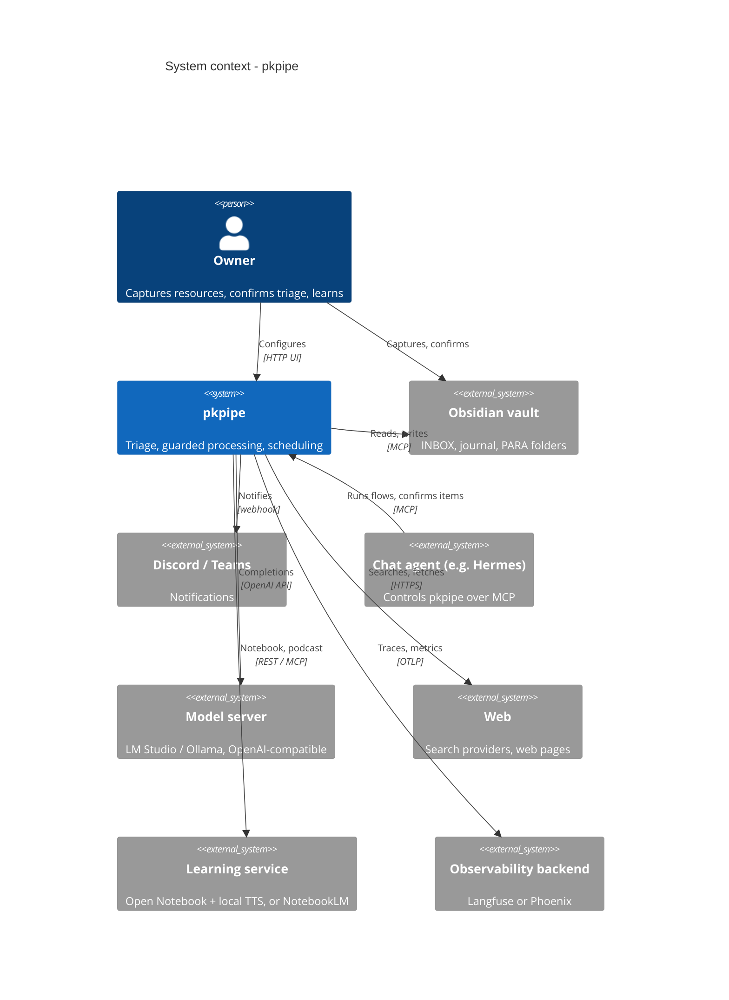
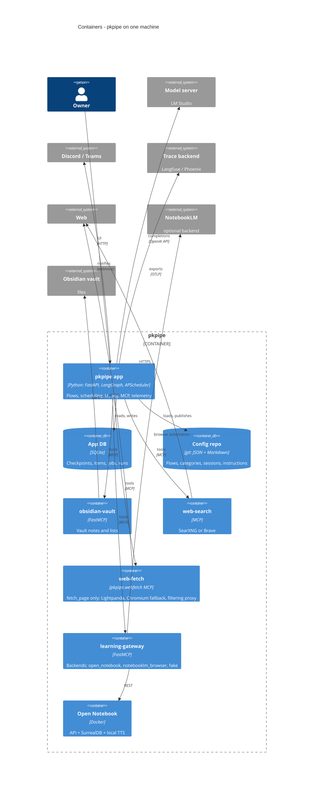
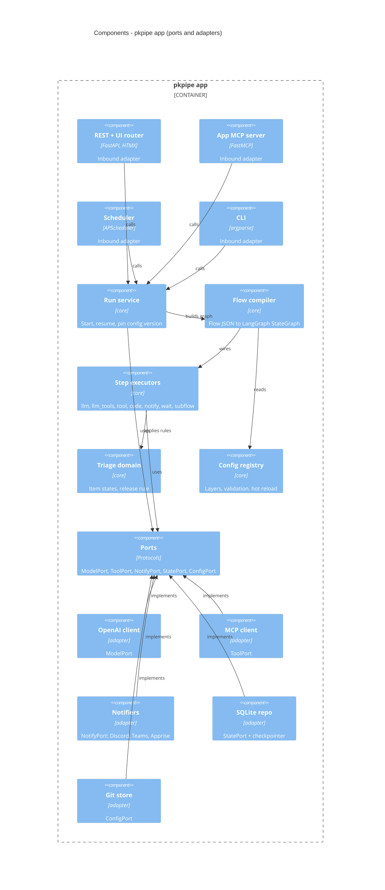

# Architecture

pkpipe is a single Python application that orchestrates flows with LangGraph, plus a handful of MCP servers that run as separate processes on the same machine. Every external dependency sits behind a standard protocol (MCP, OpenAI API, REST, OTLP, webhook) and, inside the code, behind a port. Swapping the model server, the learning backend or a notification channel is configuration, not code.

## Principles

The binding rules are in the constitution (`.specify/memory/constitution.md`). In short:

1. **Local-first, model-agnostic, deployable anywhere.** The reference deployment is one machine with a local model; the same engine runs in the cloud (for example Microsoft Foundry) by swapping configuration and adapters.
2. **Hexagonal core.** The core depends only on ports; integrations are adapters. The deterministic security code (`pkpipe.security`: URL filter, sanitizer, heuristics, canary, verdict) is held to the same import rule, so steps may use it.
3. **Configuration over code.** Flows, categories, session plans and instructions are JSON + Markdown, layered (public pack → private overlay) and versioned in git.
4. **Untrusted content isolation.** Raw web text only reaches sessions without tools.
5. **Code decides, models propose.** Gates, flags and state changes are deterministic code.
6. **Human in the loop.** Triage, weekly reviews and quarantine releases are the owner's decisions.

## Technology

| Concern | Choice |
| --- | --- |
| Language, tooling | Python 3.12+, `uv` |
| Orchestration | LangGraph (StateGraph, SQLite checkpointer) |
| API and UI | FastAPI + HTMX + Monaco editor |
| Scheduling | APScheduler (SQLite job store), `launchd` keeps the app alive |
| Model | Any OpenAI-compatible server; default LM Studio with a ~9B instruct model, JSON-schema structured output |
| Tools | MCP over Streamable HTTP (`langchain-mcp-adapters`, FastMCP) |
| Web fetch | Lightpanda (headless, MCP), Playwright + Chromium fallback |
| Learning backend | Open Notebook (REST) with local TTS (Speaches / Kokoro); NotebookLM as optional backend |
| Guards | Local classifiers: Qwen3Guard-Gen-0.6B (harmful content, jailbreak) + ProtectAI DeBERTa (prompt injection), [decision 0001](decisions/0001-injection-classifier.md); canary, heuristics and verdicts in code |
| Observability | OpenTelemetry (OpenInference, FastAPI, httpx) → Langfuse or Phoenix |
| Docs | Docusaurus, GitHub Pages |

## C4 – level 1: system context

The system has one user; everything else is an external system that can be replaced as long as it speaks the same protocol.

## C4 – level 2: containers

Every box is a separate process. The app never imports an MCP server; it reaches them by URL from `mcp_servers.json`. The one exception is the owner channel: the UI and the app MCP read the triage file and write the owner's decisions through the `pkpipe.obsidian` library in-process (same file locking as the vault server), because owner decisions must not be a tool on the server that LLM sessions can reach. Only the `learning-gateway` knows about Open Notebook or NotebookLM, so switching the learning backend does not touch the app.

## C4 – level 3: components of the app

Dependencies point inwards: inbound adapters call the core, the core knows only the ports, outbound adapters implement the ports.

| Component | Module | Depends on | Replacing it affects |
| --- | --- | --- | --- |
| REST + UI router | `pkpipe.api` | Run service, Config registry | UI only |
| App MCP server | `pkpipe.mcp` | Run service, Triage domain, `pkpipe.api.services` | MCP clients only |
| Scheduler | `pkpipe.scheduler` | Run service | Nothing |
| Run service | `pkpipe.engine.runs` | Flow compiler, RunStorePort, checkpointer | – |
| Flow compiler | `pkpipe.engine.compiler` | Step executors, Config registry | – |
| Step executors | `pkpipe.steps` | ModelPort, ToolPort, NotifyPort, ClockPort, TracerPort | New step type = new module (`@register_step`) |
| Triage domain | `pkpipe.domain.triage` | Nothing (pure Python) | – |
| Config registry | `pkpipe.engine.registry` | ConfigPort | – |
| OpenAI client | `pkpipe.adapters.model_openai` | `langchain-openai` | Model server: URL only |
| MCP client | `pkpipe.adapters.tools_mcp` | FastMCP client | Tool backend: `mcp_servers.json` only |
| Notifiers | `pkpipe.adapters.notify_*` | `httpx`, `apprise` | New channel = new adapter |
| SQLite repo | `pkpipe.adapters.state_sqlite` | `langgraph-checkpoint-sqlite` | Can move to Postgres |
| Tracer | `pkpipe.adapters.tracer_otel` | `pkpipe.telemetry` (OpenTelemetry) | TracerPort; the core never imports OpenTelemetry |
| Composition root | `pkpipe.app` | All adapters | Chooses the adapter per port |
| Git store | `pkpipe.adapters.config_git` | `git` | Can move to plain files |

Every port has an in-memory fake under `tests/fakes/`, so unit tests and evals run without a model server, MCP servers or network.
