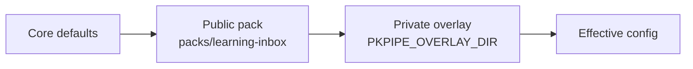

# Configuration

All behaviour lives in a versioned config directory: JSON for structure and mappings, Markdown for prompts and instructions. Every JSON file has a JSON Schema generated from Pydantic models; the loader and the UI validate with the same schemas.

## Layers



Core defaults (`CORE_DEFAULTS` in `pkpipe.engine.registry`) hold safe security values (private networks blocked, per-run canary, quarantine folder) and empty notification routing, so a pack only states what it changes. Later layers win key by key. Lists of objects merge by `id` (categories) or `flow` (schedules); an overlay can add, change or disable (`enabled: false`) an entry. Secrets are never in config: values like `env:DISCORD_WEBHOOK_URL` are resolved from the environment or the macOS keychain.

## Files

| File | Describes |
| --- | --- |
| `models.json` | Model profiles: endpoint, model, temperature, context, fallback (`default`, `judge`) |
| `mcp_servers.json` | MCP registration: transport, URL, allowed tools, backend, `egress` (the server sends data off this machine: web search, fetch, hosted backends; flows that handle journal data must not call it); for `learning` also `options` ([learning gateway](#learning-gateway)) |
| `channels.json` | Notification channels and routing per event type |
| `schedules.json` | Cron expression → flow; optional `misfire_grace_s` (default 21600) and `timezone` |
| `categories.json` | Category → subflow, PARA path, triage hint, **session plan**, context |
| `layout.json` | The vault layout: every folder and file the flows and steps name ([Vault layout](#vault-layout)) |
| `security.json` | Guard models and thresholds, canary rotation, URL filter, quarantine dir ([Secure fetch](#secure-fetch)) |
| `security/deny_list.txt` | Deny-list of the URL filter: one domain per line (subdomains included), `#` comments |
| `security/query_guard_terms.txt` | Terms no web query may contain (`security.query_guard.terms_file`): one per line, `#` comments; the overlay's copy is maintained by `context_refresh` (names of the enterprise notes are appended, nothing is ever removed) |
| `evals.json` | Eval gates per suite (`min` / `max` per metric), judge profile, pairwise and calibration limits, `concurrency` (eval requests in flight, default 1; `pkpipe eval --concurrency N` overrides it), `preflight` (system preflight thresholds, [below](#system-preflight)) ([Evaluation](evaluation.md)). Thresholds only move upwards |
| `telemetry.json` | Prompt/response content capture per flow (`capture_content.flows`); journal and context flows are always off. Exporters come from `OTEL_*` env ([operations](operations.md)) |
| `flows/*.json` | Graph: nodes, edges, conditions, subflow calls ([Flows](flows.md)) |
| `steps/*.json` | Defaults per step type: model profile, output schema, retry |
| `prompts/system/*.md` | Short fixed role prompts per session type |
| `instructions/<category>/<session>.md` | Session instructions, injected into the user prompt |
| `contexts/*.md` | Context packs (`system.md` public, shipped in the pack; `personal.md`, `enterprise.md` private, written by the weekly `context_refresh` flow into the overlay; `<pack>.md.proposed` is a proposal, not a pack) |
| `schemas/*.json` | Structured-output schemas |

## Vault layout

Spec 020. Every folder or file of the vault that pkpipe names comes from one `layout.json` block (flows and steps read it as `${config.layout.<name>}`) and from the same `layout` block of the obsidian-vault server's policy file. Defaults equal the folders pkpipe used before the layout existed, so the public pack behaves as before. A private overlay changes only the values it needs; a path is relative to the vault root, free of `..`, hidden folders and `:`.

| Key | Meaning | Default |
| --- | --- | --- |
| `inbox_dir` | Folder of the INBOX notes | `0-INBOX` |
| `inbox_list_file` | A single list file whose bullet entries are the triage items (empty: one note per item) | none |
| `triage_file`, `processing_list` | The triage table and the manual processing list | `0-INBOX/Inbox-Triage.md`, `0-INBOX/Manual-Resource-Processing-List.md` |
| `archive_dir` | Where a processed INBOX note moves to | `4-Archive/Inbox` |
| `inbox_archive_pattern` | Dated archive file of entries removed from the list file | `4-Archive/Inbox/Inbox-Archive-{yyyy-MM-dd}.md` |
| `agent_tasks_dir`, `proposals_dir`, `context_review_dir` | Agent task notes, system change proposals, context review notes | `2-Areas/Agent-Tasks`, `2-Areas/Self-Improvement/System-Changes`, `2-Areas/Context-Review` |
| `tool_candidates_file`, `improvement_file` | System tool candidates, improvement backlog | `2-Areas/System/System-Tool-Candidates.md`, `2-Areas/Self-Improvement/Improvement-Backlog.md` |
| `quarantine_dir` | Quarantine folder (also `security.json` `quarantine_dir`; keep both equal) | `0-INBOX/_quarantine` |
| `journal_pattern` | Journal day note; placeholders `{yyyy}`, `{MM}`, `{dd}`, `{yyyy-MM-dd}` | `2-Areas/Journal/{yyyy-MM-dd}.md` |
| `attachments_dir` | Embedded images of list entries | `0-INBOX/attachments` |
| `projects_dir`, `areas_dir`, `resources_dir` | The PARA folders (project notes for the context refresh) | `1-Projects`, `2-Areas`, `3-Resources` |
| `inbox_list` | How the list file is read: `bullet_markers`, `header_end` (regex of the line that ends the header), `strip_params` (tracking parameters, `*` wildcard), `comments_ignored` | `["-", "*"]`, `^---\s*$`, `utm_*`, `fbclid`, `gclid`, `igshid`, `mc_*`, `true` |

The category's PARA folder stays in `categories.json` (`para_path`): move it together with `resources_dir`.

**Vault policy.** The vault server derives the folder allow lists of its tools from the layout (`inbox_dir`, the PARA folders, the archive root). Anything else is an explicit `allow` entry, and the layout is validated against the allow lists when the policy loads: every path that its tool may not use fails with the field, the path and the tool, for example the journal folder of the layout `DailyJournals/{yyyy}/{yyyy-MM-dd}.md` needs `"allow": {"read_note": [..., "DailyJournals"], "read_notes": [..., "DailyJournals"]}`. The top-level keys `triage_file`, `processing_list`, `improvement_file`, `tool_candidates_file` and `quarantine_dir` of older policy files still work.

```json
{
  "vault_dir": "/path/to/vault",
  "layout": {
    "inbox_dir": "1-Inbox",
    "inbox_list_file": "1-Inbox/INBOX.md",
    "triage_file": "1-Inbox/Inbox-Triage.md",
    "journal_pattern": "DailyJournals/{yyyy}/{yyyy-MM-dd}.md"
  },
  "allow": { "read_note": ["1-Inbox", "DailyJournals"], "read_notes": ["1-Inbox", "DailyJournals"] }
}
```

### The INBOX list file

With `inbox_list_file` set, triage reads that file instead of the notes of `inbox_dir`: the front matter, title and intro up to the `header_end` line are the header, and every bullet entry below is an item. A line that is not a bullet and not blank continues the entry above (so a title with its URL on the next line is one entry); `<!-- comments -->` are never entries. Kinds: `link`, `image` (`![[name.jpg]]`), `text_link` (title plus URL) and `text`. The item is identified by its normalised resource (the URL without tracking parameters, the embed target or the text), so the same link twice is one item. A row of the triage file gets the columns `kind` and `needs_owner`; they appear in a file the first time a list item needs them. The local model reads no pixels: an image row has the suggestion `none` and `needs_owner`, and its category is your override.

After an item is processed, its entries (duplicates included) are removed from the list file by the vault tool `inbox_remove_entries` and appended to the dated archive file; entries are matched by their text, never by line number, and every other byte of the list stays. Quarantined and failed items stay in the list.

## Notifications
`channels.json` defines channels and routes events to them; `NotifyPort.send(event, payload)` delivers to every channel routed for the event (a `notify` step, or `channels` to override the route). Every delivery is a `notify.send` span with `notify.event`, `notify.channel`, `notify.channel_type` and the flow, step and item attributes of the sending step. One failing channel never stops the others; the failure sets that span to error status and is listed in the step output.

```json
{
  "channels": {
    "discord_main": {"type": "discord_webhook", "url": "env:DISCORD_WEBHOOK_URL"},
    "teams_main":   {"type": "teams_webhook",   "url": "env:TEAMS_WEBHOOK_URL"},
    "phone":        {"type": "apprise",         "urls": ["env:NTFY_URL"]}
  },
  "routes": {"triage_ready": ["discord_main", "teams_main"], "security_flag": ["discord_main", "phone"]},
  "ui_url": "http://127.0.0.1:8787"
}
```

| Type | Delivers | Needs |
| --- | --- | --- |
| `discord_webhook` | `content` (or JSON template, e.g. embeds); `allowed_mentions` is always empty so untrusted text never pings | `url` |
| `teams_webhook` | Adaptive Card message to a Teams Workflows webhook | `url` |
| `apprise` | Any [Apprise](https://github.com/caronc/apprise) service, so a new channel is configuration only | `urls` (each an `env:` reference holding an Apprise URL) |
| `log` | Writes to the log (development) | none |

Webhook and Apprise URLs contain secrets, so the config accepts only `env:NAME` references; they are resolved when sending, never logged, and the notifier's HTTP client is excluded from httpx auto-instrumentation so tokens do not reach traces. Redirects are not followed.

**Templates** are Jinja2 files `templates/<event>.<channel type>.md|json` in the pack or overlay (an overlay file replaces the pack file). The step payload is the template context: `message` plus the step's `payload` keys. A `.json` template is the channel-native body and must write values as `{{ value | tojson }}`. Without a template the `message` is sent; a broken template falls back to plain text with a span event. Text beyond the channel limit (Discord 2000, others 4000 characters) is truncated and ends with `ui_url`. The pack ships `triage_ready`, `daily_summary`, `security_flag` and `weekly_review` for Discord, Teams and Apprise.

## Secure fetch

`security.json` keys used by the `secure_fetch` flow (spec 008):

| Key | Meaning | Default |
| --- | --- | --- |
| `url_filter.block_private_networks` | Refuse private, loopback, link-local and CGNAT targets (after DNS) | `true` |
| `url_filter.max_bytes` | Size limit of a page; larger pages are blocked (security flag) | 2000000 |
| `url_filter.deny_list` | Deny-list file in the config layers (`security/deny_list.txt`) | none |
| `classifier.backend` | `qwen3guard`, `deberta` or `combined` (maximum over `members`); see [decision 0001](decisions/0001-injection-classifier.md) | pack: `combined` |
| `classifier.members[]` | `{backend, model, model_dir, chunk_tokens}` per model of `combined` | pack: Qwen3Guard-Gen-0.6B (1024 tokens) + ProtectAI DeBERTa (512) |
| `classifier.model_dir` (also per member) | Local model directory (may be `env:NAME\|default`); else `~/tools/qwen3guard/<model name>` or `~/tools/protectai-deberta-pi-v2` | none |
| `classifier.chunk_tokens` (also per member) | Tokens per scanned chunk (≤ 4096; DeBERTa ≤ 512) | 1024 / 512 |
| `classifier.threshold` | Score that raises a flag (secure fetch and output guard) | 0.5 |
| `classifier.required` | Without a usable classifier every fetch and every guarded output is flagged (fail closed) | `true` |
| `heuristics.threshold` | Heuristic score that raises a flag | 1.0 |

## Output guard and security flags

`security.json` keys of spec 009:

| Key | Meaning | Default |
| --- | --- | --- |
| `output_guard.block_on` | Qwen3Guard safety labels that make a harm category a `malicious_content` flag (`Unsafe`, `Controversial`) | `["Unsafe"]` |
| `canary.rotate` | The canary of sessions with `canary: true`: `per_run` (from the run id), `daily`, `never` | `per_run` |
| `quarantine_dir` | Quarantine folder of the vault (the vault server's `quarantine_dir` policy must match) | `0-INBOX/_quarantine` |
| `query_guard.blocked_terms`, `query_guard.terms_file` | Names that no web query of a session with tools may contain (spec 010 FR-002, [Sessions instead of skills](#plan-rules)) | none |

An `llm` / `llm_tools` step over external content sets `"canary": true`; validation then requires that every successor is an `output_guard` step whose `input` lists it. The `output_guard` step (`{"input": ["summarize"], "canary": true}`) sets `item.flagged` and the flow routes the item to the `handle_security_flag` subflow. That flow writes `security/malicious_urls.jsonl` and the deny-list in the overlay (`<overlay>/security/`, the deny-list file of `url_filter.deny_list`, started from the pack's list) or, without an overlay, in `$PKPIPE_DATA_DIR/security/`. Owner releases write eval candidates to `<overlay>/evals/candidates/security.jsonl` (else `$PKPIPE_DATA_DIR/candidates/`).

The `webfetch` entry of `mcp_servers.json` points at the web-fetch MCP server (`python -m pkpipe.webfetch.server`, 127.0.0.1:8704, allow list `fetch_page`). The server reads the same layered config (`--pack`, `--overlay` or `PKPIPE_OVERLAY_DIR`) and re-reads the URL filter and deny-list for every fetch.

## Model profiles

Steps name a profile (`default`, `judge`), never an endpoint. The `judge` profile is used only by the eval judge and must be a different model than the one under test (spec 013): the public pack uses `env:PKPIPE_JUDGE_MODEL|google/gemma-4-12b` on `env:PKPIPE_JUDGE_BASE_URL|env:PKPIPE_MODEL_BASE_URL|...`, and `pkpipe validate` rejects an `evals.json` `judge_profile` that an LLM step uses. `models.json` maps profile names to settings:

| Field | Meaning | Default |
| --- | --- | --- |
| `base_url` | OpenAI-compatible endpoint (LM Studio, Ollama, vLLM), may be `env:NAME` | required |
| `model` | Model name, may be `env:NAME` | required |
| `temperature` | Sampling temperature (0 to 2) | 0.2 |
| `max_tokens` | Output cap | server default |
| `context` | Context window in tokens. A prompt that certainly cannot fit (more than 6 characters per token) is refused with `ContextOverflow` before sending; a server-reported overflow raises the same error. Never truncated silently | none |
| `timeout_s` | Request timeout; scaled by the [system preflight](#system-preflight)'s timeout multiplier (`PKPIPE_MODEL_TIMEOUT_MULTIPLIER`, 1-10) on a degraded machine | 120 |
| `schema_retries` | Extra attempts after invalid JSON, then `SchemaError` | 1 |
| `retries` | Extra tries after a transient endpoint failure (connection error, timeout, 5xx, 408/429, LM Studio's HTTP 400 "Model unloaded" while it swaps or loads a model), each recorded as a `model.retry` span event; after the last one the `fallback` profile takes over, else `ModelUnavailable`. Client errors (an HTTP 404 for an unknown model id included: a profile error, neither retried nor handed to the `fallback`), context overflow and invalid output are never retried this way. The public pack uses 2 | 0 |
| `retry_backoff_s` | Wait before the first retry, doubled for each next one | 2 |
| `api_key` | Optional bearer token, may be `env:NAME` | none |
| `fallback` | Another profile used when the endpoint is down (connection, timeout, 5xx); recorded as a `model.fallback` span event. Cycles are rejected | none |

`env:NAME` reads an environment variable and fails with a clear error when unset; `env:NAME|other` falls back to `other` (another `env:` reference or a literal). The public pack uses `env:PKPIPE_MODEL_BASE_URL|http://127.0.0.1:1234/v1` and `env:PKPIPE_MODEL_NAME|qwen3.5-9b-mlx`, so LM Studio works out of the box and Ollama is a `models.json` or environment change only.

With a JSON schema the adapter sends `response_format: json_schema`, strips `<think>` blocks (and anything before a lone `</think>`), extracts the first JSON object and validates it locally. When `content` is empty (Qwen on LM Studio puts schema-constrained answers into `reasoning_content`), the reasoning is used only if it is exactly one JSON object; reasoning prose is never mined for drafts. Output cut by `max_tokens` is an error in both JSON and text mode. Every call emits a span (`llm.model_name`, token counts, latency).

## System preflight

`evals.json` → `preflight` holds the thresholds with which code maps a system snapshot (memory, swap, thermal state, load, LLM server) to `ok` / `degraded` / `blocked`, an eval concurrency and a model timeout multiplier (`pkpipe doctor`, [operations](operations.md#system-preflight)). All fields are optional; the defaults suit a 32 GB Apple-silicon machine running two local models.

| Field | Meaning | Default |
| --- | --- | --- |
| `enabled` | Run the preflight before model suites of `pkpipe eval` | true |
| `max_concurrency` | Concurrency when everything is ok (live tests, `pkpipe doctor`); `pkpipe eval` uses `concurrency` instead | 4 |
| `reduced_concurrency`, `reduced_timeout_multiplier` | Effect of a *reduce* rule | 2, 1.5 |
| `minimal_timeout_multiplier` | Effect of a *minimal* rule (concurrency 1) and of a block | 2.0 |
| `memory_pressure_reduce`, `memory_pressure_block` | Kernel pressure level (`warn`, `critical`) that reduces / blocks; `null` never blocks | `warn`, `critical` |
| `available_memory_reduce_pct`, `available_memory_block_pct` | Available memory below this percent of total reduces / blocks | 10, 3 |
| `swap_reduce_pct`, `swap_minimal_pct` | Swap used at or above this percent reduces / sets concurrency 1 (reduce becomes minimal under memory pressure) | 80, 95 |
| `swap_min_gib` | The swap percentages count only from this much swap used, or under memory pressure (macOS resizes its swap file, so a small nearly full one alone is no stall) | 12 |
| `load_per_cpu_reduce`, `load_per_cpu_minimal` | 1-minute load average per CPU | 1.5, 3.0 |
| `thermal_reduce`, `thermal_minimal`, `thermal_block` | Thermal state (`nominal`, `fair`, `serious`, `critical`) that reduces / sets 1 / blocks; a CPU speed limit below 100% is always minimal | `fair`, `serious`, `critical` |
| `llm_busy_queued` | Requests queued by *other* clients on a required model that reduce | 1 |
| `require_loaded_models` | Block when the server reports a required model as not loaded (false: let a JIT load happen) | true |
| `sample_interval_s` | Period of the live-test sampler (`PKPIPE_LIVE_SAMPLE_S` overrides it) | 30 |

Inverted pairs (a block threshold milder than its reduce threshold) are rejected by `pkpipe validate`. These are operational limits, not eval gates: they may move both ways.

## Learning gateway

The `learning` entry of `mcp_servers.json` selects and tunes the backend of the learning-gateway MCP server (spec 012); the flows only know the four tools `create`, `status`, `link`, `audio`. Switching the backend is an overlay change.

| Setting | Meaning | Default |
| --- | --- | --- |
| `backend` | `open_notebook`, `notebooklm_browser` (needs `backend_options.driver`), `fake` (tests) | `open_notebook` |
| `options.timeout_s` | A generation that is still running after this many seconds fails with the reason `timeout after N min`; keep `learning_material.wait_generation.deadline_s` (6000) above it | 5400 (90 minutes, local TTS is slow) |
| `options.data_dir` | Job store (`jobs.db`) and, below it, `audio/` | `$PKPIPE_DATA_DIR/learning` |
| `options.audio_dir` | Where downloaded podcasts go | `<data_dir>/audio` |
| `options.backend_options` | Passed to the backend. Open Notebook: `api_url` (`http://127.0.0.1:5055`), `ui_url` (`http://127.0.0.1:8502`), `episode_profile` (`pkpipe_overview`), `speaker_profile` (`pkpipe_duo`), `password_env` (name of the environment variable that holds the API password, if authentication is on), `request_timeout_s`. NotebookLM: `driver` (`module:factory`), `options` (passed to the factory), `call_timeout_s` (120) | see the left |

The URL filter comes from `security.json` `url_filter` (`block_private_networks`, `deny_list`). Run the server with `uv run python -m pkpipe.learning.server` (port 8703, loopback only); the stack is described in `deploy/open-notebook/README.md`. Unknown option names are rejected.

## Sessions instead of skills

Session references (`system`, `instruction`, `context`, `output_schema`) are relative paths inside a layer; absolute paths and `..` are rejected. A session is one step with a fresh message list: a short fixed system prompt, the category instruction in the user prompt (about 800 tokens at most), at most one context pack, and only the declared inputs. This works better for small local models than long, bundled skill documents.

```json
{
  "id": "tool",
  "para_path": "3-Resources/Tools",
  "triage_hint": "Software, library or service that could become part of my ecosystem.",
  "sessions": [
    {"id": "research", "system": "researcher", "instruction": "tool/research.md", "tools": ["websearch:search"], "inputs": ["item.extract"], "output_schema": "tool_research"},
    {"id": "compare", "system": "analyst", "instruction": "tool/compare.md", "tools": ["websearch:search"], "inputs": ["research"], "output_schema": "tool_comparison"},
    {"id": "fit_personal", "system": "analyst", "instruction": "tool/fit.md", "context": "personal", "inputs": ["research", "compare"], "output_schema": "tool_fit"},
    {"id": "fit_enterprise", "system": "analyst", "instruction": "tool/fit.md", "context": "enterprise", "inputs": ["research", "compare"], "output_schema": "tool_fit"},
    {"id": "synthesize", "system": "synthesizer", "instruction": "tool/synthesize.md", "inputs": ["*"], "output_schema": "tool_evaluation"}
  ]
}
```

### Plan rules

`pkpipe validate` checks every category with `subflow: other_resource` (`pkpipe.domain.session_plan`); a violation is an error that names the category and session:

| Rule | Why |
| --- | --- |
| `inputs` are `item.extract` (the validated secure-fetch extract; the plan then runs secure fetch first), `item.text` (the INBOX note text, raw), other `item.<field>`, `*` (the extract and every earlier, not skipped, session output) or the id of an **earlier** session | A session gets exactly what it declares |
| A session with `tools` never reads raw text (`item.text`, `item`, `*`) and only the output of a session that has an `output_schema` | Constitution IV: only validated JSON reaches a session with tools; raw note text goes to tool-less sessions only (the Misc evaluation) |
| A session with `context: enterprise` has no tool on an `egress` MCP server (web search), and no such session reads an output derived from an enterprise session | Spec 010 FR-002 |
| An instruction is about 800 tokens at most (a quarter of its characters) | FR-003 |
| `note_session` (default `synthesize`, else the last session) is a session of the plan; its output becomes the note, a session with an `output_schema` gives one section per field | Later sessions can run after it without changing the note (the extension point for the system relevance session of spec 016) |
| A session whose `context` pack is not in the config (a private pack in a public checkout) is skipped at run time and a validation warning says so | A session never answers about projects it does not know |

Every session of a plan runs with the run's canary and its output is checked by the output guard before a write. `security.query_guard` holds the names no web query may contain (`blocked_terms`, and `terms_file`: one term per line, an asset such as `contexts/blocked_terms.txt`); a tool call on an `egress` server whose string arguments contain a term (case, accent and punctuation insensitive, whole words) is refused before it leaves the machine, traced as a `query_guard` security flag, and the model is told only that the call was blocked.

The public plans: **Tool** `research` (web search) → `compare` (web search) → `fit_personal` (context `personal`) → `fit_enterprise` (context `enterprise`, no web search) → `synthesize` → `system_relevance` (context `system`, spec 016: the sixth session, reads only `research` and `compare`, no tools; `note_session` stays `synthesize`); **Marketing** `extract` → `synthesize`; **Misc** `evaluate` (reads the note text; a `suggestion` of a new category becomes an agent task). The system relevance session answers `relevance` (`none` or `candidate`; a tool the context lists under `## In use` is marked in use by code), `component` (the exact name of a component in the `## Components` list of `contexts/system.md`), `benefit` and `effort` (S, M, L); code, not the model, decides whether that becomes a row of `System-Tool-Candidates.md` ([System tool candidates](process/system-tool-candidates.md)).

A new category is an overlay entry, nothing else (test: `tests/integration/engine/test_category_sessions.py`):

```json
{"id": "paper", "label": "Papers", "subflow": "other_resource", "para_path": "3-Resources/Papers",
 "triage_hint": "A research paper worth keeping.",
 "sessions": [{"id": "summarize", "system": "synthesizer", "instruction": "other/summarize.md",
               "inputs": ["item.extract"], "output_schema": "resource_note"}]}
```

Triage offers it (id, label and hint), the owner's override or confirmation releases items to it, and its plan runs through secure fetch, the sessions, the output guard and the vault writes like the public plans. Its sessions need a dataset in the overlay (`<overlay>/evals/datasets/sessions/paper/summarize.jsonl`) before the config UI publishes a change to them.

## Context packs

| Pack | Built by | Visibility |
| --- | --- | --- |
| `system.md` | Maintained with the design (components and stack); ships in the public pack | Public |
| `personal.md` | Weekly `context_refresh` flow from the personal project notes | Private overlay, never in the public repository |
| `enterprise.md` | Weekly `context_refresh` flow, anonymized, local model only | Private overlay, never in the public repository |

A session receives at most one pack. A session with the enterprise pack has no web-search tool, and every web query passes the query guard, which blocks client, project and people names (`security.query_guard`).

### Weekly refresh (spec 011)

`context_refresh` runs Sunday 19:00 (`schedules.json`) and on demand (`pkpipe run context_refresh`, UI, app MCP). It refreshes its scopes in parallel; each scope is one pack:

```json
{"id": "enterprise", "kind": "enterprise", "folder": "1-Projects/Enterprise", "pack": "enterprise", "max_tokens": 1500}
```

| Scope field | Meaning | Default |
| --- | --- | --- |
| `id`, `pack` | Scope id and pack file name (`contexts/<pack>.md`); `system` is reserved and refused | `pack` = `id` |
| `kind` | `personal` (names stay) or `enterprise` (anonymized, names go to the query guard) | required |
| `folder` | Vault folder with the project notes (`.md` files of this folder, no subfolders) | required |
| `max_tokens` | Token budget of the generated pack (4 characters per token); projects that do not fit are left out whole | 1500 |
| `max_notes`, `max_chars` | Notes read (at most 60) and characters handed to the session | 40, 24000 |

The scopes are the `args.scopes` of the node `scopes` in `flows/context_refresh.json`; an overlay changes a folder, a budget or adds a second enterprise scope by overriding that node. A note with `context_exclude: true` in its front matter is not read.

What the flow does for a scope ([Refresh Project Contexts](process/refresh-project-contexts.md)):

1. **Read** the folder's notes through the vault MCP server (path allow list). A missing or empty folder gives an empty pack with a warning (a vault server that is down fails the scope instead, so a pack is never blanked by a transient error).
2. **Summarize** with one local session without tools (`context_pack.summarize_personal` / `summarize_enterprise`, schemas `context_personal` / `context_enterprise`).
3. **Anonymize** (enterprise): code collects the names the notes declare (front matter `client`, `customer`, `company`, `project`, `people`, `aliases`, ...; labelled lines such as `Client: ...` or `Sponsor: ...`; the note titles) and the names the session reports that occur in the notes, adds the owner's `security.query_guard` terms, replaces every occurrence in the generated text by `[client]`, `[project]`, `[person]` or `[name]` (case, accent and punctuation insensitive, whole words, short forms and last names included) and verifies the result with the query guard's own matching; a line that still matches is dropped. The injection heuristics must not flag the pack.
4. **Write** (never the public pack): the pack goes to `<overlay>/contexts/<pack>.md` with a hash of the generated part in its first line. The new names, in every form, are appended to `<overlay>/security/query_guard_terms.txt` before the pack is written.
5. **Keep manual edits.** A pack whose generated part is unchanged is replaced; text below `<!-- pkpipe:manual -->` is always carried over. If you edited the generated part (or wrote the file yourself) the pack is left alone, the new version is written to `contexts/<pack>.md.proposed` and the diff is the review note `2-Areas/Context-Review/<pack>.md` in the vault. Accept a proposal with `mv contexts/<pack>.md.proposed contexts/<pack>.md`.
6. **Notify** (`context_review` event) with counts and the review note paths only: never pack text, a diff or a name.

The flows handle the data class `context` ([Flows](flows.md)): they validate and run on a loopback model only (a remote profile, fallback, environment value, egress tool or session with tools is refused), their traces carry no prompt or response content, and a flow that drops the data class fails validation.

## Publishing a change

Edits in the UI are drafts. Publish runs schema and reference validation and a smoke eval on the affected step's dataset, then commits to the config git repo. A running flow finishes on the config version it started with; the version hash is stored in the run state and on every trace.

The UI edits the **private overlay** (`PKPIPE_OVERLAY_DIR`), which must be its own git repository; the public pack is never written. A draft is a set of file changes stored in the app DB; each file remembers the hash it started from, so a file that changed on disk meanwhile (Obsidian, git, a second tab) is reported as a conflict instead of being overwritten. Editable: the known config files, `flows/*.json` and text assets below `prompts/`, `instructions/`, `contexts/`, `schemas/` and `templates/` (256 KiB at most). Publish does, in this order:

1. **Validate** the draft with the same loader as `pkpipe validate` (a temp copy of the overlay with the draft applied).
2. **Gate** it with the spec 013 `PublishGate`: only the suites whose inputs changed run (plus the security smoke test for LLM changes); a failing or unmeasurable change blocks. An override needs a written reason and is recorded; lowering a gate threshold is refused outright.
3. **Commit** only the draft's files (`git commit -- <paths>`) to the overlay repository. Uncommitted edits to those files, or an overlay that is not a git repo, refuse the publish. Nothing is pushed; pushing is yours.

Every publish keeps its diff, and **rollback** is a `git revert` that is validated before it is committed. After a publish or rollback the scheduler re-reads `schedules.json`. A new category is a form in the UI that adds an entry to the overlay's `categories.json` (sessions and instructions are added in the editor); see [Operations](operations.md#config-ui-and-app-mcp).

The version is a sha256 over the effective JSON (including flows) and the text assets (`prompts/`, `instructions/`, `contexts/`, `schemas/`), so editing a prompt is a new version too. When a run starts, the snapshot of that version is stored in the app DB and the run, including a resume after a restart, uses only that snapshot.
