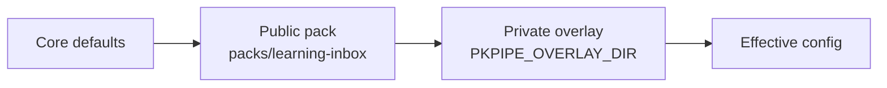

# Configuration

All behaviour lives in a versioned config directory: JSON for structure and mappings, Markdown for prompts and instructions. Every JSON file has a JSON Schema generated from Pydantic models; the loader and the UI validate with the same schemas.

## Layers



Core defaults (`CORE_DEFAULTS` in `pkpipe.engine.registry`) hold safe security values (private networks blocked, per-run canary, quarantine folder) and empty notification routing, so a pack only states what it changes. Later layers win key by key. Lists of objects merge by `id` (categories) or `flow` (schedules); an overlay can add, change or disable (`enabled: false`) an entry. Secrets are never in config: values like `env:DISCORD_WEBHOOK_URL` are resolved from the environment or the macOS keychain.

## Files

| File | Describes |
| --- | --- |
| `models.json` | Model profiles: endpoint, model, temperature, context, fallback (`default`, `judge`) |
| `mcp_servers.json` | MCP registration: transport, URL, allowed tools, backend |
| `channels.json` | Notification channels and routing per event type |
| `schedules.json` | Cron expression → flow |
| `categories.json` | Category → subflow, PARA path, triage hint, **session plan**, context |
| `security.json` | Guard models and thresholds, canary rotation, URL filter, quarantine dir |
| `telemetry.json` | Prompt/response content capture per flow (`capture_content.flows`); journal and context flows are always off. Exporters come from `OTEL_*` env ([operations](operations.md)) |
| `flows/*.json` | Graph: nodes, edges, conditions, subflow calls |
| `steps/*.json` | Defaults per step type: model profile, output schema, retry |
| `prompts/system/*.md` | Short fixed role prompts per session type |
| `instructions/<category>/<session>.md` | Session instructions, injected into the user prompt |
| `contexts/*.md` | Context packs (`system.md` public; `personal.md`, `enterprise.md` private) |
| `schemas/*.json` | Structured-output schemas |

## Sessions instead of skills

Session references (`system`, `instruction`, `context`, `output_schema`) are relative paths inside a layer; absolute paths and `..` are rejected. A session is one step with a fresh message list: a short fixed system prompt, the category instruction in the user prompt (about 800 tokens at most), at most one context pack, and only the declared inputs. This works better for small local models than long, bundled skill documents.

```json
{
  "id": "tool",
  "para_path": "3-Resources/Tools",
  "triage_hint": "Software, library or service that could become part of my ecosystem.",
  "sessions": [
    {"id": "research", "system": "researcher", "instruction": "tool/research.md", "tools": ["websearch:search"], "inputs": ["item.extract"]},
    {"id": "compare", "system": "analyst", "instruction": "tool/compare.md", "tools": ["websearch:search"], "inputs": ["research"]},
    {"id": "fit_personal", "system": "analyst", "instruction": "tool/fit.md", "context": "personal", "inputs": ["research", "compare"]},
    {"id": "fit_enterprise", "system": "analyst", "instruction": "tool/fit.md", "context": "enterprise", "inputs": ["research", "compare"]},
    {"id": "synthesize", "system": "synthesizer", "instruction": "tool/synthesize.md", "inputs": ["*"], "output_schema": "tool_evaluation"},
    {"id": "system_relevance", "system": "analyst", "instruction": "tool/system_relevance.md", "context": "system", "inputs": ["synthesize"]}
  ]
}
```

## Context packs

| Pack | Built by | Visibility |
| --- | --- | --- |
| `system.md` | Maintained with the design (components and stack) | Public |
| `personal.md` | Weekly `context_refresh` flow from personal project notes | Private overlay, not in git |
| `enterprise.md` | Weekly `context_refresh` flow, anonymized, local model only | Private overlay, not in git |

A session receives at most one pack. A session with the enterprise pack has no web-search tool, and every web query passes a query guard that blocks client and project names.

## Publishing a change

Edits in the UI are drafts. Publish runs schema and reference validation and a smoke eval on the affected step's dataset, then commits to the config git repo. A running flow finishes on the config version it started with; the version hash is stored in the run state and on every trace.
