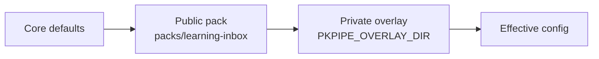

# Configuration

All behaviour lives in a versioned config directory: JSON for structure and mappings, Markdown for prompts and instructions. Every JSON file has a JSON Schema generated from Pydantic models; the loader and the UI validate with the same schemas.

## Layers



Core defaults (`CORE_DEFAULTS` in `pkpipe.engine.registry`) hold safe security values (private networks blocked, per-run canary, quarantine folder) and empty notification routing, so a pack only states what it changes. Later layers win key by key. Lists of objects merge by `id` (categories) or `flow` (schedules); an overlay can add, change or disable (`enabled: false`) an entry. Secrets are never in config: values like `env:DISCORD_WEBHOOK_URL` are resolved from the environment or the macOS keychain.

## Files

| File | Describes |
| --- | --- |
| `models.json` | Model profiles: endpoint, model, temperature, context, fallback (`default`, `judge`) |
| `mcp_servers.json` | MCP registration: transport, URL, allowed tools, backend, `egress` (the server sends data off this machine: web search, fetch, hosted backends; flows that handle journal data must not call it); for `learning` also `options` ([learning gateway](#learning-gateway)) |
| `channels.json` | Notification channels and routing per event type |
| `schedules.json` | Cron expression → flow; optional `misfire_grace_s` (default 21600) and `timezone` |
| `categories.json` | Category → subflow, PARA path, triage hint, **session plan**, context |
| `security.json` | Guard models and thresholds, canary rotation, URL filter, quarantine dir ([Secure fetch](#secure-fetch)) |
| `security/deny_list.txt` | Deny-list of the URL filter: one domain per line (subdomains included), `#` comments |
| `evals.json` | Eval gates per suite (`min` / `max` per metric), judge profile, pairwise and calibration limits, `concurrency` (eval requests in flight, default 1; `pkpipe eval --concurrency N` overrides it) ([Evaluation](evaluation.md)). Thresholds only move upwards |
| `telemetry.json` | Prompt/response content capture per flow (`capture_content.flows`); journal and context flows are always off. Exporters come from `OTEL_*` env ([operations](operations.md)) |
| `flows/*.json` | Graph: nodes, edges, conditions, subflow calls ([Flows](flows.md)) |
| `steps/*.json` | Defaults per step type: model profile, output schema, retry |
| `prompts/system/*.md` | Short fixed role prompts per session type |
| `instructions/<category>/<session>.md` | Session instructions, injected into the user prompt |
| `contexts/*.md` | Context packs (`system.md` public; `personal.md`, `enterprise.md` private) |
| `schemas/*.json` | Structured-output schemas |

## Notifications
`channels.json` defines channels and routes events to them; `NotifyPort.send(event, payload)` delivers to every channel routed for the event (a `notify` step, or `channels` to override the route). Every delivery is a `notify.send` span with `notify.event`, `notify.channel`, `notify.channel_type` and the flow, step and item attributes of the sending step. One failing channel never stops the others; the failure sets that span to error status and is listed in the step output.

```json
{
  "channels": {
    "discord_main": {"type": "discord_webhook", "url": "env:DISCORD_WEBHOOK_URL"},
    "teams_main":   {"type": "teams_webhook",   "url": "env:TEAMS_WEBHOOK_URL"},
    "phone":        {"type": "apprise",         "urls": ["env:NTFY_URL"]}
  },
  "routes": {"triage_ready": ["discord_main", "teams_main"], "security_flag": ["discord_main", "phone"]},
  "ui_url": "http://127.0.0.1:8787"
}
```

| Type | Delivers | Needs |
| --- | --- | --- |
| `discord_webhook` | `content` (or JSON template, e.g. embeds); `allowed_mentions` is always empty so untrusted text never pings | `url` |
| `teams_webhook` | Adaptive Card message to a Teams Workflows webhook | `url` |
| `apprise` | Any [Apprise](https://github.com/caronc/apprise) service, so a new channel is configuration only | `urls` (each an `env:` reference holding an Apprise URL) |
| `log` | Writes to the log (development) | none |

Webhook and Apprise URLs contain secrets, so the config accepts only `env:NAME` references; they are resolved when sending, never logged, and the notifier's HTTP client is excluded from httpx auto-instrumentation so tokens do not reach traces. Redirects are not followed.

**Templates** are Jinja2 files `templates/<event>.<channel type>.md|json` in the pack or overlay (an overlay file replaces the pack file). The step payload is the template context: `message` plus the step's `payload` keys. A `.json` template is the channel-native body and must write values as `{{ value | tojson }}`. Without a template the `message` is sent; a broken template falls back to plain text with a span event. Text beyond the channel limit (Discord 2000, others 4000 characters) is truncated and ends with `ui_url`. The pack ships `triage_ready`, `daily_summary`, `security_flag` and `weekly_review` for Discord, Teams and Apprise.

## Secure fetch

`security.json` keys used by the `secure_fetch` flow (spec 008):

| Key | Meaning | Default |
| --- | --- | --- |
| `url_filter.block_private_networks` | Refuse private, loopback, link-local and CGNAT targets (after DNS) | `true` |
| `url_filter.max_bytes` | Size limit of a page; larger pages are blocked (security flag) | 2000000 |
| `url_filter.deny_list` | Deny-list file in the config layers (`security/deny_list.txt`) | none |
| `classifier.backend` | `qwen3guard`, `deberta` or `combined` (maximum over `members`); see [decision 0001](decisions/0001-injection-classifier.md) | pack: `combined` |
| `classifier.members[]` | `{backend, model, model_dir, chunk_tokens}` per model of `combined` | pack: Qwen3Guard-Gen-0.6B (1024 tokens) + ProtectAI DeBERTa (512) |
| `classifier.model_dir` (also per member) | Local model directory (may be `env:NAME\|default`); else `~/tools/qwen3guard/<model name>` or `~/tools/protectai-deberta-pi-v2` | none |
| `classifier.chunk_tokens` (also per member) | Tokens per scanned chunk (≤ 4096; DeBERTa ≤ 512) | 1024 / 512 |
| `classifier.threshold` | Score that raises a flag (secure fetch and output guard) | 0.5 |
| `classifier.required` | Without a usable classifier every fetch and every guarded output is flagged (fail closed) | `true` |
| `heuristics.threshold` | Heuristic score that raises a flag | 1.0 |

## Output guard and security flags

`security.json` keys of spec 009:

| Key | Meaning | Default |
| --- | --- | --- |
| `output_guard.block_on` | Qwen3Guard safety labels that make a harm category a `malicious_content` flag (`Unsafe`, `Controversial`) | `["Unsafe"]` |
| `canary.rotate` | The canary of sessions with `canary: true`: `per_run` (from the run id), `daily`, `never` | `per_run` |
| `quarantine_dir` | Quarantine folder of the vault (the vault server's `quarantine_dir` policy must match) | `0-INBOX/_quarantine` |

An `llm` / `llm_tools` step over external content sets `"canary": true`; validation then requires that every successor is an `output_guard` step whose `input` lists it. The `output_guard` step (`{"input": ["summarize"], "canary": true}`) sets `item.flagged` and the flow routes the item to the `handle_security_flag` subflow. That flow writes `security/malicious_urls.jsonl` and the deny-list in the overlay (`<overlay>/security/`, the deny-list file of `url_filter.deny_list`, started from the pack's list) or, without an overlay, in `$PKPIPE_DATA_DIR/security/`. Owner releases write eval candidates to `<overlay>/evals/candidates/security.jsonl` (else `$PKPIPE_DATA_DIR/candidates/`).

The `webfetch` entry of `mcp_servers.json` points at the web-fetch MCP server (`python -m pkpipe.webfetch.server`, 127.0.0.1:8704, allow list `fetch_page`). The server reads the same layered config (`--pack`, `--overlay` or `PKPIPE_OVERLAY_DIR`) and re-reads the URL filter and deny-list for every fetch.

## Model profiles

Steps name a profile (`default`, `judge`), never an endpoint. The `judge` profile is used only by the eval judge and must be a different model than the one under test (spec 013): the public pack uses `env:PKPIPE_JUDGE_MODEL|google/gemma-4-12b` on `env:PKPIPE_JUDGE_BASE_URL|env:PKPIPE_MODEL_BASE_URL|...`, and `pkpipe validate` rejects an `evals.json` `judge_profile` that an LLM step uses. `models.json` maps profile names to settings:

| Field | Meaning | Default |
| --- | --- | --- |
| `base_url` | OpenAI-compatible endpoint (LM Studio, Ollama, vLLM), may be `env:NAME` | required |
| `model` | Model name, may be `env:NAME` | required |
| `temperature` | Sampling temperature (0 to 2) | 0.2 |
| `max_tokens` | Output cap | server default |
| `context` | Context window in tokens. A prompt that certainly cannot fit (more than 6 characters per token) is refused with `ContextOverflow` before sending; a server-reported overflow raises the same error. Never truncated silently | none |
| `timeout_s` | Request timeout | 120 |
| `schema_retries` | Extra attempts after invalid JSON, then `SchemaError` | 1 |
| `retries` | Extra tries after a transient endpoint failure (connection error, timeout, 5xx, 408/429, LM Studio's HTTP 400 "Model unloaded" while it swaps or loads a model), each recorded as a `model.retry` span event; after the last one the `fallback` profile takes over, else `ModelUnavailable`. Client errors, context overflow and invalid output are never retried this way. The public pack uses 2 | 0 |
| `retry_backoff_s` | Wait before the first retry, doubled for each next one | 2 |
| `api_key` | Optional bearer token, may be `env:NAME` | none |
| `fallback` | Another profile used when the endpoint is down (connection, timeout, 5xx); recorded as a `model.fallback` span event. Cycles are rejected | none |

`env:NAME` reads an environment variable and fails with a clear error when unset; `env:NAME|other` falls back to `other` (another `env:` reference or a literal). The public pack uses `env:PKPIPE_MODEL_BASE_URL|http://127.0.0.1:1234/v1` and `env:PKPIPE_MODEL_NAME|qwen3.5-9b-mlx`, so LM Studio works out of the box and Ollama is a `models.json` or environment change only.

With a JSON schema the adapter sends `response_format: json_schema`, strips `<think>` blocks (and anything before a lone `</think>`), extracts the first JSON object and validates it locally. When `content` is empty (Qwen on LM Studio puts schema-constrained answers into `reasoning_content`), the reasoning is used only if it is exactly one JSON object; reasoning prose is never mined for drafts. Output cut by `max_tokens` is an error in both JSON and text mode. Every call emits a span (`llm.model_name`, token counts, latency).

## Learning gateway

The `learning` entry of `mcp_servers.json` selects and tunes the backend of the learning-gateway MCP server (spec 012); the flows only know the four tools `create`, `status`, `link`, `audio`. Switching the backend is an overlay change.

| Setting | Meaning | Default |
| --- | --- | --- |
| `backend` | `open_notebook`, `notebooklm_browser` (needs `backend_options.driver`), `fake` (tests) | `open_notebook` |
| `options.timeout_s` | A generation that is still running after this many seconds fails with the reason `timeout after N min`; keep `learning_material.wait_generation.deadline_s` (6000) above it | 5400 (90 minutes, local TTS is slow) |
| `options.data_dir` | Job store (`jobs.db`) and, below it, `audio/` | `$PKPIPE_DATA_DIR/learning` |
| `options.audio_dir` | Where downloaded podcasts go | `<data_dir>/audio` |
| `options.backend_options` | Passed to the backend. Open Notebook: `api_url` (`http://127.0.0.1:5055`), `ui_url` (`http://127.0.0.1:8502`), `episode_profile` (`pkpipe_overview`), `speaker_profile` (`pkpipe_duo`), `password_env` (name of the environment variable that holds the API password, if authentication is on), `request_timeout_s`. NotebookLM: `driver` (`module:factory`), `options` (passed to the factory), `call_timeout_s` (120) | see the left |

The URL filter comes from `security.json` `url_filter` (`block_private_networks`, `deny_list`). Run the server with `uv run python -m pkpipe.learning.server` (port 8703, loopback only); the stack is described in `deploy/open-notebook/README.md`. Unknown option names are rejected.

## Sessions instead of skills

Session references (`system`, `instruction`, `context`, `output_schema`) are relative paths inside a layer; absolute paths and `..` are rejected. A session is one step with a fresh message list: a short fixed system prompt, the category instruction in the user prompt (about 800 tokens at most), at most one context pack, and only the declared inputs. This works better for small local models than long, bundled skill documents.

```json
{
  "id": "tool",
  "para_path": "3-Resources/Tools",
  "triage_hint": "Software, library or service that could become part of my ecosystem.",
  "sessions": [
    {"id": "research", "system": "researcher", "instruction": "tool/research.md", "tools": ["websearch:search"], "inputs": ["item.extract"]},
    {"id": "compare", "system": "analyst", "instruction": "tool/compare.md", "tools": ["websearch:search"], "inputs": ["research"]},
    {"id": "fit_personal", "system": "analyst", "instruction": "tool/fit.md", "context": "personal", "inputs": ["research", "compare"]},
    {"id": "fit_enterprise", "system": "analyst", "instruction": "tool/fit.md", "context": "enterprise", "inputs": ["research", "compare"]},
    {"id": "synthesize", "system": "synthesizer", "instruction": "tool/synthesize.md", "inputs": ["*"], "output_schema": "tool_evaluation"},
    {"id": "system_relevance", "system": "analyst", "instruction": "tool/system_relevance.md", "context": "system", "inputs": ["synthesize"]}
  ]
}
```

## Context packs

| Pack | Built by | Visibility |
| --- | --- | --- |
| `system.md` | Maintained with the design (components and stack) | Public |
| `personal.md` | Weekly `context_refresh` flow from personal project notes | Private overlay, not in git |
| `enterprise.md` | Weekly `context_refresh` flow, anonymized, local model only | Private overlay, not in git |

A session receives at most one pack. A session with the enterprise pack has no web-search tool, and every web query passes a query guard that blocks client and project names.

## Publishing a change

Edits in the UI are drafts. Publish runs schema and reference validation and a smoke eval on the affected step's dataset, then commits to the config git repo. A running flow finishes on the config version it started with; the version hash is stored in the run state and on every trace.

The UI edits the **private overlay** (`PKPIPE_OVERLAY_DIR`), which must be its own git repository; the public pack is never written. A draft is a set of file changes stored in the app DB; each file remembers the hash it started from, so a file that changed on disk meanwhile (Obsidian, git, a second tab) is reported as a conflict instead of being overwritten. Editable: the known config files, `flows/*.json` and text assets below `prompts/`, `instructions/`, `contexts/`, `schemas/` and `templates/` (256 KiB at most). Publish does, in this order:

1. **Validate** the draft with the same loader as `pkpipe validate` (a temp copy of the overlay with the draft applied).
2. **Gate** it with the spec 013 `PublishGate`: only the suites whose inputs changed run (plus the security smoke test for LLM changes); a failing or unmeasurable change blocks. An override needs a written reason and is recorded; lowering a gate threshold is refused outright.
3. **Commit** only the draft's files (`git commit -- <paths>`) to the overlay repository. Uncommitted edits to those files, or an overlay that is not a git repo, refuse the publish. Nothing is pushed; pushing is yours.

Every publish keeps its diff, and **rollback** is a `git revert` that is validated before it is committed. After a publish or rollback the scheduler re-reads `schedules.json`. A new category is a form in the UI that adds an entry to the overlay's `categories.json` (sessions and instructions are added in the editor); see [Operations](operations.md#config-ui-and-app-mcp).

The version is a sha256 over the effective JSON (including flows) and the text assets (`prompts/`, `instructions/`, `contexts/`, `schemas/`), so editing a prompt is a new version too. When a run starts, the snapshot of that version is stored in the app DB and the run, including a resume after a restart, uses only that snapshot.
