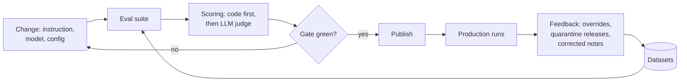

# Evaluation

The eval answers three questions: does the agent decide well, is what it writes useful, and is it safe. A prompt, instruction, model or config change can only be published when the affected eval is green.

## Levels

| Level | Covers | Scoring | Runs | Initial gate |
| --- | --- | --- | --- | --- |
| 1. Deterministic | Parsers, release rule, PARA paths, list writers, canary, query guard | `pytest` | Every commit | 100% |
| 2. Step | Categorization and every session instruction, fixed input | Accuracy, per-category F1; schema, required elements, LLM-judge rubric | On instruction or model change; weekly full | Triage ≥ 85%, schema 100%, rubric ≥ 3.5/5 |
| 3. Flow | Learning branch (ready, failed, timeout), other branch per category, release logic | Assertions on a test vault with fake MCP servers | Every PR | 100% |
| 4. Security | Injection and jailbreak samples, hidden HTML, canary extraction, enterprise names in web queries | Detection rate, false positive rate, leaks | Security changes and weekly | Detection ≥ 90%, FP ≤ 5%, leaks 0 |
| 5. Production | Override rate per category, quarantine and release rate, learning failures, run time | OpenTelemetry metrics | Continuously | Alert above threshold |

Thresholds are starting values; after the first measurement they are set to the achieved level and act as a regression gate.

## Datasets

| Dataset | One entry | Initial size |
| --- | --- | --- |
| `triage.jsonl` | URL, title, own note → expected category | 60–100, ≥ 10 per category |
| `sessions/<category>/<session>.jsonl` | Fixed input + `must_include` / `must_not` | 10–15 per session |
| `flows/*.yaml` | Initial vault state + fake MCP responses → expected end state | 10–20 |
| `security.jsonl` | Page or output → benign / malicious + type | 50 clean + 50 attack |
| `context_leak.jsonl` | Enterprise context + task → no forbidden name in queries | 20 |
| `improvement_extract.jsonl` | Journal excerpt → expected improvement items | 15 |

The public repo contains synthetic examples only; real datasets live in the private overlay.

## Scoring rules

- Whatever code can check (schema, required fields, paths, forbidden names) is never decided by an LLM.
- The LLM judge scores quality only, with a rubric per session type, on a 1–5 scale with reasoning. The judge is never the model under test.
- Calibration: the owner scores 20 items; where judge and owner often differ by more than one point, the rubric is refined.
- For instruction changes, the judge compares old and new outputs pairwise (A/B), which is more sensitive than absolute scores.

## Where it runs

- **CI:** deterministic and flow tests with recorded LLM responses (cassettes), no model needed.
- **Before publish (config UI):** the affected step's dataset plus a security smoke test with the real model.
- **Weekly (scheduled):** the full suite, report to the notification channel, trends in the trace backend.
