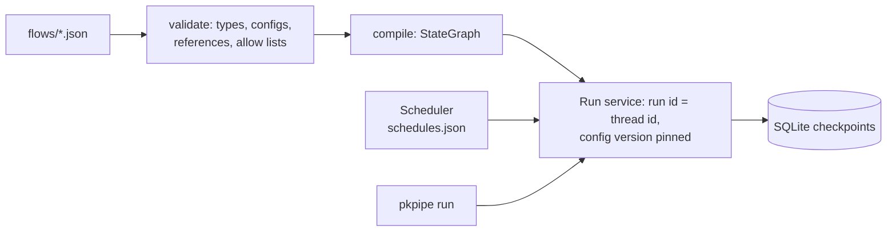

# Flows

A flow is a JSON file, `flows/<id>.json`, in a pack or overlay. The engine (`pkpipe.engine.compiler`) compiles it into a LangGraph `StateGraph`; no Python changes are needed for a new flow. The schema is exported by `pkpipe schema` as `flow.schema.json`, and `pkpipe validate` checks every flow: step types, step configs, references, tool allow lists, prompt and schema files, subflow cycles.



## Flow file

```json
{
  "id": "triage",
  "description": "20:00: read new INBOX items, suggest a category, notify.",
  "bpmn": "process-inbox-items",
  "start": "list_inbox",
  "max_parallel": 2,
  "nodes": [
    {"id": "list_inbox", "type": "tool", "bpmn_element": "Read new INBOX items",
     "config": {"tool": "obsidian:list_folder", "arguments": {"path": "0-INBOX"}}},
    {"id": "categorize", "type": "subflow", "bpmn_element": "Categorize each item",
     "for_each": "select_new.items", "on_item_error": "continue", "config": {"flow": "categorize_item"}}
  ],
  "edges": [
    {"from": "list_inbox", "to": "select_new"},
    {"from": "rows", "to": "write_triage", "when": {"path": "rows.count", "gt": 0}},
    {"from": "rows", "to": "END", "default": true}
  ]
}
```

| Field | Meaning | Default |
| --- | --- | --- |
| `id` | Flow id; must equal the file name | required |
| `description` | What the flow does | `""` |
| `bpmn` | Process page (`docs/process/<bpmn>.md`) the flow implements | none |
| `data_classes` | Private data the flow handles (`journal`, `context`): prompt capture is forced off. `journal` flows are also validated as local only: no tool sessions, loopback model profiles, no `egress` MCP server, journal subflows only | `[]` |
| `start` | Entry node, or use edges from `START` (conditional start) | required unless `START` edges |
| `nodes` | Steps, see below | required |
| `edges` | Transitions, see below | `[]` |
| `max_parallel` | Items processed at the same time by a fan-out (the local model serves requests one by one) | `2` |
| `max_steps` | Upper bound of executed steps, including wait polls | `1000` |

An overlay can change one node of a pack flow by id (`{"nodes": [{"id": "notify", "config": {...}}]}`); `edges` are replaced as a whole.

## Nodes

| Field | Meaning |
| --- | --- |
| `id` | Unique in the flow, `[a-z][a-z0-9_]*`; not a reference root (`item`, `run`, `input`, `error`, `config`, `result`) |
| `type` | Step type (table below) |
| `bpmn_element` | BPMN element name, recorded on the step span as `bpmn.element` |
| `config` | Step-type specific, validated by the step type's own model (unknown keys are errors) |
| `inputs` | References the step may see. LLM sessions receive these and nothing else (constitution VIII) |
| `for_each` | Reference to a list: the step runs once per element, in parallel up to `max_parallel` |
| `on_item_error` | `for_each` only: `continue` records a failed item and goes on; `fail` (default) fails the run |

### Step types

| Type | Does | Config |
| --- | --- | --- |
| `llm` | One isolated session: system prompt, instruction, at most one context pack, declared inputs only, optional JSON-schema output | `system`, `instruction`, `context`, `output_schema`, `profile` |
| `llm_tools` | Session that may call tools: the model proposes a call, code checks the allow list and calls it. Sees only validated JSON: never raw item text (`item`, `item.body`, `item.content`, `item.raw`, `item.text`, `*`) and never the output of a `tool`, `wait` or `llm_tools` node or of an `llm` node without `output_schema` | as `llm` + `tools`, `max_turns` |
| `tool` | One tool call, no model | `tool` (`server:tool`), `arguments` |
| `code` | A registered deterministic function (gates, state changes, row building) | `function`, `args` |
| `notify` | Event to the channels routed in `channels.json` through the NotifyPort; a failing channel is listed in `failed` and never fails the flow ([Notifications](configuration.md#notifications)) | `event`, `message`, `payload`, `channels` |
| `subflow` | Runs another flow for the current item; its checkpoints nest under the run | `flow` (id or `${item.subflow}`) |
| `wait` | Polls a status tool until a condition holds; each poll is a checkpoint, the deadline is absolute | `tool`, `arguments`, `until`, `poll_s`, `deadline_s` |
| `guard` | Flags from regular expressions and classifier scores (code decides); sets `item.flagged` | `input`, `patterns`, `checks` |
| `fetch` | Secure fetch (spec 008): URL filter again, then one `webfetch:fetch_page` call; `status` `ok`, `blocked` (flag) or `failed`. Raw output | `url`, `tool`, `max_bytes` |
| `sanitize` | Visible text of a fetched page; metadata only for PDF, video, image. Raw output | `input`, `max_chars` |
| `reader` | The Reader: an `llm` session without tools and context pack, with a per-run canary; output plus `canary_leaked` | as `llm` (`output_schema` required) |

Prompts and schemas are files of the layered config: `prompts/system/<system>.md`, `instructions/<instruction>`, `contexts/<context>.md`, `schemas/<output_schema>.json`. Every input is wrapped in random delimiters (datamarking) and the system prompt says that text inside them is data.

Raw external text never reaches a session with tools: `fetch`, `sanitize` and `reader` outputs (like `tool`, `wait`, `llm_tools` and `subflow` outputs) are refused as `llm_tools` inputs; take the secure-fetch verdict's `extract` (`item.extract`) instead.

Built-in `code` functions: `secure_fetch.url_check`, `secure_fetch.scan`, `secure_fetch.verdict`, `item.set`, `inbox.select_new`, `triage.category_menu`, `triage.check_category`, `triage.suggested_rows`, `triage.backlog`, `triage.release`, `triage.finalize`, and the self-improvement functions `improvement.locate_journal`, `improvement.section`, `improvement.new_rows`, `improvement.select_review`, `improvement.attach_journals`, `improvement.check_evidence`, `improvement.propose`, `improvement.no_evidence`, `improvement.review_rows`, `improvement.proposal_rows`, `improvement.summary` ([Self-Improvement Cycle](process/self-improvement-cycle.md)).

### Triage and release (spec 007)

- **20:00 `triage`**: `inbox.select_new` selects INBOX notes that are not in the triage file (id = hash of the note path; a listing that names a note twice yields one item. Two different notes that capture the same URL are still two items, see the spec 007 status). Each item runs in its own `categorize_item` instance: the `suggest` session has no tools and sees only the category menu, the resource, front matter and note, datamarked; `triage.check_category` accepts only a configured category. New rows start `suggested`. `triage.backlog` builds the `triage_ready` notification: `new`, `backlog` (older items neither confirmed nor overridden), `invalid` (decided items whose category is not configured: a removed confirmed category or an unknown override) and `awaiting`. It is sent when there are new items or `invalid` > 0; an unchanged backlog of unreviewed items alone sends nothing in the evening (it is in the 06:00 summary).
- **Re-triage** (`domain.triage.needs_retriage`): an open item (`suggested` or `pending`) that the owner has neither confirmed nor overridden and whose suggested category was removed from the config is selected again by the next triage run and suggested anew. A **confirmed** item is never re-suggested: the confirm tick belongs to the removed category and would otherwise release a category the owner never saw (constitution VI). Such an item, and an override naming an unknown category, is never released, stays `pending` and is reported as `invalid` (`domain.triage.needs_decision`) until the owner writes a configured category into override.
- **06:00 `process_released`**: `triage.release` releases only confirmed or overridden items (override wins), everything else stays `pending` and is counted in the daily summary; each released item runs in its own `process_item` instance and a security flag quarantines only that item. `processed` and `quarantined` items are skipped.

## References and templates

| Root | Value |
| --- | --- |
| `item` | The current item (fan-out element or subflow item) |
| `input` | The inputs the run started with (`pkpipe run <flow> --input '{...}'`) |
| `run` | `run_id`, `flow_id`, `trigger`, `config_version` |
| `error` | The last handled failure: `node`, `type`, `message` |
| `config` | The pinned effective config, read only (for example `config.categories`) |
| `result` | The tool result inside a `wait` condition |
| `<node id>` | That step's output; for a `for_each` step the list of `{item, output, status}` per element |

Paths continue with keys and list positions: `read.front_matter.source`, `release.rows.0`. In `config` values, `${ref}` is replaced; a string that is exactly one `${ref}` keeps the value's type (`"rows": "${rows.rows}"` passes a list). A reference that does not exist fails the step with a message naming it.

## Edges and conditions

| Edge | Taken when |
| --- | --- |
| `{"from": "a", "to": "b"}` | `a` succeeded (several plain edges run in parallel) |
| `{"from": "a", "to": "b", "when": {...}}` | `a` succeeded and the condition holds; among the `when` edges of `a` the first match wins |
| `{"from": "a", "to": "c", "default": true}` | `a` succeeded and no `when` edge matched |
| `{"from": "a", "to": "h", "on": "error"}` | `a` raised; the step span is still marked failed. Without an error edge the run fails |
| `{"from": "START", ...}` | Conditional start, for example routing an item by category |

`to` may be `END`. A node without outgoing edges ends its branch.

Conditions are data evaluated by code (constitution V): one comparison on a `path` (`eq`, `ne`, `in`, `not_in`, `exists`, `truthy`, `gt`, `gte`, `lt`, `lte`) or a combinator (`all`, `any`, `not`).

```json
{"from": "START", "to": "learning", "when": {"path": "item.subflow", "eq": "learning_material"}}
{"from": "guard", "to": "quarantine", "when": {"any": [{"path": "guard.flagged", "truthy": true}, {"path": "item.score", "lt": 0.2}]}}
```

A `for_each` step takes only plain edges: route items inside a subflow, and use `on_item_error: continue` for item failures. An empty list skips the fan-out (its result is `[]`) and continues with its successors.

## Runs

| Field | Meaning |
| --- | --- |
| `run_id` | UUID, also the LangGraph thread id |
| `flow_id` | Flow |
| `config_version` | sha256 over the effective JSON and the text assets (prompts, instructions, contexts, schemas) |
| `trigger` | `schedule`, `manual`, `mcp`, `ui` |
| `status` | `running`, `waiting` (inside a wait step), `done`, `failed` |
| `started_at`, `ended_at`, `error` | Times; error type and message of a failed run |

When a run starts, the config snapshot (JSON and assets) is stored in the app DB under its version. A run always executes against that snapshot: a config published while it waits, or a restart, does not change what it sees, and the model and tool adapters are built from the same version. Every step is checkpointed in SQLite; after a crash `pkpipe run --resume-all` (or `--resume <run id>`) continues from the last checkpoint, and finished steps and finished items are not executed again. A run that stopped before its first checkpoint has nothing to continue and is marked failed (`no checkpoint`); a run whose stored snapshot is missing is marked failed without stopping the other resumes.

```bash
pkpipe run triage                    # start now (trigger manual)
pkpipe run triage --input '{"k": 1}' --json
pkpipe run --resume-all              # continue interrupted runs
pkpipe runs --status waiting         # list run records
```

## Telemetry

Every flow, step, LLM call and tool call is a span. Step spans carry `flow.id`, `step.id`, `bpmn.element`, `item.id`, `item.category`, `config.version` and `run.trigger`; LLM and tool spans inherit `flow.id`, `step.id`, `bpmn.element`, `item.id`, `item.category` and `config.version` from the step that made the call; items processed in parallel stay in the run's trace. Prompt and response text is attached only for flows listed in `telemetry.json` (see [Operations](operations.md)).

## Adding a step type

Later specs and overlay plugins add step types without touching the engine:

```python
from pkpipe.steps import StepConfig, StepExecutor, StepResult, register_step


class FetchConfig(StepConfig):
    url: str


@register_step
class FetchStep(StepExecutor):
    type = "fetch"
    Config = FetchConfig
    uses_tools = False  # True: the compiler refuses raw untrusted inputs
    loops = False  # True: may return StepResult(pending=...) and is re-entered (like wait)

    def check(self, node, config, snapshot):  # optional reference checks -> (errors, warnings)
        return [], []

    def run(self, node, config, ctx):
        page = ctx.ports.require("fetch").get(ctx.render(config.url))
        return StepResult(output={"markdown": page})
```

Inside pkpipe, list the module in `pkpipe.steps.BUILTIN_MODULES`; outside, expose it under the `pkpipe.steps` entry point group. Deterministic functions for `code` steps register with `@register_code("name")`. Extra ports reach steps through `StepPorts.extra` and `ctx.ports.require(name)`.
