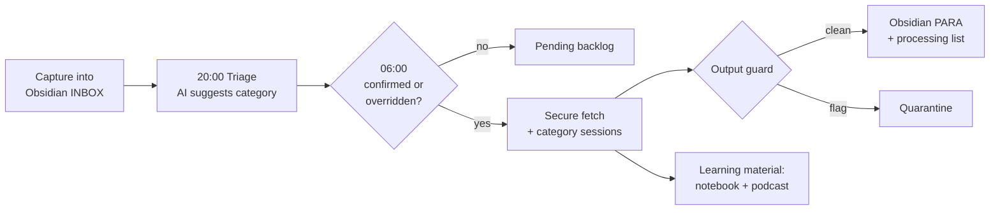

# pkpipe – Personal Knowledge Pipeline

pkpipe turns an Obsidian INBOX into curated knowledge. Every evening it suggests a category for each new item, you confirm or override in the morning, and isolated LLM sessions turn each released item into a notebook with a podcast, a tool evaluation or a curated note in your PARA folders.

It runs on one machine with a local model (LM Studio, Ollama or any OpenAI-compatible server). Security, evaluation and observability are part of the design, not add-ons.

## How to read these docs

| Page | What it answers |
| --- | --- |
| [Architecture](architecture.md) | Principles, technology, C4 context / container / component views |
| [Process model](bpmn.md) | The BPMN process model: every process as an image and as Mermaid |
| [Configuration](configuration.md) | Layers, files, categories, session plans, context packs |
| [Security](security.md) | Isolation, input and output guards, canary, quarantine |
| [Evaluation](evaluation.md) | Five eval levels, datasets, gates, feedback loop |
| [Operations](operations.md) | Scheduling, release ladder, observability, runbook |
| [Glossary](glossary.md) | Terms used across docs, specs and code |

The implementation is spec-driven: see `specs/README.md` and the constitution in `.specify/memory/constitution.md`.

## The idea in one picture

