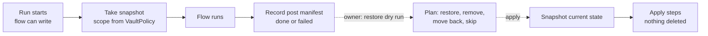
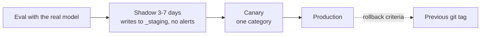

# Operations

## Schedules

| Trigger | Flow | Notes |
| --- | --- | --- |
| `0 20 * * *` | `triage` | Categorize new INBOX items, notify |
| `0 6 * * *` | `process_released` | Process confirmed or overridden items |
| `0 19 * * 0` | `context_refresh` | Rebuild context packs |
| `30 21 * * *` | `improvement_extract` | Optional, enabled by an overlay `schedules.json` entry: journal extraction ([cycle](process/self-improvement-cycle.md)) |
| `30 19 * * 0` | `improvement_review` | Optional, enabled by an overlay entry: weekly review |
| Manual (UI, CLI, app MCP) | Any | e.g. `run_flow("triage")` |

APScheduler with a SQLite job store; missed runs (machine asleep) run once on wake (`misfire_grace_time` + `coalesce`). One instance per flow; item parallelism is configurable (default 2, because the local model serves requests sequentially). LangGraph checkpoints make long waits resumable after a restart.

`pkpipe.scheduler.FlowScheduler` keeps one job `flow:<flow>` per entry of `schedules.json` (`max_instances=1`, `coalesce=True`, `misfire_grace_time` = `misfire_grace_s`, default 6 h). Syncing is idempotent: an unchanged schedule keeps its stored next fire time, so a run missed while the app was stopped still runs once when it starts again within the grace time. Schedules for flows that do not exist yet are skipped with a warning.

## Runs and the app DB

The app DB is one SQLite file: `$PKPIPE_DB`, else `$PKPIPE_DATA_DIR/pkpipe.db`, else `~/.local/share/pkpipe/pkpipe.db`. It holds the run table, the config snapshots runs are pinned to, the LangGraph checkpoints and the scheduler jobs.

| Command | Effect |
| --- | --- |
| `pkpipe run <flow> [--input JSON] [--trigger manual]` | Start a run now; exit 1 if it fails |
| `pkpipe run --resume <run id>` | Continue a `running` or `waiting` run from its last checkpoint |
| `pkpipe run --resume-all` | Continue every interrupted run (after a crash or reboot) |
| `pkpipe runs [--status S] [--flow F] [--json]` | List run records |

A resumed run uses the config version it started with, even if a newer one was published. See [Flows](flows.md) for the flow format.

## Vault snapshots and restore

Before the first node of every run whose flow can write to the vault (a tool call of `write_note`, `append_note`, `move_note`, `update_triage`, `upsert_processing_list`, `update_improvements`, `update_tool_candidates`, `quarantine_note` or `inbox_remove_entries`, also through a subflow) the run service saves a snapshot (spec 019); a flow that only reads takes none. The unit is the run: "restore the state before run X". If the snapshot cannot be written (disk full, permissions) the run fails before it starts and the error names the cause: writing without a way back is not allowed. The run's end (done or failed) records the hash of every file it left different, which is what a later restore compares with.

**Scope.** Derived from the vault policy, so it follows any layout and names no folder of the pack: the managed files, every `.md` file below the folders of the writing tools' allow lists, the layout's write places (`VaultLayout.snapshot_roots()`, spec 020 FR-009) and the quarantine folder. The journal folder is never copied; attachments (images) are out of scope, the pipeline never writes them. Symlinks and hidden folders are not followed, sync-conflict copies are listed but never restored over or removed, a note over `snapshots.max_file_bytes` is recorded in the manifest only (a restore skips it and says so).

**Where.** `$PKPIPE_DATA_DIR/snapshots/<run id>/` (next to the app DB when `PKPIPE_DATA_DIR` is not set), mode 0700, never in the vault, the overlay or a repository: `manifest.json`, `post.json`, `files/<path>` (the bytes before the run), `trash/<path>` (what a restore moved out of the vault). It is plain files: no git needed, no interference with the owner's own commits. The engine process that runs flows needs the vault to build the scope: set `PKPIPE_VAULT_DIR` and, when the vault server runs with a policy file, `PKPIPE_VAULT_POLICY` (the same file); without a vault a flow that can write does not start (the run fails with "no vault is configured for snapshots"): writing without a way back is not allowed. When the policy file is used, its layout must equal `layout.json` (the snapshot refuses otherwise), and the process that runs the flows must see the same vault folder as the vault server; a note the writer puts outside the scope is neither copied nor restorable, and the restore plan prints the scope it knows (`snapshot scope: ...`).

**Overlapping runs.** Each run records what the vault looks like when it ends, so two writing runs that overlap in time (or an owner edit during a run) record each other's writes. A restore of a run skips every path that an overlapping run changed too (`overlapping_run:<run>`), without `--force`; restore in reverse order or force it knowingly (the safety snapshot still makes it undoable). A run that is still running or waiting overlaps every restore whose span it touches: its paths are skipped the same way, and a restore of an active run is refused. Pruning keeps the snapshot of every active run (and the newest of each flow); a resumed run whose snapshot is gone fails before its next node instead of writing with no way back. A restore keeps its snapshot out of pruning until it ends (one `.restoring.<token>` marker per restore, refreshed after every step) and saves the bytes it overwrites in `trash/` (also without `--force`, so a file that grew past `max_file_bytes` during the run stays recoverable). Each step looks at its file again right before it writes or removes it, and skips (`changed_during_restore`) instead of overwriting an Obsidian autosave. A note over `max_file_bytes` is listed but not copied: the log and the `snapshot.take` span say how many, `pkpipe snapshot show` lists them, and a restore skips them (`not_copied`).

| Command | Effect |
| --- | --- |
| `pkpipe snapshot list [--json]` | Run, flow, time, size, files, status (`kept`, `restored`, `pruned`) |
| `pkpipe snapshot show <run>` | Scope, what the run changed, notes that were not copied |
| `pkpipe snapshot prune` | Remove snapshots past `snapshots.retention_days` and, while over `snapshots.max_bytes`, the oldest; the newest snapshot of each flow stays. Also runs after every new snapshot |
| `pkpipe restore <run>` | **Dry run**: the plan with four verbs (`restore`, `remove`, `move_back`, `skip` with its reason); nothing changes |
| `pkpipe restore <run> --apply` | Do it: first a snapshot of the current state (`restore-<run>-<time>-<n>`, so a restore is undoable too), then the plan. Exit 2 when a step was skipped |
| `--force` | Also overwrite what changed since the run, after saving the current bytes in the snapshot's `trash/` |

`<run>` is the run id or a unique prefix of at least 6 characters. A restore never deletes: a file the run created moves to `trash/`, and a file the owner edited after the run ended (its hash is neither the pre-run nor the run's post hash) is a conflict and is skipped, so an edit in Obsidian is never overwritten without `--force`. Applied twice, a restore plans nothing the second time. A run that is still `running` or `waiting` is refused. Restoring a run that is not the newest to touch a file reports that file as a conflict, and two flows that run at the same time record each other's writes in their post manifests (the engine allows one active run per flow), so restore in reverse order.

The same restore is an owner action of the UI (the run page: plan, apply, force) and of the app MCP server (`restore_run`, owner token only, audit-logged with counts and the safety snapshot, never paths; note paths in the tool result are datamarked). Nothing about a restore is sent anywhere: spans (`snapshot.take`, `snapshot.finish`, `snapshot.restore`) carry the run id, file counts and byte totals, never paths or note text.

**Not covered, by design.** The app DB (run records, drafts), the learning gateway's job store, Open Notebook content and messages already sent. A restored run keeps its run record; the `snapshots` table marks it `restored` with `reverted = 1`. `pkpipe doctor` prints the snapshot directory: number, size against the limit, free disk space and the newest snapshot.



## Learning gateway and Open Notebook

`uv run python -m pkpipe.learning.server` serves `learning:create|status|link|audio` on `127.0.0.1:8703` (loopback only, launchd/systemd like the vault server). Jobs live in `$PKPIPE_DATA_DIR/learning/jobs.db` and survive a restart; downloaded podcasts are in `.../learning/audio`. A failed job keeps its reason (`select job_id, item_id, status, json_extract(data, '$.reason') from notebook_jobs`). Items whose service was down stay `released` and are retried by the next 06:00 run; a URL the gateway refuses (deny list, a host that resolves to a private address) quarantines the item like the first URL check; failed or timed-out generations are listed as `failed` in the processing list.

The default backend is Open Notebook with Speaches (Kokoro voice): `cd deploy/open-notebook && cp .env.example .env`, fill the three values, `docker compose up -d`, then `uv run python -m pkpipe.learning.open_notebook_setup` (idempotent; downloads the voice model once, registers LM Studio and Speaches, creates the `pkpipe_overview` / `pkpipe_duo` profiles). Images are pinned by digest; update tag and digest together. A 3 segment overview takes about 10 minutes on a CPU with a 12B model (outline and transcript are written by `google/gemma-4-12b`, not Qwen3.5, whose reasoning breaks the JSON). Live tests: `PKPIPE_REQUIRE_LIVE=1 uv run pytest tests/integration/learning/test_open_notebook_live.py` (starts the stack when it is down and stops it afterwards; notebook, link, Kokoro speech, failure and filter checks take seconds). The full generation of a short podcast is opt-in with `PKPIPE_LIVE_AUDIO=1` because a thinking model writing the transcript takes 10 to 40 minutes on CPU.

## Web search

`uv run python -m pkpipe.websearch.server` serves `websearch:search(query, max_results)` on `127.0.0.1:8702` (loopback only; `deploy/launchd/io.pkpipe.web-search.plist.example`). Backend: SearXNG at `--searxng-url` / `PKPIPE_SEARXNG_URL` (default `http://127.0.0.1:8080`; `deploy/docker-compose.yml` starts one with the JSON API enabled, `SEARXNG_SECRET` required) or `--backend brave` with `BRAVE_API_KEY`. Results are `{title, url, snippet}`; a result with a non-http(s) URL, credentials, a private host or a deny-listed domain is dropped, text is stripped of tags and invisible characters and capped, at most 10 results. A failing backend returns `{"results": [], "error": "<code>"}`. The server never logs queries; the query guard runs in the engine before the call.

## Evals

`pkpipe eval --suite <suite|all>` runs the eval suites and exits 1 when a gate is red ([Evaluation](evaluation.md)). Reports (JSON + Markdown) go to `$PKPIPE_DATA_DIR/evals`; every eval span carries `eval.run_id`. CI replays recorded model responses (`--cassette replay`); after a prompt, instruction or model change, re-record them against the real model with `--cassette record --concurrency 4` and commit the changed `evals/cassettes/*.json`. The weekly health check is `pkpipe eval --suite production --db <app DB> --vault <vault>`: it alerts on failed runs, override, quarantine and learning-failure rates above the gates in `evals.json`.

## System preflight

An eval or a live test run drives the local model server hard for up to an hour. On the reference Mac mini (M4, 32 GB unified memory, LM Studio with two models x 4 parallel predictions) the failures were never in pkpipe: swap at 17.55 of 18.43 GB stalled LM Studio for 25 minutes and left eval cases unjudged, and a second client on the same server turned a 40-minute live run into 113 minutes. The system preflight reads the machine before a run and lets code decide how hard to drive the server.

```bash
uv run pkpipe doctor              # snapshot + decision; exit 1 when blocked
uv run pkpipe doctor --json       # the same as JSON
uv run pkpipe doctor --no-llm     # host only, the LLM server is not contacted
```

| Option | Meaning |
| --- | --- |
| `--base-url` | LLM server (default: the `default` model profile) |
| `--model ID` | Required model (repeatable; default: the model under test and, on the same server, the eval judge from `models.json` / `evals.judge_profile`) |
| `--max-concurrency N` | Concurrency when everything is ok (default `evals.preflight.max_concurrency`, 4) |
| `--pack`, `--overlay` | Config layers (thresholds, model profiles) |

Sample output on the reference machine during a busy afternoon (another agent using LM Studio):

```text
system      darwin-arm64, 10 CPUs
memory      32.0 GiB total, 9.3 GiB available (29%), pressure normal, compressed 4.4 GiB
swap        18.8 GiB of 20.0 GiB used (94.2%)
thermal     nominal
load        1.90 4.00 6.29 (0.19 per CPU)
top memory  node 914 MiB, ...
llm server  http://127.0.0.1:1234/v1 reachable [openai, lmstudio-rest, lms]
  - qwen3.5-9b-mlx (required): loaded, parallel 4, context 32768, status generating, queued 2
  - google/gemma-4-12b (required): loaded, parallel 4, context 32768, status processingPrompt, queued 0

decision    DEGRADED: eval concurrency 2, timeouts x1.5
  - [reduce] swap_high: swap 18.8 of 20.0 GiB used (94.2%)
  - [reduce] llm_busy: 'qwen3.5-9b-mlx' has 2 request(s) queued by other clients
```

**What is read** (`pkpipe.adapters.system_probe`, behind `SystemProbePort`; no sudo, well under a second, no extra dependency): one `sysctl` call (`hw.memsize`, `hw.ncpu`, `vm.loadavg`, `vm.swapusage`, `kern.memorystatus_vm_pressure_level` = the kernel's normal / warn / critical, `kern.memorystatus_level` = the free percentage `memory_pressure -Q` prints), `vm_stat` (free and compressed pages), `pmset -g therm` (CPU speed limit, a recorded thermal warning), `NSProcessInfo.thermalState` (nominal / fair / serious / critical, read through the Objective-C runtime with ctypes), `ps -axco rss=,comm=` (the five largest memory users by executable *name*: never paths, arguments or user data), and the LLM server: `/v1/models` (served models; any OpenAI-compatible server), LM Studio's `/api/v0/models` (loaded state, context) and, for a local server, `lms ps --json` (parallel predictions, status, queued requests). This works the same for the LM Studio app and the headless `llmster` daemon (`lms daemon up` + `lms server start`); a server that is briefly away (switching between the two, a restart) is retried twice, 2 s apart. On Linux the probe reads `/proc/meminfo`, `/proc/loadavg` and `ps` only (no pressure level, no thermal state). A reading that fails is listed under `not read` and never fails the command.

**How it decides** (`pkpipe.domain.system.decide`, pure code, thresholds in `evals.json` → `preflight`, [configuration](configuration.md#system-preflight)). Each rule that fires adds a reason with a severity; the worst severity wins:

| Severity | Effect | Fired by (defaults) |
| --- | --- | --- |
| `block` | `blocked`, concurrency 0, exit 1 | memory pressure `critical`; under 3% memory available; thermal state `critical`; LLM server unreachable; a required model not served or not loaded |
| `minimal` | `degraded`, concurrency 1, timeouts x2 | swap ≥ 95% (from 12 GiB used, or under pressure); swap ≥ 80% *and* memory pressure ≥ warn; thermal state `serious`; CPU speed limited (< 100%); load ≥ 3.0 per CPU |
| `reduce` | `degraded`, concurrency 2, timeouts x1.5 | memory pressure `warn`; under 10% available; swap ≥ 80% with at least 12 GiB used; thermal state `fair` or a recorded thermal warning; load ≥ 1.5 per CPU; another client has a request queued on a required model |
| `info` | concurrency capped, status unchanged | the server runs fewer parallel predictions than the ceiling |

`ok` keeps the ceiling (4 for live tests; `evals.concurrency` for `pkpipe eval`) and timeouts x1. Reasons carry a scope: `system` (memory, swap, thermal, load) or `llm` (server, models). The timeout multiplier scales every model profile's `timeout_s` (`PKPIPE_MODEL_TIMEOUT_MULTIPLIER`, clamped to 1-10, read by the model adapter at call time; the model span records the effective `pkpipe.model.timeout_s`). macOS grows swap in steps, so a high swap percentage with pressure `normal` is a warning sign, not a stall; the stall came with pressure and a nearly full swap together, which is why that combination is `minimal`. With pressure `normal` the swap percentages count only from `swap_min_gib` (12 GiB) used: after macOS shrank the swap file to 8 GiB, 6.9 GiB used read as 86% and throttled a run that the kernel did not consider under pressure.

**Where it is used.** `pkpipe eval` without `--concurrency` runs the preflight before suites that call a model (not in `--cassette replay`, not for code-only suites; `--no-preflight` skips it): the decision can only lower `evals.concurrency` (production default 1 stays 1) and lengthens timeouts; a `system` block refuses the run (exit 1), an `llm` block is printed and left to the suites, which report the unreachable model per case. Live tests run it once per session and keep re-sampling ([tests/README.md](https://github.com/zskreisz01/pkpipe/blob/master/tests/README.md), "How live tests adapt").

**Telemetry.** Every preflight is a `system.preflight` span (`pkpipe.span.kind` = `system`, `system.source` = `preflight` or `sampler`) with the snapshot as attributes: `system.memory.{total_bytes,available_bytes,available_pct,free_bytes,compressed_bytes,pressure}`, `system.swap.{total_bytes,used_bytes,used_pct}`, `system.thermal.{state,cpu_speed_limit,throttled,warning}`, `system.load.{1m,per_cpu}`, `system.cpu.count`, `system.top_processes` (`name=MiB`), `llm.server.{url,reachable,sources,models_loaded,models}`, and the decision: `system.decision`, `system.eval_concurrency`, `system.timeout_multiplier`, `system.reasons` (`severity:code`). Gauges of the latest sample (attribute `source`): `pkpipe.system.memory_pressure` (0 normal, 1 warn, 2 critical, -1 unknown), `pkpipe.system.memory_available_ratio`, `pkpipe.system.swap_used_bytes`, `pkpipe.system.thermal_level` (0-3, -1 unknown), `pkpipe.system.load_per_cpu`, `pkpipe.system.decision` (0 ok, 1 degraded, 2 blocked), `pkpipe.system.eval_concurrency`. The sampler records the gauges every sample and a span only when the decision changes. Nothing in them is content; process entries are names only.

## Release ladder



Rollback when the override or quarantine rate exceeds twice the weekly average, or on any context leak. A rollback of the code or config does not undo what a run already wrote to the vault: `pkpipe restore <run>` does ([Vault snapshots and restore](#vault-snapshots-and-restore)); check it with the dry run first.

## Observability

Only OTLP is exported, so the backend is replaceable (Langfuse or Phoenix). Spans carry `flow.id`, `step.id`, `bpmn.element`, `item.id`, `item.category`, `config.version`, `run.trigger`. Metrics: items per category, backlog size, learning generation time and timeout rate, step error rate, tokens per second, flags per detector, and the system gauges of the [preflight](#system-preflight). Prompt and response capture is configurable and off for private data.

### Configuring telemetry

Telemetry is configured only from standard `OTEL_*` variables and exports OTLP http/protobuf only (`pkpipe.telemetry`):

| Variable | Effect |
| --- | --- |
| `OTEL_EXPORTER_OTLP_ENDPOINT` | Base URL; traces go to `/v1/traces`, metrics to `/v1/metrics`. Unset: spans are dropped. |
| `OTEL_EXPORTER_OTLP_TRACES_ENDPOINT` / `..._METRICS_ENDPOINT` | Full per-signal URLs. |
| `OTEL_EXPORTER_OTLP_HEADERS` | `key=value,key2=value2`, e.g. Langfuse basic auth. |
| `OTEL_SERVICE_NAME` | Service name (default `pkpipe`). |
| `OTEL_TRACES_EXPORTER` | `otlp` (default), `console` (dev), `none`. |
| `OTEL_METRICS_EXPORTER` | `otlp` (default) or `none`. Phoenix accepts traces only, so use `none` there or send metrics to a collector. |
| `OTEL_SDK_DISABLED` | `true` turns telemetry off. |

**Phoenix (local default):** `docker compose -f deploy/docker-compose.yml up -d phoenix`, then
`OTEL_EXPORTER_OTLP_ENDPOINT=http://127.0.0.1:6006 OTEL_METRICS_EXPORTER=none`. The compose file disables Phoenix auth because the port is bound to 127.0.0.1.

**Langfuse:** Langfuse ingests OTLP traces at `<host>/api/public/otel`. Set
`OTEL_EXPORTER_OTLP_ENDPOINT=https://<langfuse-host>/api/public/otel`,
`OTEL_EXPORTER_OTLP_HEADERS="Authorization=Basic%20<base64(public_key:secret_key)>"` (values are URL-decoded as the OTel spec requires; a literal space also works) and `OTEL_METRICS_EXPORTER=none`.
No core change is needed (constitution I, X).

**Content capture:** off by default. A flow opts in through
`telemetry.json` (`{"capture_content": {"flows": ["<flow-id>"]}}`, validated by `pkpipe validate`); flows handling the `journal` or `context` data class are forced off.
A scrubbing exporter strips prompt/response attributes (OpenInference `input.*`, `output.*`, `llm.*_messages`, ...),
exception messages and status descriptions from every span of a flow with capture off, so a backend never sees them.
Security flags are recorded as `security.flag` span events with detector, action and reason code only.
Every step span carries all seven attributes; one that does not apply (a run-level step without an item) is the
empty string.

**Backend down:** the exporter never raises into the app; failed batches are dropped, a warning is logged and
`pkpipe.telemetry_export_failures_total` counts the dropped spans.

Metric names: `pkpipe.items_total{category}`, `pkpipe.backlog_size`, `pkpipe.flags_total{detector}`,
`pkpipe.learning_timeouts_total`, `pkpipe.learning_generation_seconds`, `pkpipe.step_errors_total{step.id,error.type}`,
`pkpipe.tokens_per_second{llm.model_name}`, `pkpipe.telemetry_export_failures_total`
(recorders: `Metrics.item_processed`, `set_backlog`, `flag`, `learning_timeout`, `learning_generation`, `step_error`,
`generation`). The two learning metrics are recorded by the learning gateway process, which reads the same `OTEL_*`
variables as the app.

### Where traces are stored

pkpipe does not store spans itself. The OpenTelemetry SDK in the app batches spans and metrics in memory and exports them over OTLP to `OTEL_EXPORTER_OTLP_ENDPOINT`; persistence is the job of the trace backend. If no endpoint is configured, spans are dropped (a console exporter can be enabled for development). The app DB (SQLite) holds run records and LangGraph checkpoints, which link to traces by trace id, but not the spans.

| Deployment | Backend | Storage of spans |
| --- | --- | --- |
| Local default | Phoenix (`deploy/docker-compose.yml`) | SQLite in `PHOENIX_WORKING_DIR`, kept in the `phoenix-data` Docker volume; PostgreSQL via `PHOENIX_SQL_DATABASE_URL` if wanted |
| Local, heavier | Langfuse (self-hosted) | PostgreSQL + ClickHouse + S3-compatible blob store (MinIO) |
| Cloud (e.g. Microsoft Foundry) | Azure Monitor / Application Insights | Log Analytics workspace, via an OpenTelemetry Collector or the Azure Monitor exporter (adapter choice, no core change) |

Retention and backups follow the backend: for the local default, back up the `phoenix-data` volume and set a retention policy in Phoenix so the SQLite file does not grow without bound.

## Process

- Engine changes happen in this repository via pull requests, with green CI.
- Deployments pin a released tag of the engine; a private deployment repository holds the overlay, contexts, datasets and service definitions.

## Web fetch

Flows fetch pages only through the web-fetch MCP server (spec 008):

```bash
LIGHTPANDA_DISABLE_TELEMETRY=true uv run python -m pkpipe.webfetch.server --stats-file ~/.local/share/pkpipe/webfetch-stats.jsonl
uv run pkpipe run secure_fetch --input '{"url": "https://example.org/"}' --json   # one URL through the whole check
```

| Option | Meaning |
| --- | --- |
| `--host`, `--port` | Loopback only, default 127.0.0.1:8704 (the `webfetch` entry of `mcp_servers.json`) |
| `--pack`, `--overlay` | Config layers for the URL filter and deny-list (default: public pack, `PKPIPE_OVERLAY_DIR`) |
| `--timeout` | Seconds per browser attempt (default 30); a timeout falls back to Chromium once |
| `--stats-file` | One JSON line per fetch (status, fetcher, fallback, reason; no URL) |

**Fallback rate (SC-002).** `fetch_stats` (MCP tool) returns the counters of the running server, including `fallback_rate`; `pkpipe eval --suite production --fetch-stats <file>` reports `fetch_fallback_rate` and the outcome counts over the stats file. Every fetch step span carries `fetch.fetcher`, `fetch.fallback`, `fetch.status` and `fetch.reason`.

## Config UI and app MCP

`pkpipe serve` starts the API, the HTMX UI, the cron scheduler (resuming interrupted runs first) and the app MCP server in one process on one listener:

```bash
PKPIPE_OVERLAY_DIR=~/pkpipe-overlay PKPIPE_VAULT_DIR=~/Vault uv run pkpipe serve   # http://127.0.0.1:8787
```

| Option | Meaning |
| --- | --- |
| `--host` | `127.0.0.1` (default), another loopback address or a Tailscale address (100.64.0.0/10, fd7a:115c:a1e0::/48). `0.0.0.0` and LAN addresses are refused |
| `--port` | Default 8787 (also the `ui_url` of `channels.json`) |
| `--overlay`, `--pack`, `--db`, `--vault` | Same as the other commands; `--vault` / `PKPIPE_VAULT_DIR` enables the triage views and decisions |
| `--allow-host` | Extra `Host` name to accept, for example a Tailscale MagicDNS name (repeatable) |
| `--no-scheduler` | UI and MCP only |

**Tokens.** On first start `tokens.json` (mode 0600) is created in the data directory with an **owner** token and an **agent** token; `PKPIPE_TOKEN` / `PKPIPE_AGENT_TOKEN` (24+ characters) override them. Log into the UI with the owner token. Without `PKPIPE_OVERLAY_DIR` the config pages are read-only.

**App MCP** is `http://127.0.0.1:8787/mcp` with `Authorization: Bearer <token>`. The agent token can `run_flow`, `get_run` and `list_triage`; `confirm_item`, `override_item` and `release_quarantine` are owner actions and need the owner token (give it only to a chat agent you trust to act for you). Every owner action and `run_flow` lands in the audit log (UI page `/audit`, `GET /api/audit`). Contract: `specs/014-config-ui-and-app-mcp/contracts/`.

For Tailscale, bind to the machine's Tailscale address (or keep loopback and use `tailscale serve`), add the MagicDNS name with `--allow-host`, and keep using the tokens; Tailscale is not a substitute for them.
