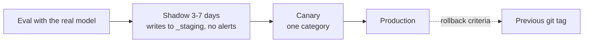

# Operations

## Schedules

| Trigger | Flow | Notes |
| --- | --- | --- |
| `0 20 * * *` | `triage` | Categorize new INBOX items, notify |
| `0 6 * * *` | `process_released` | Process confirmed or overridden items |
| `0 19 * * 0` | `context_refresh` | Rebuild context packs |
| `30 21 * * *` | `improvement_extract` | Private overlay: journal extraction |
| `30 19 * * 0` | `improvement_review` | Private overlay: weekly review |
| Manual (UI, CLI, app MCP) | Any | e.g. `run_flow("triage")` |

APScheduler with a SQLite job store; missed runs (machine asleep) run once on wake (`misfire_grace_time` + `coalesce`). One instance per flow; item parallelism is configurable (default 2, because the local model serves requests sequentially). LangGraph checkpoints make long waits resumable after a restart.

`pkpipe.scheduler.FlowScheduler` keeps one job `flow:<flow>` per entry of `schedules.json` (`max_instances=1`, `coalesce=True`, `misfire_grace_time` = `misfire_grace_s`, default 6 h). Syncing is idempotent: an unchanged schedule keeps its stored next fire time, so a run missed while the app was stopped still runs once when it starts again within the grace time. Schedules for flows that do not exist yet are skipped with a warning.

## Runs and the app DB

The app DB is one SQLite file: `$PKPIPE_DB`, else `$PKPIPE_DATA_DIR/pkpipe.db`, else `~/.local/share/pkpipe/pkpipe.db`. It holds the run table, the config snapshots runs are pinned to, the LangGraph checkpoints and the scheduler jobs.

| Command | Effect |
| --- | --- |
| `pkpipe run <flow> [--input JSON] [--trigger manual]` | Start a run now; exit 1 if it fails |
| `pkpipe run --resume <run id>` | Continue a `running` or `waiting` run from its last checkpoint |
| `pkpipe run --resume-all` | Continue every interrupted run (after a crash or reboot) |
| `pkpipe runs [--status S] [--flow F] [--json]` | List run records |

A resumed run uses the config version it started with, even if a newer one was published. See [Flows](flows.md) for the flow format.

## Learning gateway and Open Notebook

`uv run python -m pkpipe.learning.server` serves `learning:create|status|link|audio` on `127.0.0.1:8703` (loopback only, launchd/systemd like the vault server). Jobs live in `$PKPIPE_DATA_DIR/learning/jobs.db` and survive a restart; downloaded podcasts are in `.../learning/audio`. A failed job keeps its reason (`select job_id, item_id, status, json_extract(data, '$.reason') from notebook_jobs`). Items whose service was down stay `released` and are retried by the next 06:00 run; failed or timed-out generations are listed as `failed` in the processing list.

The default backend is Open Notebook with Speaches (Kokoro voice): `cd deploy/open-notebook && cp .env.example .env`, fill the three values, `docker compose up -d`, then `uv run python -m pkpipe.learning.open_notebook_setup` (idempotent; downloads the voice model once, registers LM Studio and Speaches, creates the `pkpipe_overview` / `pkpipe_duo` profiles). Images are pinned by digest; update tag and digest together. A 3 segment overview takes about 10 minutes on a CPU with a 12B model (outline and transcript are written by `google/gemma-4-12b`, not Qwen3.5, whose reasoning breaks the JSON). Live tests: `PKPIPE_REQUIRE_LIVE=1 uv run pytest tests/integration/learning/test_open_notebook_live.py` (starts the stack when it is down and stops it afterwards).

## Evals

`pkpipe eval --suite <suite|all>` runs the eval suites and exits 1 when a gate is red ([Evaluation](evaluation.md)). Reports (JSON + Markdown) go to `$PKPIPE_DATA_DIR/evals`; every eval span carries `eval.run_id`. CI replays recorded model responses (`--cassette replay`); after a prompt, instruction or model change, re-record them against the real model with `--cassette record --workers 4` and commit the changed `evals/cassettes/*.json`. The weekly health check is `pkpipe eval --suite production --db <app DB> --vault <vault>`: it alerts on failed runs, override, quarantine and learning-failure rates above the gates in `evals.json`.

## Release ladder

Rollback when the override or quarantine rate exceeds twice the weekly average, or on any context leak.

## Observability

Only OTLP is exported, so the backend is replaceable (Langfuse or Phoenix). Spans carry `flow.id`, `step.id`, `bpmn.element`, `item.id`, `item.category`, `config.version`, `run.trigger`. Metrics: items per category, backlog size, learning generation time and timeout rate, step error rate, tokens per second, flags per detector. Prompt and response capture is configurable and off for private data.

### Configuring telemetry

Telemetry is configured only from standard `OTEL_*` variables and exports OTLP http/protobuf only (`pkpipe.telemetry`):

| Variable | Effect |
| --- | --- |
| `OTEL_EXPORTER_OTLP_ENDPOINT` | Base URL; traces go to `/v1/traces`, metrics to `/v1/metrics`. Unset: spans are dropped. |
| `OTEL_EXPORTER_OTLP_TRACES_ENDPOINT` / `..._METRICS_ENDPOINT` | Full per-signal URLs. |
| `OTEL_EXPORTER_OTLP_HEADERS` | `key=value,key2=value2`, e.g. Langfuse basic auth. |
| `OTEL_SERVICE_NAME` | Service name (default `pkpipe`). |
| `OTEL_TRACES_EXPORTER` | `otlp` (default), `console` (dev), `none`. |
| `OTEL_METRICS_EXPORTER` | `otlp` (default) or `none`. Phoenix accepts traces only, so use `none` there or send metrics to a collector. |
| `OTEL_SDK_DISABLED` | `true` turns telemetry off. |

**Phoenix (local default):** `docker compose -f deploy/docker-compose.yml up -d phoenix`, then
`OTEL_EXPORTER_OTLP_ENDPOINT=http://127.0.0.1:6006 OTEL_METRICS_EXPORTER=none`. The compose file disables Phoenix auth because the port is bound to 127.0.0.1.

**Langfuse:** Langfuse ingests OTLP traces at `<host>/api/public/otel`. Set
`OTEL_EXPORTER_OTLP_ENDPOINT=https://<langfuse-host>/api/public/otel`,
`OTEL_EXPORTER_OTLP_HEADERS="Authorization=Basic%20<base64(public_key:secret_key)>"` (values are URL-decoded as the OTel spec requires; a literal space also works) and `OTEL_METRICS_EXPORTER=none`.
No core change is needed (constitution I, X).

**Content capture:** off by default. A flow opts in through
`telemetry.json` (`{"capture_content": {"flows": ["<flow-id>"]}}`, validated by `pkpipe validate`); flows handling the `journal` or `context` data class are forced off.
A scrubbing exporter strips prompt/response attributes (OpenInference `input.*`, `output.*`, `llm.*_messages`, ...),
exception messages and status descriptions from every span of a flow with capture off, so a backend never sees them.
Security flags are recorded as `security.flag` span events with detector, action and reason code only.
Every step span carries all seven attributes; one that does not apply (a run-level step without an item) is the
empty string.

**Backend down:** the exporter never raises into the app; failed batches are dropped, a warning is logged and
`pkpipe.telemetry_export_failures_total` counts the dropped spans.

Metric names: `pkpipe.items_total{category}`, `pkpipe.backlog_size`, `pkpipe.flags_total{detector}`,
`pkpipe.learning_timeouts_total`, `pkpipe.learning_generation_seconds`, `pkpipe.step_errors_total{step.id,error.type}`,
`pkpipe.tokens_per_second{llm.model_name}`, `pkpipe.telemetry_export_failures_total`
(recorders: `Metrics.item_processed`, `set_backlog`, `flag`, `learning_timeout`, `learning_generation`, `step_error`,
`generation`).

### Where traces are stored

pkpipe does not store spans itself. The OpenTelemetry SDK in the app batches spans and metrics in memory and exports them over OTLP to `OTEL_EXPORTER_OTLP_ENDPOINT`; persistence is the job of the trace backend. If no endpoint is configured, spans are dropped (a console exporter can be enabled for development). The app DB (SQLite) holds run records and LangGraph checkpoints, which link to traces by trace id, but not the spans.

| Deployment | Backend | Storage of spans |
| --- | --- | --- |
| Local default | Phoenix (`deploy/docker-compose.yml`) | SQLite in `PHOENIX_WORKING_DIR`, kept in the `phoenix-data` Docker volume; PostgreSQL via `PHOENIX_SQL_DATABASE_URL` if wanted |
| Local, heavier | Langfuse (self-hosted) | PostgreSQL + ClickHouse + S3-compatible blob store (MinIO) |
| Cloud (e.g. Microsoft Foundry) | Azure Monitor / Application Insights | Log Analytics workspace, via an OpenTelemetry Collector or the Azure Monitor exporter (adapter choice, no core change) |

Retention and backups follow the backend: for the local default, back up the `phoenix-data` volume and set a retention policy in Phoenix so the SQLite file does not grow without bound.

## Process

- Engine changes happen in this repository via pull requests, with green CI.
- Deployments pin a released tag of the engine; a private deployment repository holds the overlay, contexts, datasets and service definitions.
