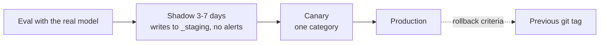

# Operations

## Schedules

| Trigger | Flow | Notes |
| --- | --- | --- |
| `0 20 * * *` | `triage` | Categorize new INBOX items, notify |
| `0 6 * * *` | `process_released` | Process confirmed or overridden items |
| `0 19 * * 0` | `context_refresh` | Rebuild context packs |
| `30 21 * * *` | `improvement_extract` | Private overlay: journal extraction |
| `30 19 * * 0` | `improvement_review` | Private overlay: weekly review |
| Manual (UI, CLI, app MCP) | Any | e.g. `run_flow("triage")` |

APScheduler with a SQLite job store; missed runs (machine asleep) run once on wake (`misfire_grace_time` + `coalesce`). One instance per flow; item parallelism is configurable (default 2, because the local model serves requests sequentially). LangGraph checkpoints make long waits resumable after a restart.

## Release ladder

Rollback when the override or quarantine rate exceeds twice the weekly average, or on any context leak.

## Observability

Only OTLP is exported, so the backend is replaceable (Langfuse or Phoenix). Spans carry `flow.id`, `step.id`, `bpmn.element`, `item.id`, `item.category`, `config.version`, `run.trigger`. Metrics: items per category, backlog size, learning generation time and timeout rate, step error rate, tokens per second, flags per detector. Prompt and response capture is configurable and off for private data.

### Where traces are stored

pkpipe does not store spans itself. The OpenTelemetry SDK in the app batches spans and metrics in memory and exports them over OTLP to `OTEL_EXPORTER_OTLP_ENDPOINT`; persistence is the job of the trace backend. If no endpoint is configured, spans are dropped (a console exporter can be enabled for development). The app DB (SQLite) holds run records and LangGraph checkpoints, which link to traces by trace id, but not the spans.

| Deployment | Backend | Storage of spans |
| --- | --- | --- |
| Local default | Phoenix (`deploy/docker-compose.yml`) | SQLite in `PHOENIX_WORKING_DIR`, kept in the `phoenix-data` Docker volume; PostgreSQL via `PHOENIX_SQL_DATABASE_URL` if wanted |
| Local, heavier | Langfuse (self-hosted) | PostgreSQL + ClickHouse + S3-compatible blob store (MinIO) |
| Cloud (e.g. Microsoft Foundry) | Azure Monitor / Application Insights | Log Analytics workspace, via an OpenTelemetry Collector or the Azure Monitor exporter (adapter choice, no core change) |

Retention and backups follow the backend: for the local default, back up the `phoenix-data` volume and set a retention policy in Phoenix so the SQLite file does not grow without bound.

## Process

- Engine changes happen in this repository via pull requests, with green CI.
- Deployments pin a released tag of the engine; a private deployment repository holds the overlay, contexts, datasets and service definitions.
