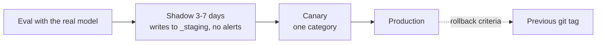

# Operations

## Schedules

| Trigger | Flow | Notes |
| --- | --- | --- |
| `0 20 * * *` | `triage` | Categorize new INBOX items, notify |
| `0 6 * * *` | `process_released` | Process confirmed or overridden items |
| `0 19 * * 0` | `context_refresh` | Rebuild context packs |
| `30 21 * * *` | `improvement_extract` | Private overlay: journal extraction |
| `30 19 * * 0` | `improvement_review` | Private overlay: weekly review |
| Manual (UI, CLI, app MCP) | Any | e.g. `run_flow("triage")` |

APScheduler with a SQLite job store; missed runs (machine asleep) run once on wake (`misfire_grace_time` + `coalesce`). One instance per flow; item parallelism is configurable (default 2, because the local model serves requests sequentially). LangGraph checkpoints make long waits resumable after a restart.

## Release ladder

Rollback when the override or quarantine rate exceeds twice the weekly average, or on any context leak.

## Observability

Only OTLP is exported, so the backend is replaceable (Langfuse or Phoenix). Spans carry `flow.id`, `step.id`, `bpmn.element`, `item.id`, `item.category`, `config.version`, `run.trigger`. Metrics: items per category, backlog size, learning generation time and timeout rate, step error rate, tokens per second, flags per detector. Prompt and response capture is configurable and off for private data.

## Process

- Engine changes happen in this repository via pull requests, with green CI.
- Deployments pin a released tag of the engine; a private deployment repository holds the overlay, contexts, datasets and service definitions.
