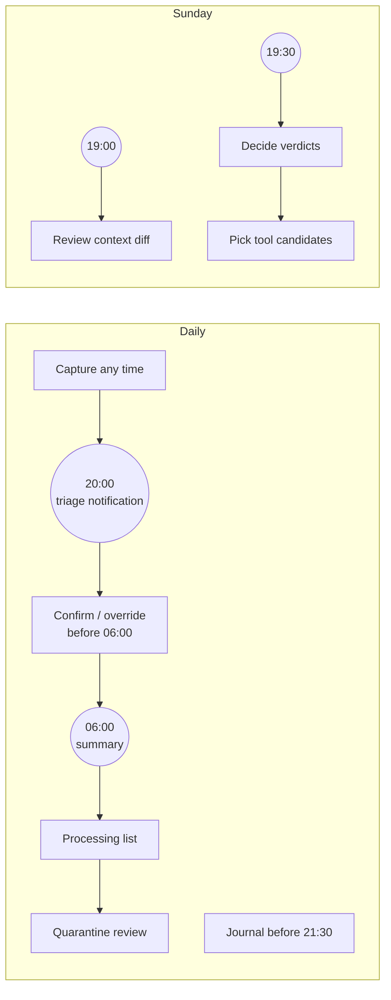

# Owner manual

This page lists only what **you**, the owner, have to do by hand. Everything else runs on its own. pkpipe never processes, releases or adopts anything without you (constitution VI). If you skip a task, nothing breaks: items wait in a pending or proposed state until you get to them.

> **Status:** pkpipe is pre-alpha. This manual describes the designed behaviour (see `docs/` and `specs/`); file names and UI views may still change while the specs are implemented.

Times are the defaults from `schedules.json`. If you change a schedule, the matching task moves with it.

## At a glance

| When | Task | Where | If you skip it |
| --- | --- | --- | --- |
| Any time | [Capture resources](#capture-resources) | Obsidian `0-INBOX` | Nothing is processed |
| End of day, before 21:30 | [Write the daily journal](#write-the-daily-journal) *(overlay)* | Obsidian journal | No improvement items that day |
| After the 20:00 notification, before 06:00 | [Confirm or override triage](#confirm-or-override-triage) | `Inbox-Triage.md`, UI or chat agent | Items stay pending and come back in the next notification |
| After the 06:00 summary | [Work through the processing list](#work-through-the-processing-list) | `Manual-Resource-Processing-List.md` | The list grows; nothing is lost |
| After the 06:00 summary, if items were quarantined | [Review quarantine](#review-quarantine) | `0-INBOX/_quarantine/`, UI | False positives are never processed |
| Immediately, on a security alert | [React to a security alert](#react-to-a-security-alert) | Notification, trace backend | A real attack may go unnoticed |
| Sunday, after 19:00 | [Review context pack diff](#review-context-pack-diff) | `contexts/` in the overlay | Sessions use stale or wrong context |
| Sunday, after 19:30 | [Weekly improvement review](#weekly-improvement-review) *(overlay)* | Review note, UI | Verdicts stay `proposed` |
| Weekly review | [Pick system tool candidates](#pick-system-tool-candidates) | `System-Tool-Candidates.md` | Candidates stay listed |
| Weekly, when the report arrives | [Check the eval report](#check-the-eval-report) | Notification, trace backend | Slow quality drift goes unnoticed |
| On occasion | [Occasional tasks](#occasional-tasks) | UI, terminal | See each task |

## Daily

### Capture resources

- **What:** put anything you want handled into the INBOX: a link, a short text, an image, with an optional note on why it matters to you.
- **When:** any time. Items captured after 20:00 are picked up the next evening.
- **How:** create a note in `0-INBOX` (Obsidian, mobile share sheet, web clipper). One resource per note. A line of your own context ("for client onboarding", "compare with X") improves the category suggestion a lot.

### Write the daily journal

*Only if the self-improvement cycle is enabled in your overlay.*

- **What:** a short daily note on what went well, what did not and what you want to try.
- **When:** before 21:30, when the extraction runs.
- **How:** write in your usual journal note. Use clear phrasing such as "next time I will…" or "experiment: …"; the extraction session picks these up as improvement items in state `proposed`. It runs locally, without tools, and the journal never leaves the machine.

### Confirm or override triage

- **What:** check the AI's category suggestion for each new item.
- **When:** after the 20:00 "triage ready" notification, before 06:00 the next morning.
- **How**, one of:
  - **Obsidian:** open `0-INBOX/Inbox-Triage.md`. For each row, tick the **confirm** checkbox if the suggestion is right, or write a category id into **override**. Leave a row alone to keep it pending.
  - **UI:** the triage view in the pkpipe web UI.
  - **Chat agent:** ask your MCP chat client to `list_triage`, then `confirm_item` / `override_item`.
- **Tips:** the notification shows confidence and reason per item; look closely at low-confidence ones. Every override becomes a training signal for the triage eval, so overriding is better than confirming a wrong category.
- **If you skip it:** unreviewed items stay `pending`, are counted in the 06:00 daily summary and appear again in the next triage notification ("N older item(s) still wait for your decision"). Nothing is processed by default.

### Work through the processing list

- **What:** consume what pkpipe prepared: listen to the podcast, read the notebook, read the tool evaluation or the curated note.
- **When:** after the 06:00 daily summary, whenever it suits you.
- **How:** open `Manual-Resource-Processing-List.md`. Each row links to the note, and for learning material to the notebook. Status per row:

  | Status | Meaning | Your action |
  | --- | --- | --- |
  | `unprocessed` | Ready for you | Read or listen, then set `done` |
  | `generating` | Podcast still being generated | Wait |
  | `ready` | Notebook and podcast are ready | Listen, then set `done` |
  | `failed` | Generation failed or timed out | Re-run the item (UI or `run_flow`) or set `manual` and handle it yourself |
  | `manual` | You took it over | Set `done` when finished |
  | `done` | Finished | – |

- **Tip:** if a note is wrong or weak, correct it in place. Corrected notes are a feedback signal for the session eval datasets (see [Evaluation](evaluation.md)).

### Review quarantine

- **What:** decide whether quarantined items are real attacks or false positives.
- **When:** after the daily summary, if it reports quarantined items.
- **How:**
  1. Open `0-INBOX/_quarantine/`. Each file holds the content in inert form (inside a code block) with `security_flag` front matter: flag, detector, score, evidence.
  2. Read the evidence. **Do not open the original URL** in a normal browser and do not copy the content into another AI tool.
  3. **Real attack:** leave it. The URL is already in `security/malicious_urls.jsonl` and the domain is on the deny-list. Delete the quarantine file whenever you like.
  4. **False positive:** release it in the UI or with `release_quarantine(id)`. The item goes back to triage and the case is added to the security eval dataset so the detector can be tuned. If the domain is trustworthy, also remove it from the deny-list in the security settings.

### React to a security alert

- **What:** a `canary_leak`, or an unusual burst of flags, sent as an immediate alert.
- **When:** as soon as you see it.
- **How:** a single `malicious_content` or `injection_or_jailbreak` flag is handled by the quarantine review above. A **canary leak** means a system instruction left the session: open the run in the trace backend (the alert links the trace id), check which session and input caused it, and pause the affected category (`enabled: false` in the overlay) until the cause is understood. A canary leak is also a rollback criterion (see [Operations](operations.md#release-ladder)).

## Weekly (Sunday)

### Review context pack diff

- **What:** check the rebuilt context packs (`personal.md`, `enterprise.md`) that sessions use for fit evaluations.
- **When:** after the Sunday 19:00 "review diff" notification.
- **How:** open the diff from the notification or in the UI. Check that the enterprise pack names no client or project you would not want in a prompt, and that nothing is outdated. Edit the pack directly where needed; your edits are kept and the next run shows them as a diff instead of overwriting them.

### Weekly improvement review

*Only if the self-improvement cycle is enabled in your overlay.*

- **What:** decide what happens to each improvement item from the past week.
- **When:** after the Sunday 19:30 "review ready" notification.
- **How:** for each item the agent proposes a verdict (**keep**, **adjust**, **drop**) with evidence and a next experiment. Confirm or change the verdict. Kept personal items move into the personal context; items in the **system** area become a configuration change and go through the eval gate (see [Publish a configuration change](#publish-a-configuration-change)).

### Pick system tool candidates

- **What:** decide which tools flagged as "could improve pkpipe itself" deserve a spike.
- **When:** during the weekly review.
- **How:** open `System-Tool-Candidates.md`. Mark the candidates worth a spike. A spike means trying the tool behind the matching adapter and comparing it with the current component on the eval suite. Adopt only if it wins, with an ADR; otherwise mark it rejected with a reason.

### Check the eval report

- **What:** the weekly full eval run and production metrics (override rate, quarantine rate, learning failures).
- **When:** when the weekly report arrives.
- **How:** look for red gates and rising trends. Override rate for a category above twice the weekly average means its triage hint or instructions need work. A red gate blocks publishing until fixed.

## Occasional tasks

### Publish a configuration change

- **When:** you change a category, instruction, schedule, model or guard threshold.
- **How:** edit in the UI (edits are drafts) or in the overlay repository. Publish runs schema validation, reference checks and the smoke eval for the affected step. Only a green publish is committed. Running flows finish on the old config version.

### Calibrate the LLM judge

- **When:** once after setup, and after a rubric change.
- **How:** score 20 session outputs yourself on the 1–5 rubric in the UI. Where the judge and you often differ by more than a point, refine the rubric.

### Supervise a release

- **When:** after upgrading the engine tag or changing a model.
- **How:** follow the release ladder (eval → shadow → canary → production). During shadow (3–7 days) pkpipe writes to `_staging` without alerts; compare a few notes with production before you promote. Roll back to the previous tag if a rollback criterion fires.

### Re-triage an item

- **When:** a category was removed from config while an item was open.
  - An item you had **not** decided on yet is suggested again automatically by the next 20:00 triage (it shows up as a new item); confirm or override the new suggestion.
  - An item you had **confirmed** (or overridden to a category that does not exist) is never released. The 20:00 notification says "N item(s) name a category that is no longer configured", even on evenings without new items.
- **How:** write an existing category id into **override** in `Inbox-Triage.md`. pkpipe never re-suggests a confirmed item, because your tick belongs to the old category.

### Keep the machine healthy

| What | When | How |
| --- | --- | --- |
| Model server running with the configured model | After reboots, if the summary reports model errors | Start LM Studio / Ollama; check with `curl $PKPIPE_MODEL_BASE_URL/models` |
| Back up app DB, overlay repo and trace volume | Weekly | Copy `pkpipe.db`, push the overlay repo, back up the `phoenix-data` volume |
| Update the engine | When a new tag is released | Pin the new tag in the deployment repo, then supervise the release |
| Rotate secrets | When a webhook or API key may have leaked, or yearly | Replace the keychain or env value; config only references `env:NAME` |

Missed schedules (machine asleep) run once on wake, so you do not need to re-run anything by hand after a night with the lid closed.
