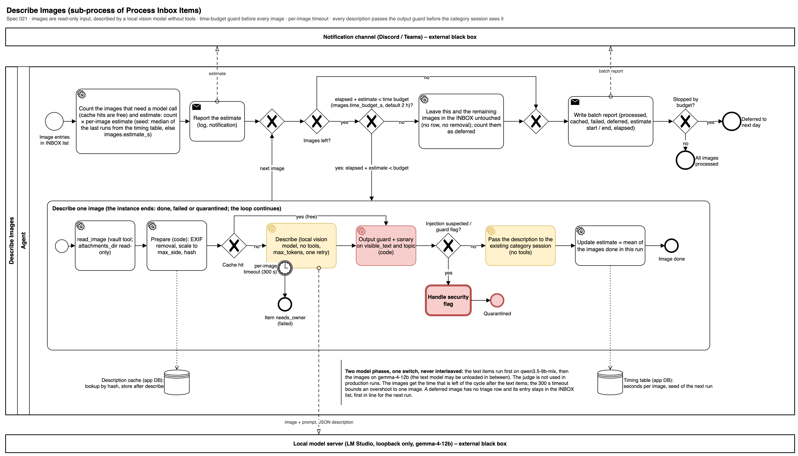
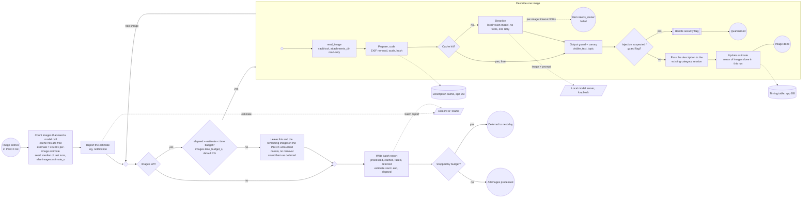

# Describe Images

Sub-process of [Process Inbox Items](process-inbox-items.md) (spec 021), called after the text items have been categorized. An image entry of the INBOX list is read by the vault server (`read_image`, `attachments_dir` is read-only), prepared by code (EXIF removal, scaling, hash), looked up in the description cache, and otherwise described by a local vision model in a session without tools. The description passes the output guard and the canary check before the existing category session sees it; a suspected injection goes to Handle Security Flag and only that image is quarantined.

The batch is bounded by a time budget, not by a count. The budget clock runs from the start of the cycle (the text phase included), so `elapsed` in the diagram is the time since the cycle started and the images get what the text phase left; the count step also reads and prepares every image once (the cache key is the hash of the prepared bytes), which the diagram shows inside the loop. A model call that fails or times out took model time and counts its seconds in the running estimate and in the timing table, like a successful one; a read or decode failure took none. At the start the guard counts the images that need a model call and reports `count × per-image estimate` (seed: median of the last runs from the timing table, else `images.estimate_s`). Before every image it stops when `elapsed + estimate` reaches `images.time_budget_s` (default 2 hours): that image and the rest stay in the INBOX list untouched, with no row and no removal, and are first in line the next day. After every image the estimate becomes the mean of the images done in this run. A boundary timer (`images.per_image_timeout_s`, 300 s) sends one stuck image to `needs_owner` so it cannot spend the budget. A run has two model phases with one switch between them, never interleaved: the text items run first on `qwen3.5-9b-mlx`, then the images on `gemma-4-12b` (the text model may be unloaded in between); the judge is not used in production runs. The images get the time that is left of the cycle after the text items. The batch report is written in both exits (budget reached, or no images left).

## Implementation (spec 021)

| BPMN element | Code | Notes |
| --- | --- | --- |
| Count and estimate, Report the estimate | `image.plan` (flow `describe_images`) and the event `images_estimate` | Reads and prepares every image once, so the batch knows which are cached (free) and which fail without a model call; the seed of the estimate is the median of the last 50 timing rows of the model, else `images.estimate_s`. The read and the preparation of the diagram's loop are therefore already done here (the loop finds the prepared image in the buffer; if it is not there, it is read and prepared again), which keeps the count exact; the diagram stays as drawn |
| Budget gateway, Leave the rest untouched | `image.budget` (FR-014) | The pure guard of `pkpipe.domain.image_batch` with the clock port as its only time source: stops before an image when `elapsed + running estimate` reaches `images.time_budget_s`; `elapsed` runs from the start of the cycle; the images left have no row and no removal |
| Update estimate | `image.record` | The mean of this run's model calls replaces the estimate (a failed or timed-out call counts its seconds too; a read or decode failure does not); every call also goes to the timing table of the app DB |
| Time budget, estimate seed, timeout | `config/images.json`: `time_budget_s` (7200), `estimate_s` (60), `per_image_timeout_s` (300) | |
| read_image | Vault tool `read_image` (FR-004) | Basename only, extensions `jpg jpeg png webp gif`, size limit, symlink refusal; `attachments_dir` is read-only (FR-010) |
| Prepare | `image.prepare` over the port `ImagePreparePort` (Pillow adapter, FR-005) | EXIF removal, scaling to `images.max_side`, JPEG re-encode, pixel limit; the hash of the prepared bytes is the cache key |
| Cache hit? | Description cache in the app DB (`ImageStorePort`, FR-012) | Key: hash, model, prompt version; the triage row shows `topic` only |
| Describe | Session `describe` of `describe_image_item`, step type `vision` (FR-006), data class `image` (FR-009) | No tools, loopback model only, `max_tokens`, `images.retries` attempts, then `needs_owner` |
| per-image timeout (300 s) | The `vision` step | Counts as a failure of that image; the loop continues |
| Output guard + canary | `output_guard` behind `describe` (FR-007), then `image.finish` | On `visible_text`, `topic`, `urls`, `evidence`; the URL policy and the deny-list for `urls` |
| Handle security flag | [Handle Security Flag](handle-security-flag.md) | Only that image is quarantined |
| Pass the description to the category session | `inbox.source_note`, `triage.category_menu`, session `suggest` on the `vision` profile, `output_guard`, `triage.check_category` (FR-008) | The extract of an image item is its description (kind, topic, visible text, the URLs that passed); `category_hint` is not passed on |
| Write batch report | `image.finish_batch` (`ImageBatchReport`) | Counts, estimates, elapsed; the rows go to the triage file, the message into the `triage_ready` notification. The resource cell of an image row is the local embed `![[name\|200]]` (`images.triage_embed_width`), so Obsidian shows the image next to the suggestion |
