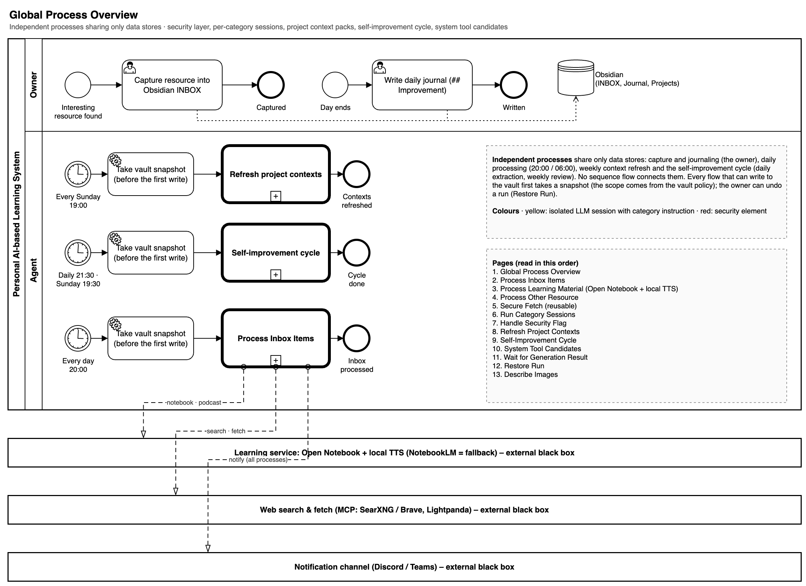
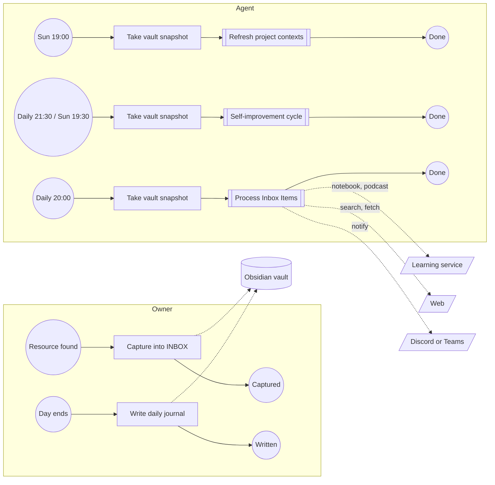

# Global Process Overview

Independent processes that share only data stores: capture and journaling by the owner, daily processing (20:00 / 06:00), the weekly context refresh and the self-improvement cycle. No sequence flow connects them. Every agent process that can write to the vault starts with the task Take vault snapshot; the owner can undo a run ([Restore Run](restore-run.md)).

