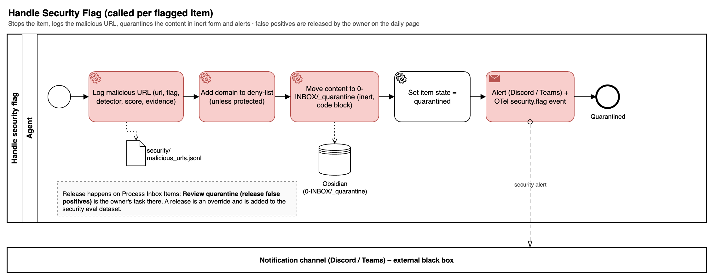
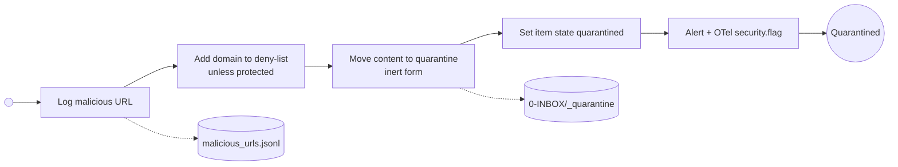

# Handle Security Flag

Called per flagged item. Stops the item, logs the malicious URL, deny-lists the domain (unless it is a protected domain, spec 028), moves the content to quarantine in inert form and alerts. Releasing a false positive is the owner's task on the daily processing page; every release becomes an entry in the security eval dataset.

## Implementation (spec 009)

The pack flow `flows/handle_security_flag.json` is called as a subflow by every flow that can raise a flag (`categorize_item`, `other_resource`, `learning_material`; `secure_fetch` sets `item.flagged` for its caller).

| BPMN element | Node | Step type | Notes |
| --- | --- | --- | --- |
| Log malicious URL | `read`, `record` | `tool` `obsidian:read_note`, `code` `security.record_flag` | One row per flag in `security/malicious_urls.jsonl` (url, domain, flag, detector, score, evidence = reason code, item id, run id, timestamp). URL: `item.url`, the extract's URL, an http(s) resource, else the note's `source`/`url`/`link` |
| Add domain to deny-list (unless protected) | `record` | `code` `security.record_flag` | Host without `www.`; once per domain (a parent entry counts); a host that is, or is a subdomain of, an entry of `security.url_filter.protected_domains` is not added (the row is still logged and the item quarantined, spec 028); `# pkpipe: flagged N, last <day>` counter on repeats. The file is the overlay's `security.url_filter.deny_list` (started from the pack's list), so the URL filter, the web-fetch server and the learning gateway read it; without an overlay `$PKPIPE_DATA_DIR/security/deny_list.txt`, merged by the in-process URL filter |
| Move content to quarantine (inert form) | `quarantine` / `quarantine_url`, `quarantine_done` | `tool` `obsidian:quarantine_note` | The note leaves the INBOX for `0-INBOX/_quarantine/<item id>.md`: the original text verbatim in a fenced code block (fence longer than any backtick run), `security_flag` front matter with flag names, detectors and reason codes only. No other vault tool may write there |
| Set item state quarantined | `mark` | `code` `item.set` | The triage row becomes `quarantined` (at triage: a new row with suggested category `none`) |
| Alert + OTel security.flag | `alert` | `notify` `security_flag` | The `security.flag` span event is recorded where the flag was raised (output guard, verdict) |

**Release.** The owner releases a false positive on the triage page of the UI or with the app MCP tool `release_quarantine` (owner token only, audited). The note is restored to its INBOX path exactly, the row goes back to `pending` (re-queued: triage suggests a category again) and the text becomes a candidate case of the security eval dataset in `<overlay>/evals/candidates/security.jsonl` (source `release`), to be reviewed and moved into `evals/datasets/security.jsonl`. The deny-list entry stays: unblocking a domain is a manual edit (out of scope of automation).
