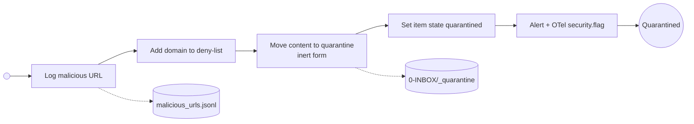

# Handle Security Flag

Called per flagged item. Stops the item, logs the malicious URL, deny-lists the domain, moves the content to quarantine in inert form and alerts. Releasing a false positive is the owner's task on the daily processing page; every release becomes an entry in the security eval dataset.

