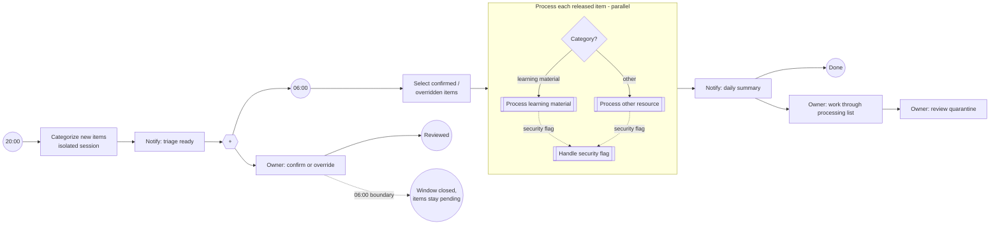

# Process Inbox Items

At 20:00 an isolated session without tools suggests a category per new INBOX item and the owner is notified. At 06:00 only confirmed or overridden items are released; the rest stays pending and is listed again in the next notification. Each released item runs in its own instance; a security flag in one item quarantines only that item.

