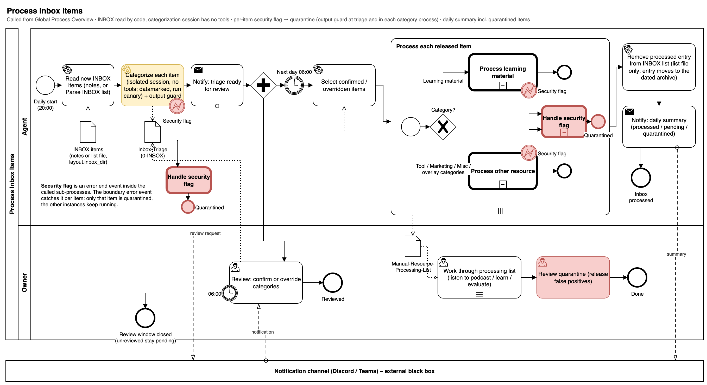
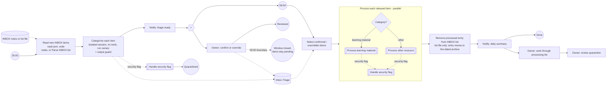

# Process Inbox Items

At 20:00 the agent reads the new INBOX items through the vault port (the `obsidian-vault` MCP server or a plain file-system adapter). Reading is a deterministic code step, not a model decision: the categorization session itself has no tools and receives each item's URL, title and note as datamarked input. It suggests a category per item (the session carries the run's canary) and the output guard checks the reply before the triage file is written: a flagged item goes to Handle Security Flag and its row is written as `quarantined` without a trusted category, while the other items continue; the owner is notified. At 06:00 only confirmed or overridden items are released; the rest stays pending and is listed again in the next notification. Each released item runs in its own instance; a security flag in one item quarantines only that item.

With an `inbox_list_file` in the layout the INBOX is one list: Parse INBOX list turns every bullet entry (link, image embed, text with a link, plain text) into one item, identified by its normalised resource; image entries get no model suggestion and wait for the owner's category. After the item is processed, Remove processed entry from INBOX list moves its entries into the dated archive file and leaves the rest of the list as it was.

