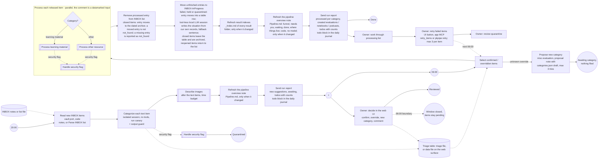

# Process Inbox Items

At 20:00 the agent reads the new INBOX items through the vault port (the `obsidian-vault` MCP server or a plain file-system adapter). Reading is a deterministic code step, not a model decision: the categorization session itself has no tools and receives each item's URL, title and note as datamarked input. It suggests a category per item (the session carries the run's canary) and the output guard checks the reply before the triage file is written: a flagged item goes to Handle Security Flag and its row is written as `quarantined` without a trusted category, while the other items continue; the owner is notified. At 06:00 only confirmed or overridden items are released; the rest stays pending and is listed again in the next notification. Each released item runs in its own instance; a security flag in one item quarantines only that item. After the text items, the sub-process [Describe Images](describe-images.md) (spec 021) describes the image entries with a local vision model within a time budget; the description goes to the same category session, and images that do not fit the budget stay in the INBOX list for the next day.

An override that names no configured category is not a dead end (spec 022): a variant of a configured id or label (`Misc`) is read as that category; a plain new name (`children`) makes the item a new-category proposal: the misc evaluation session reads it with the requested name (behind the output guard), a proposal note with the evaluation and a ready-to-paste `categories.json` entry is written below `layout.proposals_dir`, and the row becomes `awaiting_category`. Nothing is filed and the pipeline never edits the configuration: the owner adds the category through a config draft (validate, eval, publish), after which the next 06:00 run releases the item. A failed evaluation is retried at the next 06:00 run, at most 3 times per item and requested name; then the item stays pending and the evening message tells the owner (a changed override starts a fresh count). Anything that is no plain name stays the old dead end (pending, "name a category that is no longer configured").

The owner decides in the web UI (spec 023), the primary surface: image thumbnails, every field, filters, "confirm all suggested", a category list or a new-category name, and a comment. With `triage.surface: vault` (default) the Obsidian triage file is the table and stays a readable fallback; with `web` the table lives in a machine-owned data file and the triage file is a generated summary page with a link, so nothing is edited in two places. The owner's comment reaches the release sessions of the category and the proposal evaluation only as the declared, datamarked input `owner_note`.

With an `inbox_list_file` in the layout the INBOX is one list: Parse INBOX list turns every bullet entry (link, image embed, text with a link, plain text) into one item, identified by its normalised resource; image entries are described by Describe Images (spec 021) and then categorized like text items. After the item is processed and **closed** (processing `done` or `ready`), Remove processed entry from INBOX list moves its entries into the dated archive file and leaves the rest of the list as it was.

An item that was worked on but is **not closed** (processing failed, held for the owner's decision, or quarantined) does not stay in `INBOX.md` and is not archived as consumed (spec 031). Move unfinished entries to INBOX-InProgress moves its entry into one row of the machine-owned table `INBOX-InProgress.md` (`layout.inbox_in_progress_file`, default `<inbox_dir>/INBOX-InProgress.md`; the entry's exact text stays in the row), and a tool-less session on a local model writes the situation of the row (what happened, the cause, the next step) from pkpipe's own records only: triage state, processing status and fixed failure reason, owner retries, classifier scores of a hold, and the notable events of the item's history. It never sees page, note or image text; if the session fails, a fixed sentence built from the codes is written, so the table never blocks. An item whose facts did not change is not asked again. When the item closes, the row leaves the table and its entry is archived like a consumed one; when a released quarantine item is open again, its entry goes back into the list. The step is off unless `triage.in_progress.enabled` (pack default: on). After it, the release run refreshes the `_Index.md` of every result folder (spec 032): a plain Markdown table of the notes pkpipe wrote there, rewritten only when it changed.

After every triage and release run, Refresh the pipeline overview note (spec 033) rewrites the machine-owned note `Pipeline.md` (`layout.pipeline_file`, default `<inbox_dir>/Pipeline.md`) and the web page `/pipeline` shows the same overview: one place for the funnel of all items (captured, triaged, released, processed with how each one went, stopped), what needs the owner (held warnings, quarantine, failed or unfinished items, the retry limit, categories to decide, each with the situation of the unfinished-items table, the next step and the action), what waits (the next run, NotebookLM quota, notebooks being generated), what was closed lately with the link to its result, and where things live. Code builds it from pkpipe's own tables (triage, processing list, unfinished-items table, retry counts, held warnings, run records, learning jobs); no model runs and no page, note or image text is in it. The vault tool writes it only when it changed (the `Generated:` line does not count), and a failing refresh never fails the run.

After every run, the 20:00 triage and the 06:00 release, the sub-process Send run report (spec 024) builds one report from counts, category ids, run ids and note links only (never item text or a URL from the INBOX): what the run did (new suggestions, or items processed per category), what it created (evaluations, notebooks, podcasts), what waits for the owner in the triage, and the todos with counts: triage decisions to review, notebook materials and podcasts still to process, tool evaluations to read. It is sent as the `daily_summary` notification (Discord, Teams, Apprise); a failure of the report never fails the run. With `report.journal_todos` on and the vault policy granting the journal folder, the same todo lines (`date - todo - item count - link`) are written into the day's daily journal between two comment markers below a configurable heading; nothing else of the journal is read or changed, and the journal block is deliberately outside the vault snapshots.

