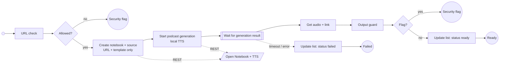

# Process Learning Material

The notebook agent only receives the URL and a prompt template from configuration; it never sees the page content. Podcast generation with local TTS is a separate, slower step with a configurable timeout. Switching to NotebookLM is a `learning-gateway` setting.

