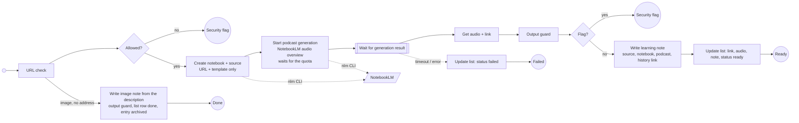

# Process Learning Material

The notebook step only receives the URL and a prompt template from configuration; it never sees the page content (the flow is deterministic, no model reads the note). The gateway filters the URL once more before the backend fetches it (with DNS resolution and the deny list; a URL it refuses takes the same security flag path as the first check), and starts the podcast generation together with the notebook (one `create` call). NotebookLM is the learning backend (spec 032; the `nlm` CLI driver, the owner's own Google session). Generation is slow, so the gateway has a configurable timeout (default 90 minutes) and records the failure reason; the flow's wait deadline backs it up. Before it creates anything the backend checks the quota (`nlm usage`): an exhausted window parks the notebook as `waiting_quota` (the item stays released, the next run continues after the reset), a transient error is retried a bounded number of times, a login or page problem fails fast with its class. When the notebook and the audio are ready, a **learning note** (source, notebook link, podcast, history link; no page text) is written into the category folder and the list row points at it; the podcast file is copied into the vault only with `learning.copy_audio_to_vault`. An image item without an address becomes its own note from the validated description, after the output guard.

