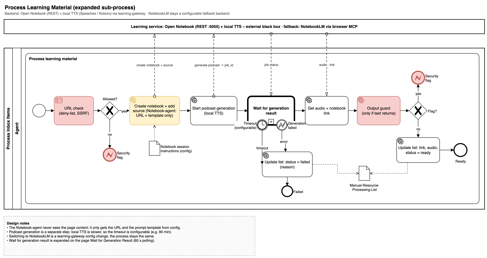
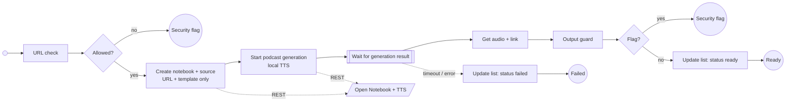

# Process Learning Material

The notebook step only receives the URL and a prompt template from configuration; it never sees the page content (the flow is deterministic, no model reads the note). The gateway filters the URL once more before the backend fetches it (with DNS resolution and the deny list; a URL it refuses takes the same security flag path as the first check), and starts the podcast generation together with the notebook (one `create` call). Generation with local TTS is slow, so the gateway has a configurable timeout (default 90 minutes) and records the failure reason; the flow's wait deadline backs it up. Switching to NotebookLM is a `learning-gateway` setting. The output guard step is added with spec 009.

