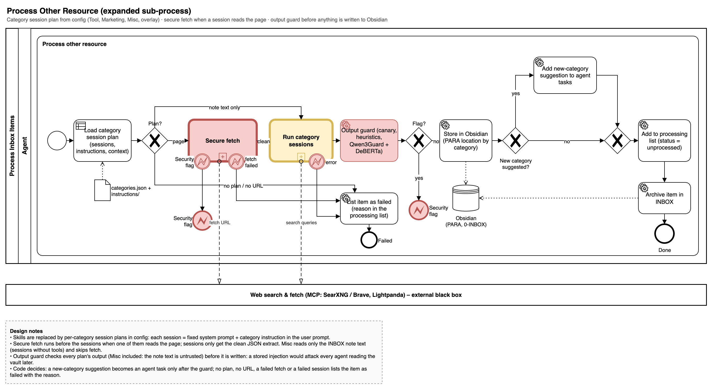
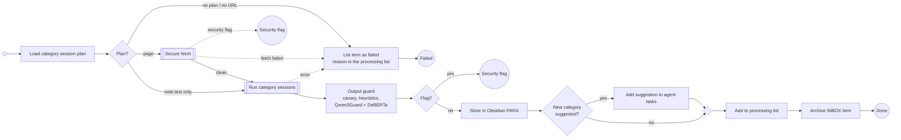

# Process Other Resource

The category's session plan is loaded from configuration (`categories.json`, flow `other_resource`, step type `session_plan`; [Flows](../flows.md#category-session-plans-spec-010)). Secure fetch runs before any session (only when a session reads the page extract), sessions only see the clean JSON extract, and the output guard (step type `output_guard`, spec 009) checks the synthesized note before anything is written to the vault: the run's canary, active markup, heuristics and the classifier. A flag hands the item to [Handle Security Flag](handle-security-flag.md); nothing of the flagged output is written. Misc items have no web content: their plan is the single new-category evaluation over the INBOX note text (a session without tools), so they skip secure fetch but still pass the output guard. After the guard, code turns a new-category suggestion into an agent task note, the note is stored in the category's PARA folder, the processing list row is set, and the INBOX note is archived. A failed session, a missing URL or an unreachable page lists the item as failed with the reason (no security flag).

