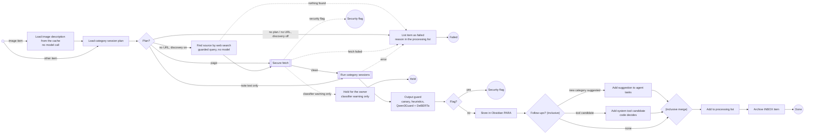

# Process Other Resource

The category's session plan is loaded from configuration (`categories.json`, flow `other_resource`, step type `session_plan`; [Flows](../flows.md#category-session-plans-spec-010)). Secure fetch runs before any session (only when a session reads the page extract), sessions only see the clean JSON extract, and the output guard (step type `output_guard`, spec 009) checks the synthesized note before anything is written to the vault: the run's canary, active markup, heuristics and the classifier. A flag hands the item to [Handle Security Flag](handle-security-flag.md); nothing of the flagged output is written. Misc items have no web content: their plan is the single new-category evaluation over the INBOX note text (a session without tools), so they skip secure fetch but still pass the output guard. After the guard, code turns a new-category suggestion into an agent task note, the note is stored in the category's PARA folder, the processing list row is set, and the INBOX note is archived. For the Tool category the plan's sixth session (system relevance, [System Tool Candidates](system-tool-candidates.md)) adds a section to the note and, when code accepts it, a row to the candidate list after the note is stored. A failed session, a missing URL or an unreachable page lists the item as failed with the reason (no security flag).

Spec 025: an image item first loads its cached description (a subflow of the `image` data class, no model call), so an address shown in the image is its source. An item that still names no URL in a category listed in `source_discovery` is not failed: `item.find_sources` builds one query from the validated description or the owner's text by a template (no model), the web-query guard checks it, `websearch:search` answers, and the URLs that pass the URL policy are fetched by secure fetch in order (the next one after a failed fetch); the category's own sessions then evaluate the first clean page. Nothing found, a refused query or a failed search lists the item as failed with a fixed reason ([Configuration](../configuration.md#source-discovery-source_discoveryjson)).

Spec 029: when the injection detector (DeBERTa) alone is over the threshold, every safety model (Qwen3Guard) says `Safe`, the heuristics are clean and the Reader found nothing, secure fetch returns `review` instead of a flag. The node `hold_review` (`security.hold_for_review`) lists the item as failed with the reason *held for your decision*, keeps the evidence (scores, labels, chunk numbers, address; no page text) in the app database and ends the item: no quarantine, no deny-list entry. The owner accepts the warning on the triage page (or `accept_classifier_warning`, `pkpipe retry --accept-warning`), the item goes through the release run again and the page passes; the Reader, the output guard and every other detector still apply.
