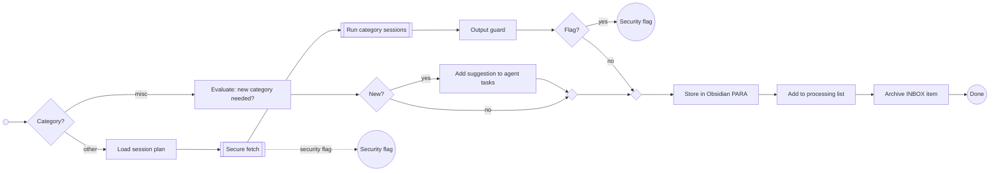

# Process Other Resource

The category's session plan is loaded from configuration. Secure fetch runs before any session, sessions only see the clean JSON extract, and the output guard checks the synthesized note before anything is written to the vault. Misc items have no web content and only get the new-category evaluation.

