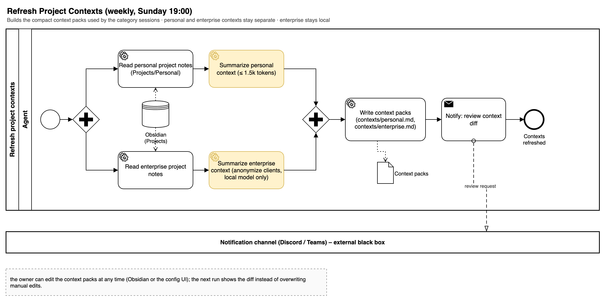
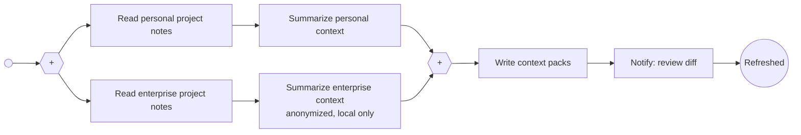

# Refresh Project Contexts

Weekly (Sunday 19:00). Builds compact context packs from the owner's project notes. Personal and enterprise contexts stay separate; the enterprise summary anonymizes clients and runs on the local model only. Manual edits are preserved: the next run shows a diff.

