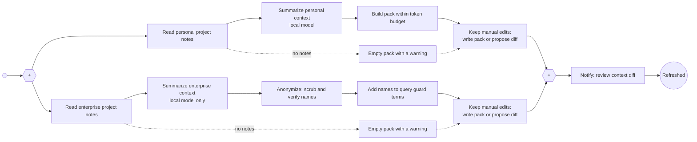

# Refresh Project Contexts

Weekly (Sunday 19:00) and on demand: flow `context_refresh` with the subflow `context_pack` per scope. Builds compact context packs from the owner's project notes. Personal and enterprise contexts stay separate and are summarized in parallel; the enterprise summary is anonymized by code and runs on the local model only (validation and every run refuse a remote profile). The names of the enterprise notes go to the query guard's terms file. Manual edits are preserved: an edited pack is not overwritten, the new version is proposed as a diff. Details: [Configuration](../configuration.md#weekly-refresh-spec-011).

