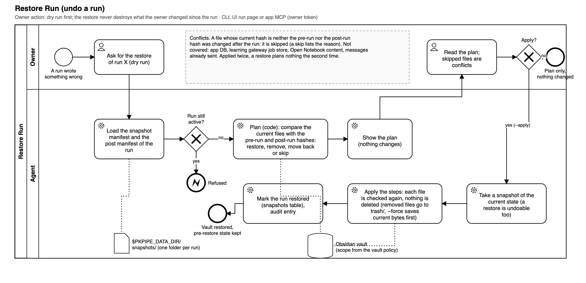
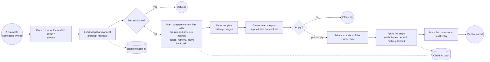

# Restore Run

The owner's undo for a run (spec 019). Before every run whose flow can write to the vault, the run service takes a snapshot; this process puts the vault back to the state before one run. It is a dry run unless the owner applies it, it never deletes (files the run created move to the snapshot's `trash/`), and a file the owner changed after the run ended is skipped as a conflict unless `--force` is given (its current bytes are saved first).

## Implementation (spec 019)

| BPMN element | Code | Notes |
| --- | --- | --- |
| Take vault snapshot (Global Process Overview) | `RunService._take_snapshot`, `FileSnapshots.take` | Before the first node of a flow that can call a writing vault tool (`flow_writes_vault`); scope from `VaultPolicy` (`derive_scope`); a failing snapshot fails the run before it starts |
| Record post manifest | `RunService._finish_snapshot`, `FileSnapshots.finish` | At the end of a run, done or failed: `post.json` lists what the run left different (`modified`, `created`, `removed`, `moved_from`) |
| Ask for the restore | `pkpipe restore <run>`, run page of the UI, app MCP `restore_run` | Owner action; the MCP tool needs the owner token and is audited |
| Run still active? | `pkpipe.engine.restore.restore_run` | A `running` or `waiting` run is refused |
| Plan | `FileSnapshots.plan_restore`, `domain.vault_snapshot.build_plan` | Verbs `restore`, `remove`, `move_back`, `skip` (reason); paths the run never touched are never in the plan |
| Apply | `FileSnapshots.apply_restore` | `--apply`; snapshot of the current state first (`restore-<run>-<time>-<n>`), each step re-checks its file, `--force` saves the current bytes in `trash/` first |
| Mark the run restored | `snapshots` table (`restored`, `reverted`), audit `restore_run` | Counts and the safety snapshot only, never paths |
