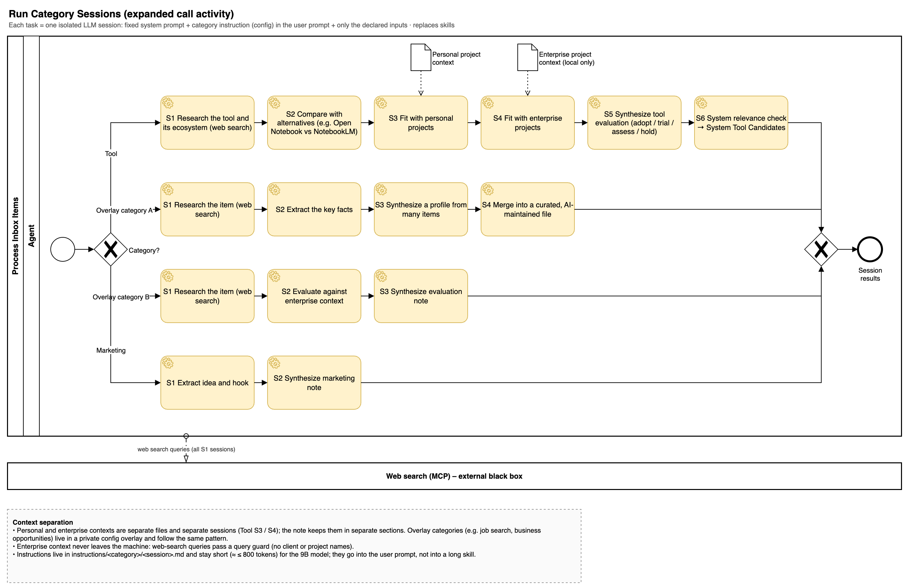
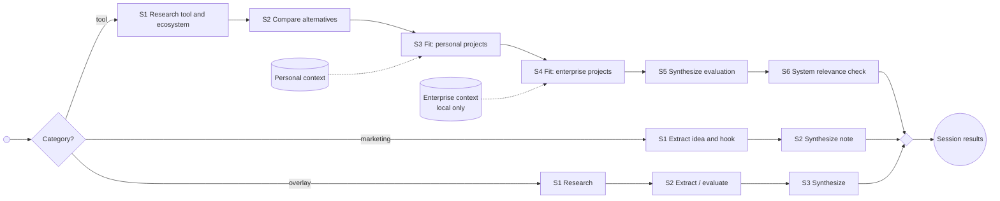

# Run Category Sessions

Each task is one isolated LLM session: a short fixed system prompt, the category instruction from configuration in the user prompt, at most one context pack, and only the declared inputs. Overlay categories (for example job search or business opportunities) live in a private configuration overlay and follow the same pattern: a new category is `categories.json` plus instruction files, no code. The `session_plan` step runs the sessions in plan order; a session whose context pack is missing is skipped. S6 (system relevance) is added by [System Tool Candidates](system-tool-candidates.md) (spec 016) after the note session, which is why the plan names its `note_session`.

