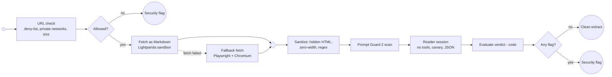

# Secure Fetch

Reusable call activity. Raw web content only enters sessions without tools; every check can end in a security flag, and the decision is made by code, not by the model. The "safe word" idea is implemented as a per-run canary plus an authenticated instruction channel.

