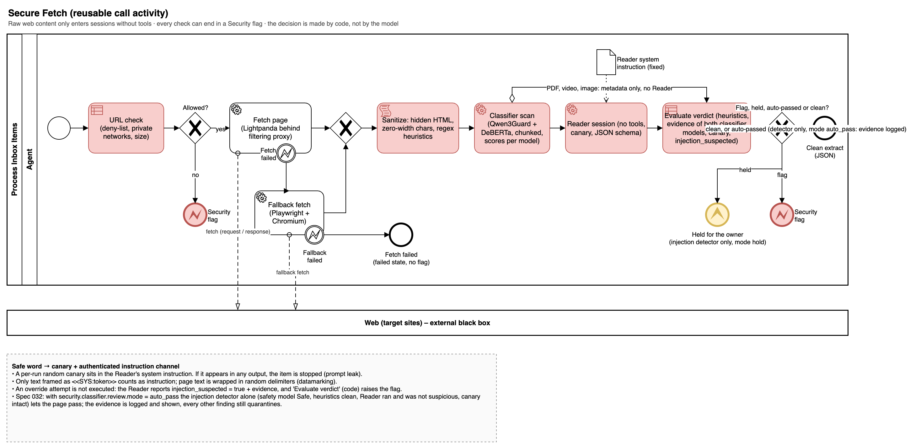
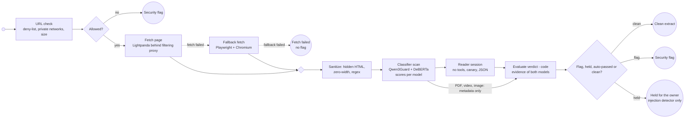

# Secure Fetch

Reusable call activity. Raw web content only enters sessions without tools; every check can end in a security flag, and the decision is made by code, not by the model. The "safe word" idea is implemented as a per-run canary plus an authenticated instruction channel.

## Implementation (spec 008)

The pack flow `flows/secure_fetch.json` implements this page node by node:

| BPMN element | Node | Step type | Notes |
| --- | --- | --- | --- |
| URL check | `url_check` | `code` `secure_fetch.url_check` | Scheme http(s), no credentials, deny-list (`security/deny_list.txt`, subdomains included), private networks after DNS resolution (loopback, RFC 1918, link-local / cloud metadata, CGNAT, IPv6 local, numeric IP forms). Unresolvable host: failed, not a flag |
| Fetch page / Fallback fetch | `fetch` | `fetch` | One call of `webfetch:fetch_page` (web-fetch MCP server). The server runs Lightpanda, and once Playwright + Chromium on error or timeout, both behind a filtering proxy that checks every request (redirect hops, scripts, XHR) and a byte budget. A blocked hop or an oversized page is `blocked` (flag); both browsers failing is `failed` (no flag) |
| Sanitize | `sanitize` | `sanitize` | Hidden elements, comments, script/style, zero-width and Unicode tag characters removed; hidden text kept aside for the heuristics. PDF, video, image: metadata only |
| Classifier scan | `scan` | `code` `secure_fetch.scan` | Regex heuristics (visible and hidden text) and the classifier of `security.classifier` (reference: Qwen3Guard-Gen-0.6B + ProtectAI DeBERTa injection classifier, maximum score, token chunks with overlap; [decision 0001](../decisions/0001-injection-classifier.md)). Scores only |
| Reader session | `read` | `reader` | No tools, no context pack, per-run canary, datamarked page, `reader_extract` schema |
| Evaluate verdict | `verdict` | `code` `secure_fetch.verdict` | Flags: `url_filter`, `heuristic`, `classifier` (also when the classifier is unavailable and `security.classifier.required`), `canary`, `reader`. Sets `item.fetch_status` (`clean`, `flagged`, `review`, `failed`), `item.extract` (clean only), `item.flagged` / `item.security_flags` (each classifier flag carries its score and the evidence of both models, spec 029) or `item.classifier_review`. **Review** (spec 029, `security.classifier.review.enabled`): the injection detector alone is over the threshold, every safety model says `Safe`, the heuristics are clean, the Reader found nothing and did not leak the canary: the item is held for the owner, not flagged. With the owner's accepted warning the same page passes. **Auto-pass** (spec 032, `security.classifier.review.mode: auto_pass`): the same narrow condition lets the page pass without waiting for the owner; the verdict is `clean` with `auto_passed` and the evidence, the step logs an `auto_passed` item event and sets `item.auto_passed`; every other finding still flags |

A flagged verdict sets `item.flagged`; a held verdict sets `item.classifier_review` and `item.fetch_status = review` (the caller lists the item as failed with the reason *held for your decision*, [Process Other Resource](process-other-resource.md)); the calling flow hands the item to [Handle Security Flag](handle-security-flag.md). Only `verdict.extract` / `item.extract` may reach a session with tools: the compiler refuses `fetch`, `sanitize`, `reader` and `subflow` outputs as `llm_tools` inputs.

