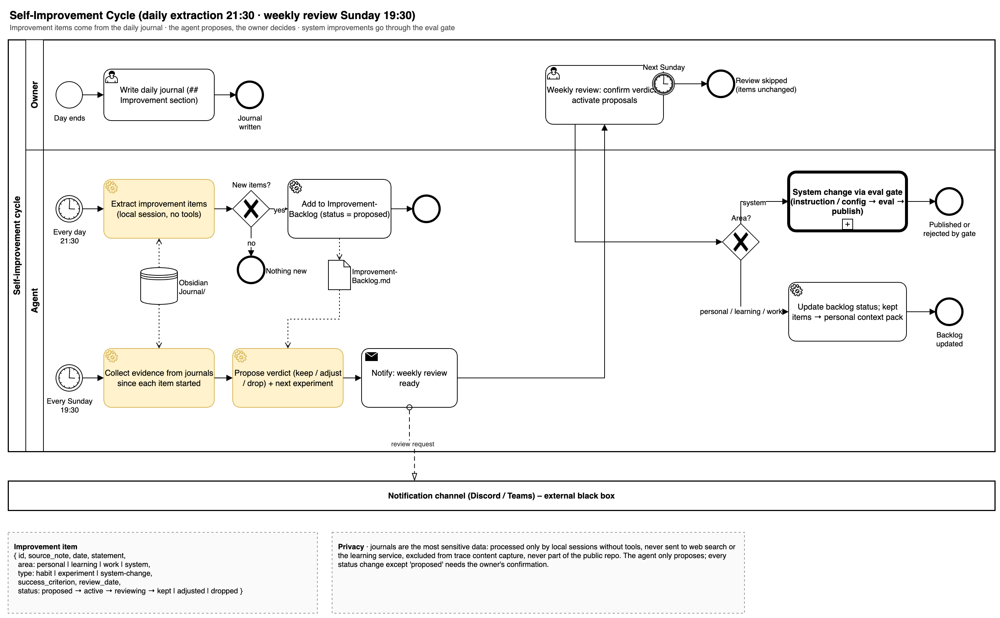
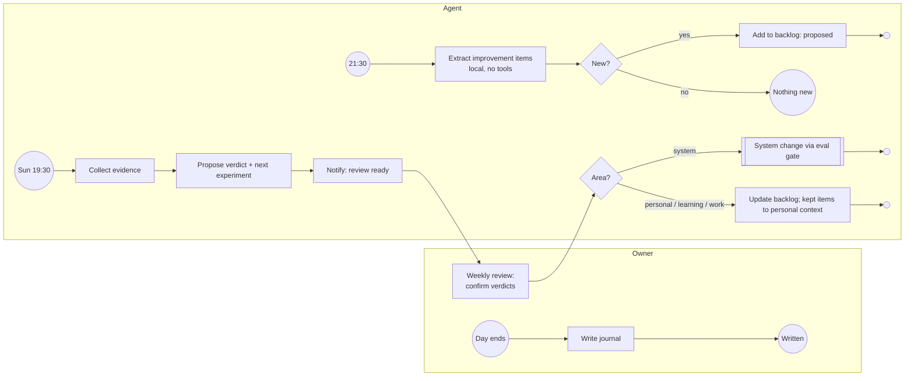

# Self-Improvement Cycle

Improvement items come from the daily journal. A local session without tools extracts them every evening; every Sunday the agent collects evidence and proposes a verdict (keep, adjust, drop) and the next experiment, and the owner decides. System improvements go through the eval gate like any other configuration change.

