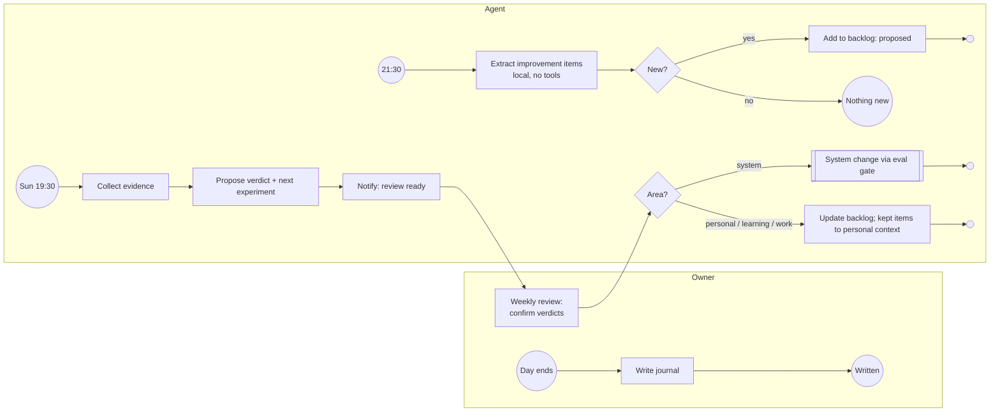

# Self-Improvement Cycle

Improvement items come from the daily journal. A local session without tools extracts them every evening; every Sunday the agent collects evidence and proposes a verdict (keep, adjust, drop) and the next experiment, and the owner decides. System improvements go through the eval gate like any other configuration change.

## Implementation (spec 015)

Optional and private by default: the flows ship in the public pack but run only when an overlay schedules them (`schedules.json`: `{"cron": "30 21 * * *", "flow": "improvement_extract"}` and `{"cron": "30 19 * * 0", "flow": "improvement_review"}`).

| Step | Does | Code decides |
| --- | --- | --- |
| `improvement_extract` | Reads `<journal folder>/<day>.md`, takes the `## Improvement` section and runs one `llm` session without tools on that section only | A statement becomes a backlog row only if it is verbatim in the section; area and type must be valid; duplicates and known items are skipped; rows are always `proposed`; a criterion is kept only if verbatim |
| `improvement_review` | For every `active` or `reviewing` item reads the journals after the day it was written (at most 28 days), runs the evidence session (`review_improvement`), then the verdict session | An evidence quote must be verbatim in a journal day (the day becomes its date); without verified evidence the verdict is `keep` and no verdict session runs; statuses are never written |
| System changes | Writes a proposal note for each `kept` item of area `system` and links it in the backlog row | Applying it is a draft config change that the publish gate (spec 013) must pass |
| Notification | Event `weekly_review` with counts and the backlog location | Never contains journal text |

The backlog is the managed vault file `Improvement-Backlog.md` (table columns `status, id, date, area, type, statement, criterion, review, source, evidence, verdict, reason, next, proposal`), written only through the `update_improvements` tool, which refuses every pipeline change of the owner's columns. Flows with `data_classes: ["journal"]` are validated as local only: no tool sessions, model profiles (and fallbacks) on a loopback address, no call to an MCP server marked `egress`, and trace content capture is forced off. The extraction is evaluated by the `improvement` suite, the two review sessions by the `sessions` suite ([Evaluation](../evaluation.md)).
