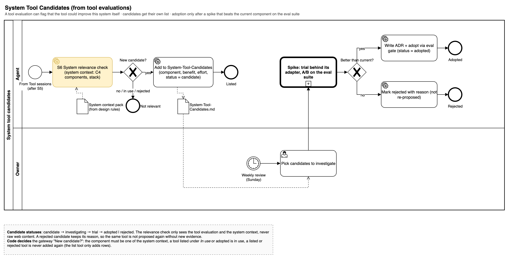
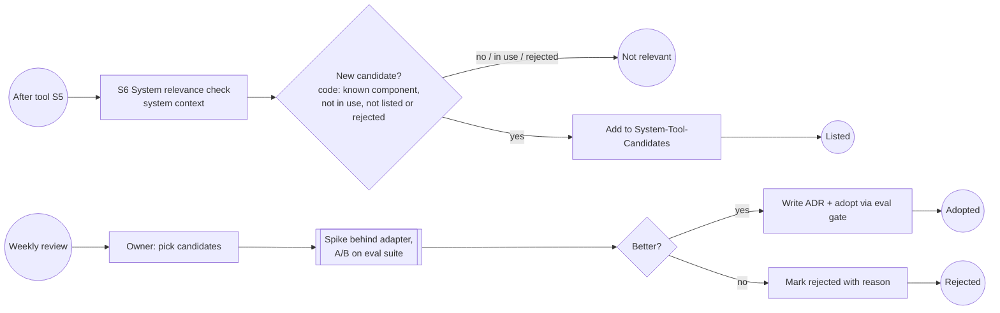

# System Tool Candidates

A tool evaluation can flag that the tool could improve pkpipe itself. Candidates go to a separate list; adoption only happens after a spike behind the matching adapter beats the current component on the eval suite, recorded in an ADR.

**S6 System relevance** (spec 016) is the sixth session of the Tool plan, after the note session. It sees only the validated research and comparison results and the public system context (`contexts/system.md`: the components of pkpipe and the tools it already uses), has no tools and answers `relevance` (`none` or `candidate`), `component`, `benefit` and `effort` (S, M, L). Code decides what happens (constitution V): a row is added to `2-Areas/System/System-Tool-Candidates.md` only for a relevant tool and a component named in the context; a tool listed under *In use* in the context or already adopted is marked in use by code, whatever the model answered in the evaluation note; a rejected tool is never proposed again (the list tool does not touch existing rows). The note gets a *System relevance* section.

**Statuses:** `candidate` -> `investigating` -> `trial` -> `adopted` | `rejected`. The agent only creates `candidate` rows; the owner changes status (`pkpipe candidates set`). A rejection needs a reason and a rejected tool returns only with new evidence. **Adoption** needs an ADR in `docs/decisions/` and an A/B report with verdict `better` and a green gate: `pkpipe candidates ab` runs the same eval suites on the current and the candidate configuration (gated metrics, plus the judge's pairwise A/B for changed sessions, 013) and `better` means the gate is green, no gated metric is worse than the current component's, and a metric improved or the judge prefers the candidate; `equal` and `inconclusive` do not adopt, `worse` is a reason to reject. Template and spike checklist: [ADR template](../decisions/template.md).

