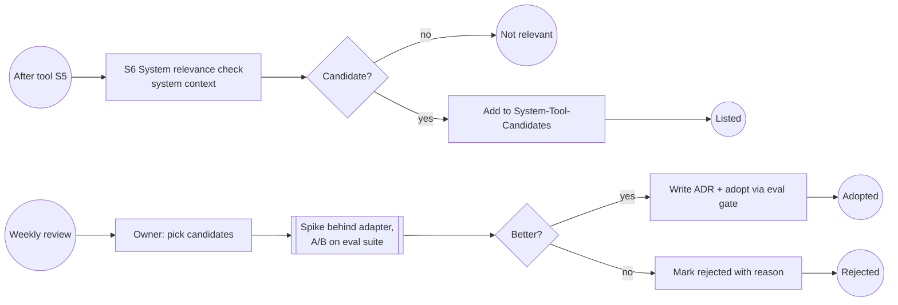

# System Tool Candidates

A tool evaluation can flag that the tool could improve pkpipe itself. Candidates go to a separate list; adoption only happens after a spike behind the matching adapter beats the current component on the eval suite, recorded in an ADR.

