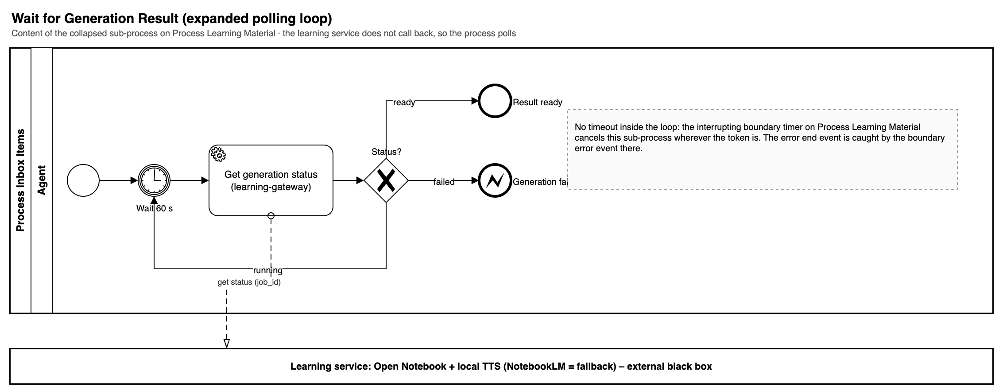
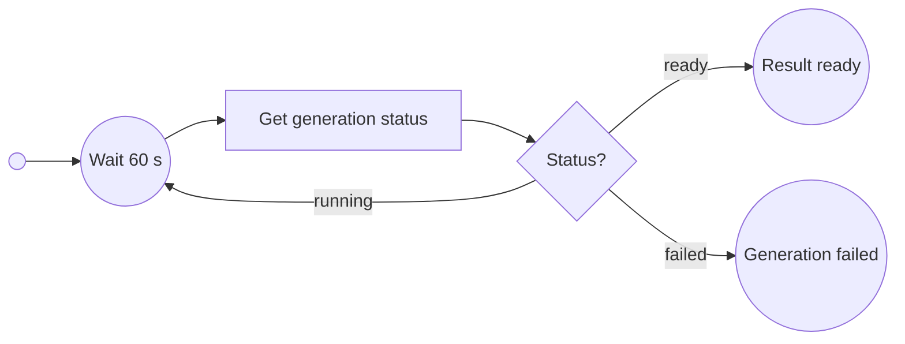

# Wait for Generation Result

The learning service does not call back, so the process polls every 60 seconds. There is no timeout inside the loop: the interrupting boundary timer on Process Learning Material cancels it.

