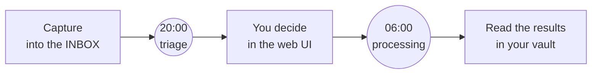

# User guide

This guide is for the person who uses pkpipe every day. It explains the daily flow, what every field of the triage means and who writes it, and how to reach the web UI from your phone or laptop. It does not explain how to install or configure pkpipe (see [Installation](installation.md) and [Configuration](configuration.md)) or the design (see [Architecture](architecture.md)).

pkpipe never processes, files or adopts anything without you: it suggests, you decide.

**Overview page.** Besides the pending count, the recent runs and publishes, the overview has a *Start a process* card (spec 030): one button each for `triage`, `process_released`, `context_refresh`, `improvement_extract` and `improvement_review`, with a short description and a confirmation. A button is greyed out while a run of that process is active. It is the same as starting the flow on the *Runs* page and is logged on the audit page; a processing run uses the models (and, for learning items, NotebookLM quota), so start it deliberately.

## The daily flow

1. **Capture** anything you want to look at later into your INBOX: a link, a note, a thought, an image. In the default setup the INBOX is a folder of notes in your Obsidian vault (one note per item); a vault can also keep one list file whose bullet entries are the items (`inbox_list_file`).
2. **20:00, triage.** pkpipe reads the new items and, for each, a local model *suggests* a category (`tool`, `marketing`, `learning-material`, `misc`, or any category you added). Images are described by a local vision model first (see [Images](#images-and-the-two-hour-budget)). Everything is written into the **triage table**, and you get a notification: "Triage ready: N new item(s)".
3. **You decide.** Open the web UI (`/triage`) and, per item, confirm the suggestion, pick another category, propose a new one, or add a comment. Items you leave alone stay *pending*: nothing happens to them.
4. **06:00, processing.** pkpipe releases only the items you confirmed or overrode and processes each one: it fetches and checks the page, runs the sessions of the category, writes a note into the right PARA folder, and updates your processing list. You get the run report (see [The run report and your todos](#the-run-report-and-your-todos)).
5. **Read the results** in your vault (the note, the notebook, the tool evaluation) and the processing list.

If you skip step 3 nothing is lost: pending items come back in every triage notification ("N older item(s) still wait for your decision").

## The triage table

Every row is one item. This table says which column is written by whom. **You** only ever need the web UI (or, as a fallback, the Obsidian file); the pipeline never changes your columns.

| Column | What it is | Written by |
| --- | --- | --- |
| `confirm` | `[ ]` / `[x]`: the suggested category is right | **You** (the pipeline can never tick it) |
| `item` | The item id: a short hash of the resource; it never changes | pipeline |
| `resource` | The note path, the URL, the text or the image (`![[name\|200]]` shows a thumbnail in Obsidian) | pipeline |
| `suggested` | The category the model suggested (`none`: nothing could be suggested) | pipeline |
| `override` | The category **you** choose instead (see [New categories](#new-categories)) | **You** |
| `state` | Where the item is in its life (see [States](#states)) | pipeline, and your decisions |
| `kind` | `note`, `link`, `text_link`, `text` or `image` (empty = note) | pipeline |
| `needs_owner` | `yes`: this item needs a category **from you** (see below) | pipeline |
| `topic` | One line about an image: what it shows, or why it could not be described | pipeline (images only) |
| `comment` | Your own words about the item | **You** |

### `needs_owner`

The pipeline never guesses blindly. An **image** that could not be described (the vision model failed, the file is too large or not a valid image, the description was flagged by a security check or was empty) gets `suggested = none` and `needs_owner = yes`. The web UI highlights these rows: you give them a category yourself (override), or confirm nothing and they stay pending. There is no suggestion to confirm, so "confirm all suggested" never touches them.

### States

| State | Meaning |
| --- | --- |
| `suggested` | New: a category was suggested, you have not decided |
| `pending` | Seen at 06:00 without a decision from you: waits, nothing is processed |
| `released` | You decided and the 06:00 run took the item; a failed run leaves it here and the next run tries again |
| `processed` | Done: the note is filed, the processing list updated. If the processing **failed** (the page could not be fetched, the learning service was down or over quota), the row is `processed` with a `failed` line in the processing list and a **Retry** button (see below) |
| `quarantined` | A security check flagged the item (for example an injection in the text). Its note was moved into the quarantine folder, inert. You can **release** it from quarantine if it was a false positive: it becomes `pending` again |
| `awaiting_category` | You asked for a new category that does not exist yet; a proposal note was written; the item waits until you add the category (see below) |

## Deciding in the web UI

Open `https://<your address>/triage` (see [Reaching the UI](#reaching-the-ui-from-your-phone-or-laptop)). Log in once with the owner token.

- **The page** shows, per row, the image (a thumbnail, never loaded from a URL), the resource, the kind and topic, the state, the suggested category, and your comment. Rows that need you are highlighted.
- **Confirm**: the suggested category is right.
- **Override**: pick another configured category from the list.
- **Propose a new category**: type a name (see below).
- **Comment**: write your words and press Save; it is stored exactly as you typed it.
- **Filters** at the top narrow the page by state, category or "needs you". **Confirm all suggested in this set** confirms every waiting row of the filtered set that has a configured suggestion; rows with an override, images that need you and rows without a valid suggestion are left alone.
- **Release from quarantine** appears on quarantined rows.
- **Accept warning and process** appears on a failed row that was held after a classifier warning (spec 029): the row shows the page address and what both models said. It is never part of *Retry all failed*.
- **Retry** appears on processed rows whose processing failed; **Retry all failed (N)** at the top of the page asks for a confirmation with the counts. A retry sends the item through the next 06:00 run again (or a manual `process_released` run); your confirm or override stays. Each item can be retried `triage.retry_max` times (default 3); after that the row says *retry limit reached*: fix the cause (for example the web-fetch server, or wait for the NotebookLM quota window) or process it by hand. The same action is the app MCP tool `retry_items` (owner token) and the command `pkpipe retry` (lists the failed items; `--all` or item ids retries them). A quarantined item is never retried; release it from quarantine first.
- **history** (next to the item id on every row) opens the history of the item (spec 030): the current state, the address and scores of a held or quarantined page, and one timeline of everything that happened to it, oldest first: each flow step with its outcome, the secure-fetch verdict with what both classifier models said, source searches, quarantine or hold, your own decisions, and the run each event belongs to. The **Items** tab searches by item id and lists the items that were active most recently. The history never shows page or note text.

The rules are enforced on the server, not in the page: an override is a configured category or a valid new name, a confirm works only on rows in an allowed state, and every decision is logged on the **Audit** page (the log keeps what you decided, never your comment text).

## Images and the two-hour budget

Image entries of the INBOX list are described by a **local** vision model (nothing is sent to the internet). The image is first made safe: decoded under a pixel limit, the EXIF and other metadata removed (GPS, device), scaled, and re-encoded. The description is a short topic; only that line appears in the table (`topic`).

The image phase of the 20:00 run has a **time budget of two hours** (`images.time_budget_s`). Before every image pkpipe checks that the expected end stays inside the budget; the images left over stay in your INBOX list untouched and are first in line the next day. The first notification says how many images will be described and the estimate. One stuck image fails alone after five minutes and goes to you (`needs_owner`); it never uses up the budget.

## New categories

A category is configuration (its sessions, its folder, its instructions), so pkpipe never creates one by itself. If an item does not fit any category you have:

1. In the web UI type a name into **propose a new category** (for example `children`; letters, digits, blanks and hyphens; a name that is only a variant of an existing category, like `Misc`, is simply that category).
2. At 06:00 pkpipe evaluates the item with the `misc` session (it sees the name you asked for and your comment) and writes a **proposal note** into your vault (the folder `proposals_dir`): the evaluation and a ready-to-paste `categories.json` entry. The row becomes `awaiting_category`, nothing is filed, the INBOX entry stays. The UI shows the path of the note, and the notification says "N item(s) propose a new category: children".
If the evaluation fails (for example the model is down), the next 06:00 run tries again, at most 3 times. After the third failure the item stays `pending` and the evening message says "The proposal for 'children' failed 3 times and is not retried": change the override (a new name starts a fresh count) or add the category by hand.
3. You add the category through a **config draft** in the UI (`/config`): validate, run the evals, publish. Then the next 06:00 run releases the item like any other. You can change the override to an existing category at any time instead.

## Editing the configuration in forms

`/config` lists every config file with **form** and **JSON** links. The form edits categories (and their sessions: add, remove, reorder), schedules (with a preview of the next runs), channels and routes, and every other section as fields with checks at the field. A session's instruction is one click away (`edit text`) with a token estimate against 800.

- Secrets (webhook URLs, bot tokens) are written as `env:NAME`; the real value lives in the environment. A literal is refused.
- You can add an `evaluate` session to a category here; spec 025's source discovery settings get their form the same way.
- *Save to draft* changes nothing live. Review the diff, **validate**, run the **smoke eval** and **publish** on the Config page, as before. A pack section you did not change before is saved as a small overlay file (only your changes).

## Your comment

`comment` is your column: the pipeline never writes, trims or clears it. It does one more thing (spec 023): at 06:00 your comment is given to the model session of the category as **your direction for that item** (`owner_note`: "why I filed this", "focus on the licence", "for the kids"), and to the evaluation of a new-category proposal. Rules that keep this safe:

- It is passed as marked data, at most 1000 characters, never inside a system prompt; the model is told it cannot change its task, format or rules.
- It is **not** passed to the image, journal or context flows, and never appears in trace content, logs or notifications.
- A session that can use web search gets it too, but every search query still passes the **query guard**: a client or project name you listed there is refused before it leaves your machine, also when it came from your own comment.
- When an override differs from the suggestion, pkpipe keeps a candidate case with your comment as the *reason* in the private overlay (`evals/candidates/triage.jsonl`) so you can review it weekly and add it to the datasets. Nothing about it goes to the public repository.

## The two surfaces: `web` and `vault`

`triage.surface` in `triage.json` decides where the table lives. You switch explicitly in the overlay config.

| Surface | The triage file in your vault | The table | Where you decide |
| --- | --- | --- | --- |
| `vault` (default) | The table itself | In that file | Obsidian (or the UI: both edit the same file) |
| `web` | A generated page: title, the link to the web UI, a short summary (counts per state, how many wait for you, how many new-category proposals, the last triage run), **no table** | A separate machine-owned file `<inbox_dir>/_pkpipe/triage-data.md` | The web UI only; nothing can be edited in two places |

To switch: set `triage.json` `surface`, add `ui.json` `public_url` (for `web`), mirror `triage_surface` and `ui_public_url` in the vault policy file, run `pkpipe validate --vault-policy <file>`, and restart `pkpipe serve` and the vault server. The **next triage run** moves the table, lossless, in either direction: every row and cell is moved as text (checkboxes, image embeds, comments, odd header variants); it is idempotent, the vault snapshot of the run is taken first (`pkpipe restore` undoes it), and the log names the plan (direction, number of rows) before anything is moved. Until then the UI keeps working on the file that still holds the table. Going back to `vault` leaves a short note in the data file; nothing is deleted.

If you use the `vault` surface and edit the file in Obsidian while a UI action writes it, writes are atomic and locked: a change made in Obsidian in between is detected and the write is retried on the fresh file, so neither side overwrites the other. A sync conflict copy of the file (`... (conflict).md`) is never read or merged; the UI points it out.

## Items without a link

A screenshot or a note without a link used to fail with "no source URL in the note" in the processing list. If you switch `source_discovery` on (`overlay/source_discovery.json`, `{"enabled": true}`, the Tool category by default), the 06:00 run searches the web for it: from the image description (topic and the visible text) or from your note text, one query, checked against your blocked names. The first clean found page is fetched and the category's evaluation runs on it; the note shows the page as its `Source`, so you can see where it came from and delete a wrong match. If nothing is found the item stays `failed` and says why; the fix is a link in its INBOX entry. An address that is visible in an image is used directly, without a search. Images need their description from the triage ("the image has no cached description; triage it again" means the vision model changed since).

## The run report and your todos

After **every** run, the 20:00 triage and the 06:00 processing, pkpipe sends one report to your notification channel (Discord, Teams or any Apprise service; the `daily_summary` route):

- what the run did: the new suggestions per category after triage, or the items processed per category after processing, with quarantined and failed counts;
- what it created: evaluations (notes of the category sessions), notebooks and podcasts;
- what waits for you in the triage;
- your **todos with counts**: *Review triage decisions* (items you still have to confirm or override), *Process notebook materials and podcasts* (learning items you decided that the next 06:00 run turns into a notebook and a podcast), *Read tool evaluations* (evaluation notes of the `tool` category you have not marked as read), *Retry failed items* (processed items whose processing failed, see the Triage page). A todo with a zero count is left out.

The report only contains counts, category ids, run ids and links to your own notes, never the text or the URL of an item. To mark a tool evaluation as read, add `reviewed: true` to the note's front matter; the todo drops it at the next run.

**Todos in your daily journal.** With `report.journal_todos.enabled` in your overlay (and the vault policy granting the journal folder to `write_journal_todos`, see [Configuration](configuration.md)), the same todos are written into the day's journal under the heading `## pkpipe todo`, one line each: `- 2026-11-07 - Review triage decisions - 14 items - [triage UI](http://...)`. pkpipe only ever replaces the block between its two comment markers; the rest of the journal is never read or changed, and a later run on the same day replaces the lines instead of adding them. You can put the heading and the two markers into your daily note template to decide where the section sits. With `report.enabled: false` you get the earlier short messages instead.

## Restore and snapshots

Before every run that writes to your vault, pkpipe takes a snapshot of the notes it can change (kept 14 days by default, in the data directory, never in the vault). If a run did something you do not want: `pkpipe restore <run id>` shows a plan (restore, remove, move back, skip) without changing anything; add `--apply` to execute it. A file you changed since the run is skipped unless you force it, and its current bytes are saved first. The UI run page offers the same. See [Operations](operations.md#vault-snapshots-and-restore).

## Reaching the UI from your phone or laptop

The UI listens on loopback or on a Tailscale address only, and always needs the owner token (plus CSRF and same-origin checks for the browser). Two supported setups, both private to your tailnet:

1. **Loopback plus `tailscale serve`** (recommended): `pkpipe serve` listens on `127.0.0.1:8787`; run `tailscale serve --bg --https=443 http://127.0.0.1:8787`. The address is `https://<mac>.<tailnet>.ts.net` (find the name with `tailscale status --json`, field `Self.DNSName`).
2. **Bind the Tailscale address**: `pkpipe serve --host <tailscale ip>` (`tailscale ip -4`).

Put the address in `ui.json`: `public_url` (the link on the generated triage page; its host is accepted automatically) and, if you also use the other form, `allowed_hosts` (the MagicDNS name and the IP). **Never use Tailscale Funnel**: it publishes the UI to the whole internet. The launchd examples are in `deploy/launchd/` (`io.pkpipe.serve.plist.example`, `io.pkpipe.serve-tailscale-ip.plist.example`). Tailscale is not a replacement for the token.

## Where to read more

[Owner manual](owner-manual.md) (every recurring task), [Configuration](configuration.md) (the files), [Operations](operations.md), [Security](security.md).
