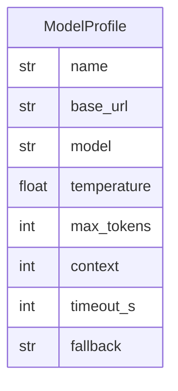

# Data Model: 002-model-port

**Spec:** [spec.md](spec.md)

Notation: **NEW** = introduced by this spec · **EXISTING** = already in the codebase.

## Entities

### NEW `ModelProfile`

| Field | Type | Required | Description |
| --- | --- | --- | --- |
| `name` | str | yes | Profile id, e.g. default, judge |
| `base_url` | str | yes | OpenAI-compatible endpoint or env ref |
| `model` | str | yes | Model name |
| `temperature` | float | no | Default 0.2 |
| `max_tokens` | int | no | Output cap |
| `context` | int | no | Context window |
| `timeout_s` | int | no | Request timeout |
| `fallback` | str | no | Another profile name |

## Diagram

## Storage

- Pydantic models in `src/pkpipe`; JSON Schema exported by `pkpipe validate`.
- Persisted rows: SQLite (app DB) or vault files as stated in the spec.
