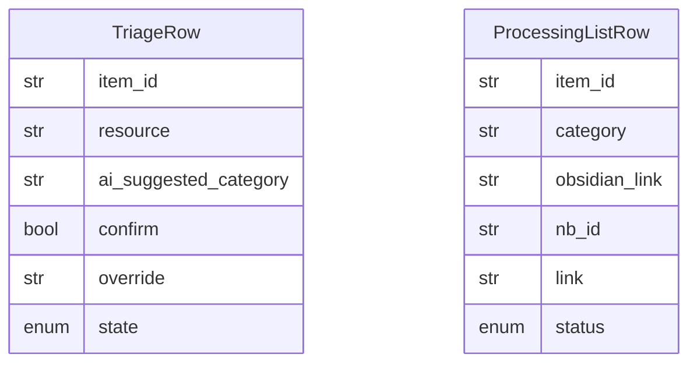

# Data Model: 004-obsidian-vault-mcp

**Spec:** [spec.md](spec.md)

Notation: **NEW** = introduced by this spec · **EXISTING** = already in the codebase.

## Entities

### NEW `TriageRow`

| Field | Type | Required | Description |
| --- | --- | --- | --- |
| `item_id` | str | yes | Stable id (hash of resource) |
| `resource` | str | yes | Link, text or image ref |
| `ai_suggested_category` | str | yes | Category id |
| `confirm` | bool | yes | Checkbox |
| `override` | str|null | no | Category id |
| `state` | enum | yes | suggested · pending · released · processed · quarantined |

### NEW `ProcessingListRow`

| Field | Type | Required | Description |
| --- | --- | --- | --- |
| `item_id` | str | yes | Triage item id |
| `category` | str | yes | Effective category |
| `obsidian_link` | str | yes | Wiki link to the note |
| `nb_id` | str|null | no | Learning only |
| `link` | str|null | no | Notebook or source URL |
| `status` | enum | yes | unprocessed · generating · ready · failed · done · manual |

## Diagram

## Storage

- Pydantic models in `src/pkpipe`; JSON Schema exported by `pkpipe validate`.
- Persisted rows: SQLite (app DB) or vault files as stated in the spec.
