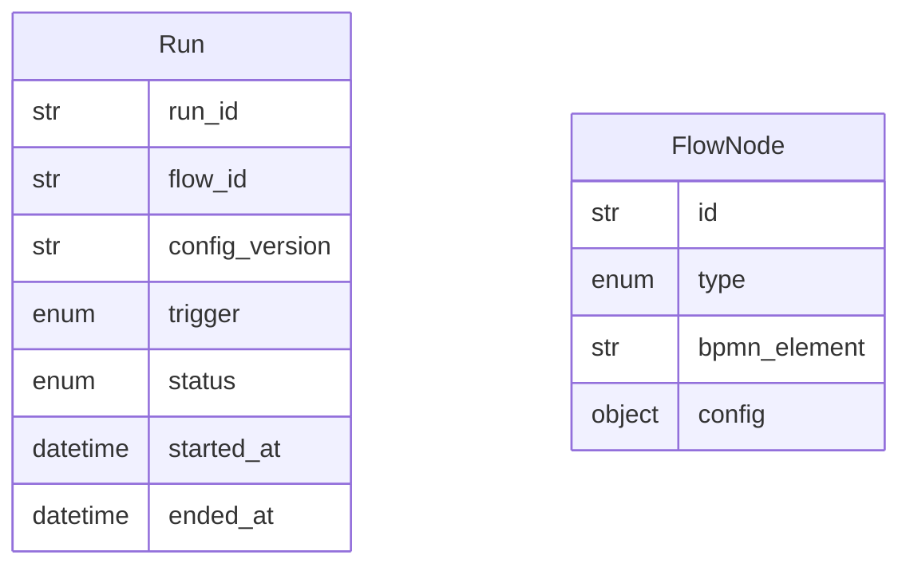

# Data Model: 005-flow-engine

**Spec:** [spec.md](spec.md)

Notation: **NEW** = introduced by this spec · **EXISTING** = already in the codebase.

## Entities

### NEW `Run`

| Field | Type | Required | Description |
| --- | --- | --- | --- |
| `run_id` | str | yes | UUID |
| `flow_id` | str | yes | Flow name |
| `config_version` | str | yes | Effective config hash |
| `trigger` | enum | yes | schedule · manual · mcp · ui |
| `status` | enum | yes | running · waiting · done · failed |
| `started_at` | datetime | yes |  |
| `ended_at` | datetime | no |  |

### NEW `FlowNode`

| Field | Type | Required | Description |
| --- | --- | --- | --- |
| `id` | str | yes | Unique in flow |
| `type` | enum | yes | Step type |
| `bpmn_element` | str | no | BPMN element name for traces |
| `config` | object | yes | Step-type specific |

## Diagram

## Storage

- Pydantic models in `src/pkpipe`; JSON Schema exported by `pkpipe validate`.
- Persisted rows: SQLite (app DB) or vault files as stated in the spec.
