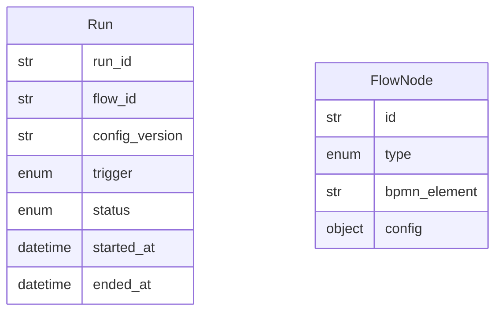

# Data Model: 005-flow-engine

**Spec:** [spec.md](spec.md)

Notation: **NEW** = introduced by this spec · **EXISTING** = already in the codebase.

## Entities

### NEW `Run`

| Field | Type | Required | Description |
| --- | --- | --- | --- |
| `run_id` | str | yes | UUID |
| `flow_id` | str | yes | Flow name |
| `config_version` | str | yes | Effective config hash |
| `trigger` | enum | yes | schedule · manual · mcp · ui |
| `status` | enum | yes | running · waiting · done · failed |
| `started_at` | datetime | yes |  |
| `ended_at` | datetime | no |  |
| `error` | str | no | Error type and message of a failed run |

### NEW `ConfigSnapshot` (table `config_snapshots`)

| Field | Type | Required | Description |
| --- | --- | --- | --- |
| `version` | str | yes | sha256 over effective JSON + text assets; primary key |
| `data` | JSON | yes | Effective config incl. `flows` |
| `assets` | JSON | yes | `{relative path: text}` of prompts, instructions, contexts, schemas |
| `created_at` | datetime | yes | First run on this version |

### NEW `Flow` (`flows/<id>.json`)

| Field | Type | Required | Description |
| --- | --- | --- | --- |
| `id` | str | yes | Equals the file name |
| `start` | str | no | Entry node (or edges from `START`) |
| `nodes` | FlowNode[] | yes |  |
| `edges` | FlowEdge[] | no | `from`, `to`, `when` (condition), `default`, `on` (`success`/`error`) |
| `max_parallel` | int | no | Fan-out limit, default 2 (FR-003) |
| `max_steps` | int | no | Step bound incl. wait polls, default 1000 |
| `data_classes` | str[] | no | `journal`/`context` force content capture off |

### NEW `FlowNode`

| Field | Type | Required | Description |
| --- | --- | --- | --- |
| `id` | str | yes | Unique in flow |
| `type` | enum | yes | Step type |
| `bpmn_element` | str | no | BPMN element name for traces |
| `config` | object | yes | Step-type specific, validated by the step type's model |
| `inputs` | str[] | no | Declared references (FR-002) |
| `for_each` | str | no | Reference to a list: `Send` fan-out |
| `on_item_error` | enum | no | `fail` · `continue` (for_each only) |

## Diagram

## Storage

- Pydantic models in `src/pkpipe/engine/flow_models.py` and `runs.py`; JSON Schema `flow.schema.json` exported by
  `pkpipe schema`.
- App DB (SQLite, `$PKPIPE_DATA_DIR/pkpipe.db`): tables `runs`, `config_snapshots`, the LangGraph checkpoint tables
  and `apscheduler_jobs`.
