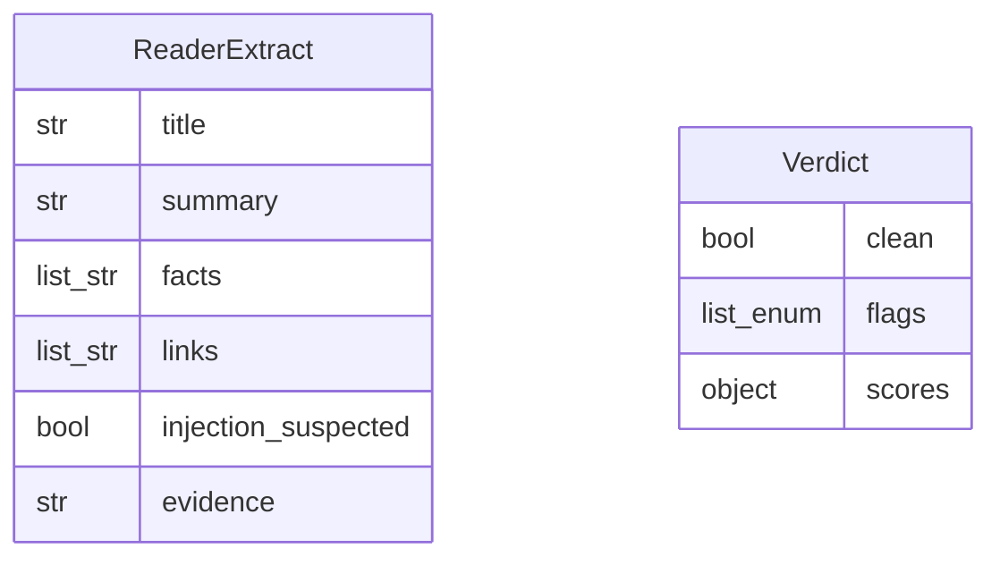

# Data Model: 008-secure-fetch

**Spec:** [spec.md](spec.md)

Notation: **NEW** = introduced by this spec · **EXISTING** = already in the codebase.

## Entities

### NEW `ReaderExtract`

| Field | Type | Required | Description |
| --- | --- | --- | --- |
| `title` | str | yes |  |
| `summary` | str | yes | ≤ 200 words |
| `facts` | list[str] | yes | Short factual bullets |
| `links` | list[str] | no | Relevant outbound links |
| `injection_suspected` | bool | yes |  |
| `evidence` | str|null | no | Quoted suspicious text |

### NEW `Verdict`

| Field | Type | Required | Description |
| --- | --- | --- | --- |
| `clean` | bool | yes |  |
| `flags` | list[enum] | yes | heuristic · classifier · canary · reader |
| `scores` | object | no | Per-detector scores |

## Diagram

## Storage

- Pydantic models in `src/pkpipe`; JSON Schema exported by `pkpipe validate`.
- Persisted rows: SQLite (app DB) or vault files as stated in the spec.
