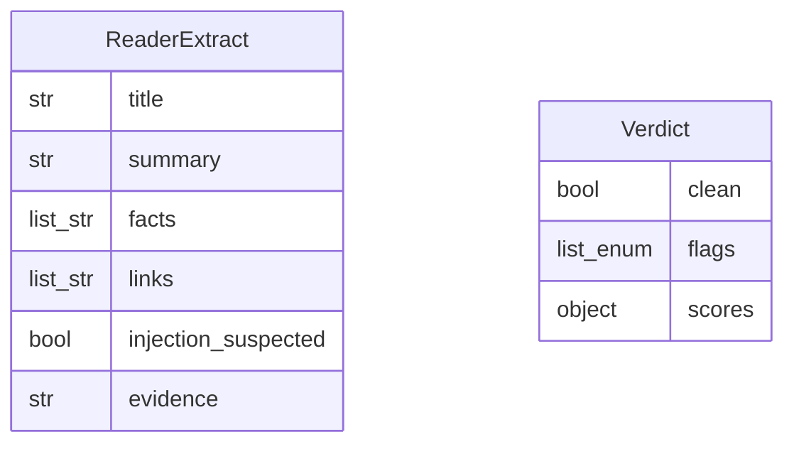

# Data Model: 008-secure-fetch

**Spec:** [spec.md](spec.md)

Notation: **NEW** = introduced by this spec · **EXISTING** = already in the codebase.

## Entities

### NEW `ReaderExtract`

| Field | Type | Required | Description |
| --- | --- | --- | --- |
| `title` | str | yes |  |
| `summary` | str | yes | ≤ 200 words |
| `facts` | list[str] | yes | Short factual bullets |
| `links` | list[str] | no | Relevant outbound links |
| `injection_suspected` | bool | yes |  |
| `evidence` | str|null | no | Quoted suspicious text |

### NEW `Verdict`

| Field | Type | Required | Description |
| --- | --- | --- | --- |
| `clean` | bool | yes |  |
| `status` | enum | yes | clean · flagged · failed (timeout, unreachable: not a flag) |
| `flags` | list[enum] | yes | url_filter · heuristic · classifier · canary · reader |
| `reasons` | list[str] | yes | Reason codes (never page text) |
| `flag_reasons` | object | yes | First reason code per flag |
| `scores` | object | no | Per-detector scores, fetcher, fallback |

### NEW `FetchResult`

Returned by the web-fetch tool `fetch_page` (raw, untrusted).

| Field | Type | Required | Description |
| --- | --- | --- | --- |
| `status` | enum | yes | ok · blocked (flag) · failed |
| `url`, `final_url` | str | yes / no | Requested URL, URL after redirects |
| `http_status`, `content_type` | int, str | no | Main response |
| `kind` | enum | yes | html · text · pdf · video · image · audio · other |
| `html` | str\|null | no | Rendered DOM (html/text only) |
| `fetcher` | enum\|null | no | lightpanda · chromium |
| `fallback_used`, `fallback_reason` | bool, str | no | Chromium fallback and why |
| `reason` | str | no | Reason code of a block or failure |

## Diagram

## Storage

- Pydantic models in `pkpipe.security.verdict`; JSON Schemas exported by `pkpipe schema` (`fetch-result`, `reader-extract`, `verdict`). The Reader's structured-output schema is `packs/learning-inbox/schemas/reader_extract.json` (a test keeps both in line).
- Nothing new is persisted beyond the run checkpoints; the verdict sets `item.fetch_status`, `item.extract` (clean only), `item.flagged`, `item.security_flags`. The web-fetch server can append one JSON line per fetch (`--stats-file`, no URLs) for the fallback rate.
