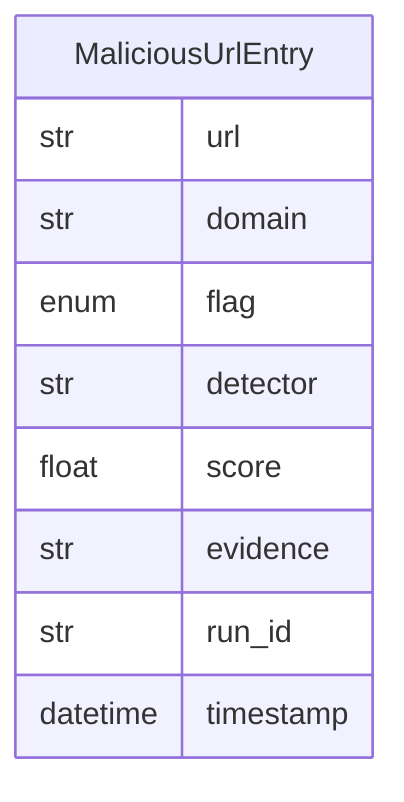

# Data Model: 009-output-guard-and-quarantine

**Spec:** [spec.md](spec.md)

Notation: **NEW** = introduced by this spec · **EXISTING** = already in the codebase.

## Entities

### NEW `MaliciousUrlEntry`

| Field | Type | Required | Description |
| --- | --- | --- | --- |
| `url` | str | yes |  |
| `domain` | str | yes |  |
| `flag` | enum | yes |  |
| `detector` | str | yes |  |
| `score` | float | no |  |
| `evidence` | str | no | Truncated |
| `run_id` | str | yes |  |
| `timestamp` | datetime | yes |  |

## Diagram

## Storage

- Pydantic models in `src/pkpipe`; JSON Schema exported by `pkpipe validate`.
- Persisted rows: SQLite (app DB) or vault files as stated in the spec.
