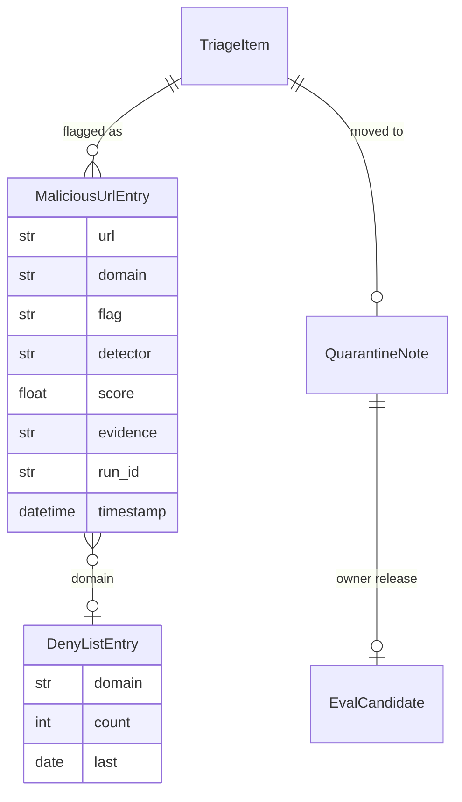

# Data Model: 009-output-guard-and-quarantine

**Spec:** [spec.md](spec.md)

Notation: **NEW** = introduced by this spec · **EXISTING** = already in the codebase.

## Entities

### NEW `MaliciousUrlEntry` (`security/malicious_urls.jsonl`, one JSON line per flag)

| Field | Type | Required | Description |
| --- | --- | --- | --- |
| `url` | str | yes | Source URL of the item (`""` when it has none) |
| `domain` | str\|null | no | Host without `www.` that is deny-listed (null without an http(s) URL) |
| `flag` | str | yes | `canary_leak`, `injection_or_jailbreak`, `malicious_content` (output guard) or a secure-fetch / URL-filter flag |
| `detector` | str | yes | `canary`, `markup`, `heuristic`, `classifier`, a model name, `url_filter`, ... |
| `score` | float | no | Detector score |
| `evidence` | str | no | Reason code, ≤ 200 chars (never page or note text) |
| `item_id` | str | no | Triage item id |
| `run_id` | str | yes | Flow run |
| `timestamp` | datetime | yes | UTC |

### NEW `GuardResult` (output of the `output_guard` step)

| Field | Type | Description |
| --- | --- | --- |
| `flagged` | bool | Any flag |
| `flags` | list of `{flag, detector, reason_code, score}` | Flag codes only |
| `scores` | object | `heuristic`, `classifier`, `label` |
| `flag_names` | list[str] | Distinct flags |

### NEW `QuarantineNote` (`0-INBOX/_quarantine/<item id>.md`)

Front matter `security_flag: {flags, detectors, reason_codes, run_id, flagged_at}`, `pkpipe_item`, `original_path`, `quarantined: true`; body: a heading, a hint and the original note verbatim in a fenced code block (fence longer than any backtick run in the note).

### NEW Deny-list entry (`security/deny_list.txt`, existing format of spec 008)

`<domain>  # pkpipe: flagged <N>, last <YYYY-MM-DD>` – one line per domain; a subdomain counts on its parent's line.

### NEW Eval candidate (`<overlay>/evals/candidates/security.jsonl`)

An `EvalCase` of the security dataset format: `{id: release-<item>-<day>, input: {text}, expected: {label: benign, type: released_false_positive, flags}, source: release}`.

### CHANGED `security.json`

The former Meta-classifier key replaced by `classifier {backend, model, model_dir, chunk_tokens, members[], threshold, required}`; `output_guard {block_on}`.

## Diagram

## Storage

- Pydantic models `pkpipe.security.quarantine.MaliciousUrlEntry` and `pkpipe.security.guard.GuardResult`; JSON Schemas exported by `pkpipe schema` (`malicious-url-entry`, `output-guard-result`).
- Files: overlay `security/` (or `$PKPIPE_DATA_DIR/security/`), vault quarantine folder, overlay `evals/candidates/`.
