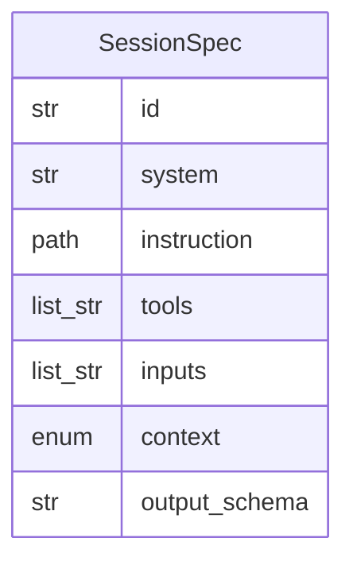

# Data Model: 010-category-sessions

**Spec:** [spec.md](spec.md)

Notation: **NEW** = introduced by this spec · **EXISTING** = already in the codebase.

## Entities

### NEW `SessionSpec`

| Field | Type | Required | Description |
| --- | --- | --- | --- |
| `id` | str | yes | Unique in plan |
| `system` | str | yes | System prompt name |
| `instruction` | path | yes | instructions/<category>/<session>.md |
| `tools` | list[str] | no | server:tool allowlist |
| `inputs` | list[str] | yes | item.*, previous session ids or * |
| `context` | enum|null | no | personal · enterprise · system |
| `output_schema` | str|null | no | Schema name |

## Diagram

## Storage

- Pydantic models in `src/pkpipe`; JSON Schema exported by `pkpipe validate`.
- Persisted rows: SQLite (app DB) or vault files as stated in the spec.
