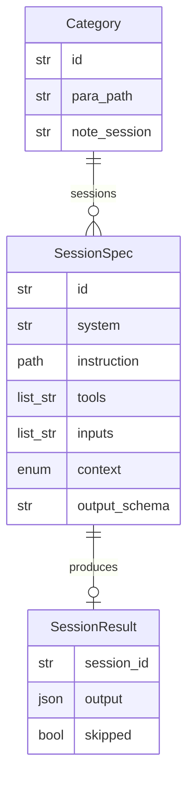

# Data Model: 010-category-sessions

**Spec:** [spec.md](spec.md)

Notation: **NEW** = introduced by this spec · **EXISTING** = already in the codebase.

## Entities

### NEW `SessionSpec`

| Field | Type | Required | Description |
| --- | --- | --- | --- |
| `id` | str | yes | Unique in plan |
| `system` | str | yes | System prompt name |
| `instruction` | path | yes | instructions/<category>/<session>.md |
| `tools` | list[str] | no | server:tool allowlist |
| `inputs` | list[str] | yes | item.*, previous session ids or * |
| `context` | enum|null | no | personal · enterprise · system |
| `output_schema` | str|null | no | Schema name |

### EXISTING `Category` (extended)

`id`, `label`, `subflow`, `para_path`, `triage_hint`, `sessions: list[SessionSpec]`, `enabled`, and **NEW** `note_session` (str | null): the session whose output becomes the note; default `synthesize`, else the last session. `SessionSpec` is `pkpipe.engine.config_models.Session`; its input rules are `pkpipe.domain.session_plan.plan_errors`.

### NEW `SessionResult`

Output of the `session_plan` step (stored under the node id): `{category, sessions: {session id: validated output | {"skipped": "context_missing", "context": ...}}, skipped: [ids], note_session}`. It derives from external content: the output guard checks it before `category.note` renders `{path, archive_path, title, body, front_matter, has_task, task_*}` from the note session's output.

### NEW `QueryGuard` (`security.json` `query_guard`)

`blocked_terms: list[str]`, `terms_file: str | null` (an asset with one term per line).

## Diagram

## Storage

- Pydantic models in `src/pkpipe`; JSON Schema exported by `pkpipe validate`.
- Persisted rows: SQLite (app DB) or vault files as stated in the spec.
