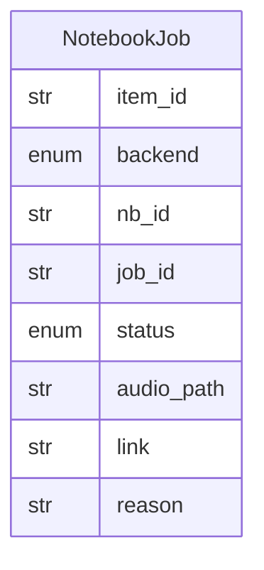

# Data Model: 012-learning-gateway

**Spec:** [spec.md](spec.md)

Notation: **NEW** = introduced by this spec · **EXISTING** = already in the codebase.

## Entities

### NEW `NotebookJob`

| Field | Type | Required | Description |
| --- | --- | --- | --- |
| `item_id` | str | yes |  |
| `backend` | enum | yes | open_notebook · notebooklm_browser · fake |
| `nb_id` | str | no |  |
| `job_id` | str | no |  |
| `status` | enum | yes | generating · ready · failed |
| `audio_path` | str | no |  |
| `link` | str | no |  |
| `reason` | str | no |  |

## Diagram

## Storage

- Pydantic models in `src/pkpipe`; JSON Schema exported by `pkpipe validate`.
- Persisted rows: SQLite (app DB) or vault files as stated in the spec.
