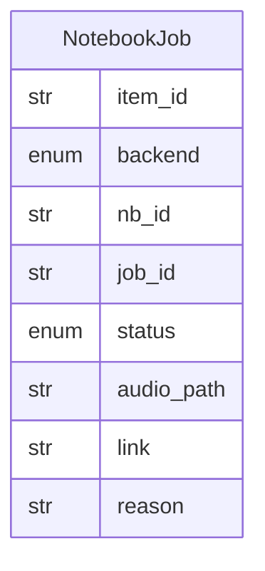

# Data Model: 012-learning-gateway

**Spec:** [spec.md](spec.md)

Notation: **NEW** = introduced by this spec · **EXISTING** = already in the codebase.

## Entities

### NEW `NotebookJob`

| Field | Type | Required | Description |
| --- | --- | --- | --- |
| `item_id` | str | yes | triage item id (empty when `create` got none); `create` is idempotent per item id |
| `backend` | enum | yes | open_notebook · notebooklm_browser · fake |
| `nb_id` | str | no | notebook id in the backend |
| `job_id` | str | yes | id used by `status` and `audio` (Open Notebook: the command id; failed creates get `failed-<random>`) |
| `status` | enum | yes | generating · ready · failed |
| `audio_path` | str | no | downloaded podcast below the gateway's audio folder |
| `link` | str | no | URL of the notebook |
| `reason` | str | no | why it failed, one line, at most 300 characters, never a secret |
| `backend_ref` | str | no | opaque backend state (Open Notebook: the episode id); not returned by the tools |
| `poll_errors` | int | yes | consecutive failed polls (5 fail the job); not returned by the tools |
| `started_at` / `finished_at` | float | yes / no | epoch seconds; the timeout counts from `started_at` |

## Diagram

## Storage

- Pydantic models in `src/pkpipe`; JSON Schema exported by `pkpipe validate`.
- Persisted rows: SQLite `jobs.db` in the gateway's data dir (`options.data_dir`, default `$PKPIPE_DATA_DIR/learning`), table `notebook_jobs(job_id, item_id, nb_id, status, started_at, data)`; `data` is the JSON of the model. The gateway is a separate process, so it does not write the app DB.
- The learning flow also sets `item.failure_reason` and `item.audio_path` on the item; the processing list keeps its columns (`nb_id`, `link`, `status`).
